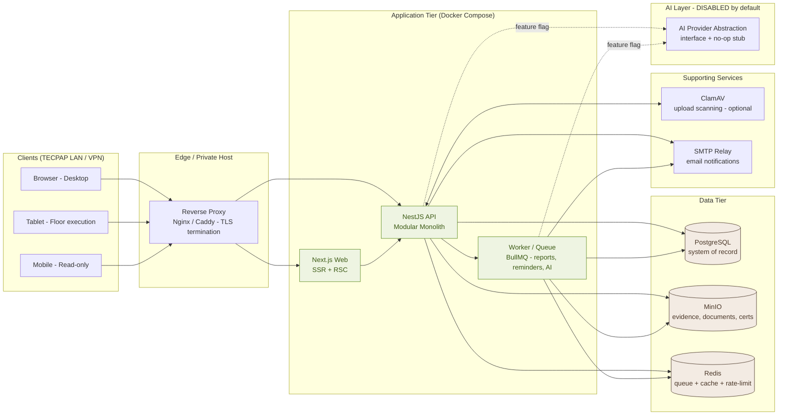
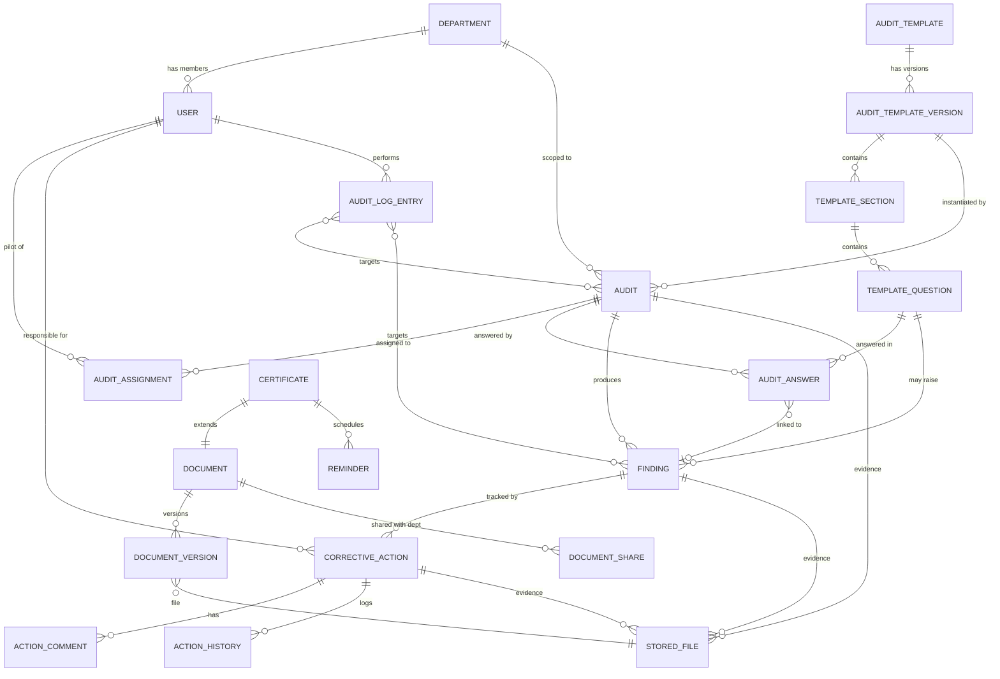

# Software Architecture Document (SAD)
## TECPAP Internal Audit Management Platform

| Field | Value |
|---|---|
| Document | Software Architecture Document |
| Project | TECPAP Internal Audit Management Platform |
| Customer | TECPAP — Packaging manufacturer, Bouskoura, Morocco |
| Status | **Draft v0.1 — Pending Approval** |
| Date | 2026-07-22 |
| Prepared by | Senior Software Architect / Technical Lead |
| Audience | Audit Department, IT, Project Sponsor |

> **Reading guide:** This document is the authoritative design reference. No implementation begins until the document is approved. Section [0.3 Open Questions](#03-open-questions--assumptions) lists items that need a human decision; everything else is a committed default that can be changed during review.

---

## Table of Contents

- [0. Executive Layer](#0-executive-layer)
  - [0.1 Executive Summary](#01-executive-summary)
  - [0.2 Key Architectural Decisions (ADR Summary)](#02-key-architectural-decisions-adr-summary)
  - [0.3 Open Questions & Assumptions](#03-open-questions--assumptions)
- [1. Functional Analysis](#1-functional-analysis)
- [2. Business Requirements](#2-business-requirements)
- [3. Non-Functional Requirements](#3-non-functional-requirements)
- [4. Proposed Architecture](#4-proposed-architecture)
- [5. Technology Justification](#5-technology-justification)
- [6. Folder Structure](#6-folder-structure)
- [7. High-Level System Architecture Diagram](#7-high-level-system-architecture-diagram)
- [8. Database Entity List](#8-database-entity-list)
- [9. Entity Relationships](#9-entity-relationships)
- [10. User Roles](#10-user-roles)
- [11. Permission Matrix](#11-permission-matrix)
- [12. Module Breakdown](#12-module-breakdown)
- [13. Feature Roadmap](#13-feature-roadmap)
- [14. UI Design System](#14-ui-design-system)
- [15. Navigation Flow](#15-navigation-flow)
- [16. API Strategy](#16-api-strategy)
- [17. Security Strategy](#17-security-strategy)
- [18. File Storage Strategy](#18-file-storage-strategy)
- [19. Logging Strategy](#19-logging-strategy)
- [20. Error Handling Strategy](#20-error-hand-strategy)
- [21. Deployment Strategy](#21-deployment-strategy)
- [22. Testing Strategy](#22-testing-strategy)
- [23. Coding Standards](#23-coding-standards)
- [24. Git Branch Strategy](#24-git-branch-strategy)
- [25. Risks](#25-risks)
- [26. Future Improvements](#26-future-improvements)

---

# 0. Executive Layer

## 0.1 Executive Summary

TECPAP's Audit Department currently runs on **Excel checklists, paper forms, scattered PDFs and manual follow-up**. This produces low traceability, delayed corrective actions, expired certificates going unnoticed, and no real management visibility.

This platform replaces that sprawl with a **single, centralized, role-based web application** that digitizes the full audit lifecycle — from template design, through scheduling and on-screen execution, to findings, corrective-action tracking, evidence storage, validation, reporting and real-time dashboards — alongside a complete **document & certificate management** module.

The system is **internal, single-tenant, on-premise-capable** (respecting Moroccan data sovereignty), used exclusively by the Audit Department and scoped pilots. It is explicitly **not a SaaS**. It is designed to be **AI-ready** (a pluggable, feature-flagged AI module) but ships **with AI disabled**.

The architecture is deliberately **pragmatic and durable**: a **modular monolith** backend, a **server-rendered** Next.js frontend, **PostgreSQL** for relational integrity, **MinIO** for evidence/document object storage, all packaged with **Docker Compose**. This trades away premature microservice complexity in favour of a system a small team can own, operate and evolve for many years — while preserving clean module boundaries so any component *can* be extracted later if scale demands it.

## 0.2 Key Architectural Decisions (ADR Summary)

| ID | Decision | Rationale (short) |
|---|---|---|
| ADR-001 | **Modular monolith**, not microservices | Internal scale (tens of users), single team, lower ops cost; clean module seams allow future extraction. |
| ADR-002 | **Single-tenant, on-prem / private-host** deployment | Not SaaS; Moroccan data sovereignty; full control of PII. |
| ADR-003 | **Permission-based RBAC + department data scoping** | Three roles today, but granular permissions allow evolution without re-design; pilots are hard-scoped to their department at the data layer. |
| ADR-004 | **AI as an optional module behind an Admin feature flag** | AI is explicitly out of scope for v1; the abstraction ensures it can be enabled later with zero rewiring. |
| ADR-005 | **MinIO (S3-compatible, self-hosted) for object storage** | Keeps evidence/documents inside TECPAP's infrastructure; S3 API means a future cloud migration is painless. |
| ADR-006 | **Online-first for v1; offline shop-floor deferred** | See open question OQ-1. Avoids a sync layer until validated as a real need. |
| ADR-007 | **REST API, URI-versioned (`/api/v1`)** | Simple, cacheable, well-understood by the team; OpenAPI-generated contracts. |
| ADR-008 | **Monorepo (pnpm workspaces + Turborepo)** | Shared types/contracts between Next.js and NestJS; one CI, atomic cross-stack changes. |
| ADR-009 | **JWT access + rotating refresh tokens; RBAC enforced server-side** | Stateless auth + revocability via refresh rotation + an auth allowlist/ denylist. |
| ADR-010 | **Append-only audit log, separate from operational logs** | Traceability is a core business goal; audit events must be immutable and tamper-evident. |

## 0.3 Open Questions & Assumptions

These are the few decisions that genuinely belong to the business. I have **assumed a sensible default** for each so the design is complete; please confirm or correct.

| ID | Question | Default assumed | Impact if changed |
|---|---|---|---|
| **OQ-1** | Do pilots execute audits **on the factory floor with tablets and unreliable Wi-Fi** (needing offline mode)? | **No offline in v1** — online-first, PWA + background sync deferred to a later phase. | High — offline would add a sync/conflict-resolution layer to the entire execution module. |
| **OQ-2** | Does TECPAP operate an existing **identity provider** (Active Directory / LDAP / Entra) users should log in with? | **Local credentials for v1**, with an SSO/LDAP abstraction ready to wire later. | Medium — affects the auth provider. |
| **OQ-3** | **Primary UI language?** (Morocco typically uses French in business; Arabic/English possible.) | **French primary**, architecture i18n-ready (AR/EN), RTL-ready. | Low–Medium — i18n built in from day 1 regardless. |
| **OQ-4** | **Hosting target**: TECPAP-owned server/VM, a Moroccan private cloud, or on-prem appliances? | **Single VM / small private host with Docker Compose**; design portable to a small cluster. | Medium — affects TLS/backup/ops design. |
| **OQ-5** | Are there **existing ERP/systems** (e.g., SAP, payroll, QMS) to integrate with in v1, or only later? | **No integrations in v1**; an integration/adapter layer is reserved. | Medium — adds an anti-corruption layer if yes. |
| **OQ-6** | **User count & concurrency** estimate (rough order of magnitude). | **≤ ~150 named users, ≤ ~30 concurrent.** Confirms no horizontal autoscaling needed in v1. | Low — only affects sizing, not shape. |
| **OQ-7** | Should **evidence files be virus-scanned** on upload (ClamAV)? | **Yes, planned** (ClamAV sidecar), quarantining infected uploads. | Low — ops service to run. |
| **OQ-8** | Regulatory frame: are we aligned to **ISO 19011** (auditing), **ISO 9001** (quality), and Moroccan **Law 09-08** (data protection)? | **Yes — design follows these as reference frames.** | Low — mostly documentation & retention rules. |

---

# 1. Functional Analysis

## 1.1 Problem statement
The Audit Department cannot guarantee that audits are performed consistently, that findings are followed up, that certificates are renewed on time, or that management has an accurate real-time view of compliance. The root cause is **fragmented, manual, paper-and-spreadsheet tooling** with no single source of truth and no traceability.

## 1.2 Current state (As-Is)
- Audit templates live in **Excel**; pilots fill them manually.
- Findings and corrective actions are tracked in **email/spreadsheets**; status is often stale.
- Evidence is **photographed/emailed/printed** and stored in personal drives.
- Certificates & policies are **PDFs in shared folders** with no expiry tracking.
- Reporting is **manual aggregation**, slow and error-prone.
- Statistics/KPIs are **reconstructed by hand** for management.

## 1.3 Desired state (To-Be)
A unified platform where:
- **Templates** are created/imported/versioned centrally.
- **Audits** are scheduled, assigned, executed on-screen, and validated through a clear workflow.
- **Findings** auto-arise from execution and link to **corrective actions** with owners, due dates and evidence.
- **Documents & certificates** are versioned, approved, searchable, and **proactively reminded** before expiry.
- **Reports** are generated (PDF/Excel/print) on demand.
- **Dashboards** show real-time KPIs for managers and scoped views for pilots.
- Everything is **traceable** (who did what, when) via an immutable audit log.

## 1.4 Core business capabilities (functional decomposition)
1. **Identity & Access** — users, roles, departments, permissions, authentication.
2. **Audit Template Management** — create/import/duplicate/version/archive templates (sections → questions).
3. **Audit Planning & Assignment** — schedule audits from templates, assign pilots, set scope/period.
4. **Audit Execution** — pilots answer questions on-screen, attach evidence, raise findings inline.
5. **Findings Management** — severity, description, linkage to question/audit/department, status lifecycle.
6. **Corrective Action Tracking** — owner, due date, priority, status, evidence, comments, validation.
7. **Evidence & File Storage** — secure upload/retrieval of any evidence/document attachment.
8. **Validation Workflow** — Audit Manager reviews, validates or rejects, with reasons.
9. **Reporting** — generate PDF/Excel/printable reports per audit, per period, per department.
10. **Document Management** — certificates, policies, procedures, instructions, forms, controlled docs; versioning, approval, expiry.
11. **Certificate Expiry & Reminders** — proactive alerts before certificates expire.
12. **Dashboards & KPIs** — real-time metrics across audits, findings, actions, certificates, departments.
13. **Notifications** — in-app + email for assignments, due dates, approvals, expiries.
14. **Administration & Settings** — feature flags (incl. AI on/off), system parameters, departments, users.
15. **AI (prepared, disabled)** — template generation, summaries, risk analysis, recommendations, OCR, document analysis.

## 1.5 Actors & their goals
- **Administrator** → configure & govern the platform; no business bottleneck.
- **Audit Manager** → run the audit program end-to-end; guarantee follow-up and reporting.
- **Pilot** → execute assigned audits and corrective actions for **their department only**; minimum friction.
- **(Implicit) Management/Executive** → consume dashboards & reports for visibility (read-mostly; served via Manager/Admin views).

## 1.6 Business invariants (must always hold)
- A pilot **can never** read or write data outside their department (except shared documents explicitly granted).
- Every state change on an audit/finding/corrective action is **recorded immutably** with actor + timestamp.
- A validated/closed audit **cannot be edited** without a formal re-opening (which itself is logged).
- Certificates past expiry are **visibly flagged** and cannot appear as "valid".
- No file is ever served without an **authorization check** on the requesting user's scope.

---

# 2. Business Requirements

> Functional requirements are grouped by capability and given stable IDs (`BR-xx`) for traceability into modules and the roadmap.

### 2.1 Identity & Access
- **BR-01** Secure login with username/email + password; session persistence via refresh token.
- **BR-02** Three first-class roles: Administrator, Audit Manager, Pilot.
- **BR-03** Each Pilot belongs to exactly one of nine departments.
- **BR-04** Department-scoped data isolation for pilots.
- **BR-05** Account lifecycle: create, activate, disable, reset password.

### 2.2 Templates
- **BR-06** Create templates manually (sections → questions; question types: yes/no, scale, numeric, text, multi-select, date, file).
- **BR-07** Import templates from Excel (defined import schema + validation report).
- **BR-08** Duplicate templates.
- **BR-09** Version templates (immutable published versions; drafts editable).
- **BR-10** Archive/restore templates.

### 2.3 Planning & Execution
- **BR-11** Schedule an audit from a published template version, with scope, period, assigned pilot(s).
- **BR-12** Pilot executes audit on-screen, answering questions and attaching evidence.
- **BR-13** A negative/failed answer can raise a Finding inline.
- **BR-14** Save progress (draft) and submit for validation.

### 2.4 Findings & Corrective Actions
- **BR-15** Findings carry severity, description, department, related question/audit, evidence, status.
- **BR-16** Corrective actions carry responsible, due date, priority, status, evidence, comments, history, completion & validation.
- **BR-17** Overdue corrective actions are automatically detected and flagged.

### 2.5 Validation & Reporting
- **BR-18** Audit Manager validates or rejects submitted audits with comments.
- **BR-19** Generate audit report as PDF, Excel, and printable HTML.
- **BR-20** Reports respect the requester's data scope.

### 2.6 Documents & Certificates
- **BR-21** Document types: certificates, policies, procedures, work instructions, forms, controlled documents, manuals, quality/environmental/H&S documents.
- **BR-22** Each document: versioning, approval status, department, owner, revision date, expiration (when applicable), attachments, search, history, permissions.
- **BR-23** Certificates specifically: PDF storage, issue/expiry dates, renewal reminders, responsible person, status, dashboard widget.
- **BR-24** Configurable reminder windows before expiry (e.g., 90/60/30/7 days).

### 2.7 Dashboards
- **BR-25** Real-time KPIs: open/closed/delayed audits, compliance rate, open/critical findings, corrective actions & delayed actions, department performance, audit trends, certificates nearing expiry, pending approvals, recent activity.

### 2.8 Administration
- **BR-26** Manage users, departments, permissions.
- **BR-27** System settings, including an explicit **AI on/off** master switch.
- **BR-28** Feature flags for graduated rollout.

### 2.9 AI (prepared, off by default)
- **BR-29** When enabled by Admin, future AI capabilities (template generation, summaries, risk analysis, recommendations, OCR, document analysis) become available through the same permission model.

---

# 3. Non-Functional Requirements

| Category | Requirement |
|---|---|
| **Performance** | API p95 < 300 ms for standard reads; dashboard aggregate endpoints p95 < 800 ms; first contentful paint < 2 s on the corporate network; support the user base in [OQ-6]. |
| **Scalability** | Vertical-first; designed to scale to thousands of audits/documents without schema change. Horizontal scaling possible behind a load balancer if ever needed (stateless API). |
| **Availability** | Internal business-hours service target (e.g., 99% during 07:00–19:00, Mon–Sat). Graceful degradation of non-critical modules (e.g., AI, email). |
| **Security** | TLS in transit; encryption at rest (DB + object storage); secrets in env/vault; least-privilege RBAC; input validation; rate limiting; file-upload sanitization; immutable audit log; periodic dependency scanning. |
| **Data sovereignty** | All data stays within TECPAP-controlled infrastructure (default to on-prem/private host — [OQ-4]); aligns with Moroccan Law 09-08. |
| **Accessibility** | **WCAG 2.1 AA**: keyboard navigation, visible focus, screen-reader labels, colour-contrast compliance, resizable text. |
| **Responsiveness** | Works on desktop (primary), tablet (floor execution), and mobile (read-mostly). |
| **Internationalization** | French primary ([OQ-3]); architecture i18n-ready for Arabic (RTL) and English. |
| **Maintainability** | Modular monolith with strict module boundaries; ≥ 80% unit test coverage on core domain logic; typed end-to-end (TypeScript + shared DTOs). |
| **Observability** | Structured logs, request correlation IDs, health checks, operational dashboards. |
| **Backup & Recovery** | Daily automated backups of PostgreSQL + MinIO with documented restore drills; RPO ≤ 24 h, RTO ≤ 4 h (to confirm with IT). |
| **Browser support** | Modern evergreen browsers (Chrome, Edge, Firefox); no IE/legacy. |
| **Auditability** | Every state-changing action recorded in an append-only audit log with actor, timestamp, before/after. |

---

# 4. Proposed Architecture

## 4.1 Architectural style
A **modular monolith** organized around business domains (a.k.a. *modular monolith / domain modules*). Each NestJS module owns its data and exposes a thin internal API to other modules. Modules **do not share database tables**; cross-module access goes through the owning module's service (application-level anti-corruption). This delivers microservice-like separation without distributed-systems cost.

## 4.2 Logical layers
1. **Presentation (Web)** — Next.js (App Router). Server Components fetch via the API; Client Components handle interactivity. Route guards enforce RBAC; the server re-validates every action.
2. **API (Backend)** — NestJS. Layers per module: **Controller** (HTTP) → **Service** (domain logic/use-cases) → **Repository** (data access via Prisma). Cross-cutting: guards, interceptors, filters, pipes.
3. **Domain & Data** — PostgreSQL as the system of record; Prisma as the typed data-access + migration layer.
4. **Storage** — MinIO for all binary content (evidence, documents, certificates, report exports).
5. **Platform/Infra** — Docker Compose orchestration; reverse proxy for TLS; (optional) Redis for jobs/queues & rate limiting; (optional) ClamAV for upload scanning; SMTP for email.

## 4.3 Cross-cutting concerns
- **AuthN/Z**: JWT access (short TTL) + refresh (rotating, httpOnly secure cookie); permission decorators + guards; department-scope resolver attached to the request context.
- **Data scoping**: a `DataScope` object (resolved from the JWT: role + departmentId) is injected into services; repositories apply it as mandatory `where` filters — scoping is **enforced, not optional**.
- **Validation**: DTOs with class-validator (API) and Zod (frontend) sharing schemas from `packages/shared-types`.
- **Transactions**: Prisma multi-statement transactions for multi-aggregate operations (e.g., submit audit → create findings).
- **Async work**: a job queue (BullMQ on Redis, optional in v1 but wired) for report generation, expiry reminders, email, (future) AI tasks.
- **Feature flags**: a `SystemSettings`/flag store read by guards so modules (notably AI) can be globally disabled.

## 4.4 Why this shape fits TECPAP
- **Right-sized**: no Kubernetes, no service mesh, no distributed transactions — appropriate for one internal department and a small team.
- **Durable**: clean module seams mean a module can be extracted to a service the day scale or team structure demands it, with no business-logic rewrite.
- **Secure by default**: server-authoritative, scoped at the data layer, append-only audit log.

---

# 5. Technology Justification

| Choice | Why (specific to this project) | Alternatives considered |
|---|---|---|
| **NestJS** | Opinionated module/DI system maps 1:1 to our domain modules; first-class guards/interceptors for RBAC & scoping; TypeScript-native; mature enterprise ecosystem. | Express (too bare), Spring/.NET (different team skill set). |
| **TypeScript (everywhere)** | Single language across FE/BE enables shared DTOs/enums — contracts cannot drift. | Mixed JS/TS (loses end-to-end type safety). |
| **Prisma ORM** | Type-safe queries, declarative migrations, schema-as-source-of-truth, excellent PostgreSQL support (incl. JSONB for flexible template question payloads). | TypeORM (heavier, more decorator magic), raw SQL (slower to maintain). |
| **PostgreSQL** | Relational integrity for a highly relational domain (audits→findings→actions); JSONB for semi-structured template data; row-level security option for defence-in-depth on department scoping; proven, free. | MySQL, SQL Server (licensing). |
| **Next.js (App Router)** | SSR/RSC for fast first paint & SEO-irrelevant but performance-relevant internal pages; file-based routing; server actions reduce client boilerplate; easy RBAC at the route level. | CRA/Vite SPA (worse perf, more client state). |
| **TailwindCSS + shadcn/ui** | Design-token-driven (maps directly to the TECPAP palette), consistent, accessible primitives we own and can theme to brand. shadcn avoids heavy locked-in component libs. | Material UI (opinionated look, harder to brand to "not AuditFlow"). |
| **React Hook Form + Zod** | Performant forms (audit execution has many fields); Zod schemas reused FE/BE. | Formik (slower), Yup (less TS-native). |
| **TanStack Query** | Declarant server-state cache, retries, invalidation — ideal for dashboards and list/detail CRUD. | Redux Toolkit Query (heavier). |
| **Framer Motion** | Subtle, tasteful transitions only; keeps the enterprise feel without gimmicks. | — |
| **MinIO** | S3-compatible & self-hosted → data stays in TECPAP infrastructure; presigned URLs for secure direct upload/download; trivial future cloud migration. | Local FS (no HA/metadata), cloud S3 (sovereignty). |
| **JWT + refresh + RBAC** | Stateless, horizontally scalable API; refresh rotation gives revocability. | Session-only (harder to scale), opaque sessions (more infra). |
| **Docker / Docker Compose** | Reproducible environments, simple ops for internal hosting, one-command dev up. | Bare-metal/manual deploys (drift), K8s (overkill now). |
| **Vitest + Playwright** | Fast, Jest-compatible unit/integration (Vitest); reliable cross-browser E2E (Playwright) covering the audit workflow. | Jest (slower), Cypress (slower, single-browser). |
| **pnpm workspaces + Turborepo** | Efficient monorepo, shared packages, cached builds, atomic cross-stack PRs. | Nx (heavier), separate repos (contract drift). |

---

# 6. Folder Structure

Monorepo layout (`apps/` + `packages/` + `infra/` + `docs/`).

```
tecpap-audit/
├── apps/
│   ├── web/                          # Next.js frontend (App Router)
│   │   ├── app/                      # Routes (route groups: (auth), (admin), (manager), (pilot))
│   │   │   ├── (auth)/login/
│   │   │   ├── (shell)/dashboard/
│   │   │   ├── (shell)/audits/
│   │   │   ├── (shell)/templates/
│   │   │   ├── (shell)/findings/
│   │   │   ├── (shell)/corrective-actions/
│   │   │   ├── (shell)/documents/
│   │   │   ├── (shell)/certificates/
│   │   │   ├── (shell)/reports/
│   │   │   └── (shell)/admin/        # users, departments, settings
│   │   ├── features/                 # Feature folders (ui + hooks + api per domain)
│   │   ├── components/               # Shared presentational components (shadcn-based)
│   │   ├── lib/                      # api client, auth, rbac helpers, utils
│   │   ├── hooks/                    # Shared React hooks
│   │   ├── styles/                   # Tailwind config, tokens, globals
│   │   ├── public/                   # Logo, favicon, brand assets
│   │   └── messages/                 # i18n catalogs (fr.json, ar.json, en.json)
│   │
│   └── api/                          # NestJS backend (modular monolith)
│       ├── src/
│       │   ├── main.ts
│       │   ├── app.module.ts
│       │   ├── config/               # Typed config (env validation)
│       │   ├── common/               # Guards, decorators, filters, interceptors, pipes
│       │   │   ├── rbac/             # @Permissions(), PermissionsGuard
│       │   │   ├── scope/            # DataScope resolver + decorator
│       │   │   └── filters/          # Global exception filter
│       │   ├── infrastructure/       # Prisma client, MinIO client, queue, mailer
│       │   └── modules/
│       │       ├── auth/
│       │       ├── users/
│       │       ├── departments/
│       │       ├── templates/        # + sections, questions, versions, excel-import
│       │       ├── audits/           # planning, assignment, execution, validation
│       │       ├── findings/
│       │       ├── corrective-actions/
│       │       ├── evidence/         # file upload/download via MinIO
│       │       ├── documents/        # policies, procedures, controlled docs...
│       │       ├── certificates/     # + expiry scheduler + reminders
│       │       ├── reports/          # PDF/Excel/print generation (queued)
│       │       ├── dashboard/        # read models / KPI aggregation
│       │       ├── notifications/    # in-app + email
│       │       ├── audit-log/        # append-only traceability
│       │       ├── admin/            # settings, feature flags (incl. AI switch)
│       │       └── ai/               # OPTIONAL, feature-flagged, provider abstraction + stub
│       └── test/                     # integration & e2e tests
│
├── packages/
│   ├── shared-types/                 # DTOs, enums, result/error types, contracts (FE & BE)
│   ├── shared-zod/                   # Zod schemas reused for validation
│   ├── ui-tokens/                    # Design tokens (colour/spacing/type) as code
│   └── config/                       # Shared ESLint / Prettier / TSConfig presets
│
├── infra/
│   ├── docker/                       # Per-service Dockerfiles
│   ├── docker-compose.yml            # api, web, postgres, minio, (redis), (clamav), proxy
│   ├── docker-compose.dev.yml        # Hot-reload dev overrides
│   ├── nginx/                        # Reverse proxy + TLS
│   └── backups/                      # Backup scripts (pg_dump, mc mirror)
│
├── docs/                             # This SAD + future module docs, ADRs, runbooks
├── .github/                          # CI workflows (or equivalent)
├── turbo.json
├── pnpm-workspace.yaml
└── package.json
```

### 6.1 NestJS module convention (per module)
Each module folder follows the same shape so the codebase is predictable:
```
modules/<domain>/
├── dto/              # request/response DTOs + validation
├── entities/         # domain entity types (Prisma model mappings)
├── <domain>.controller.ts
├── <domain>.service.ts        # use-cases / domain logic
├── <domain>.repository.ts     # Prisma data access (scope-aware)
├── <domain>.module.ts         # wiring (providers, imports, exports)
└── __tests__/                 # unit + integration tests
```
> Modules import each other only via **service interfaces**, never by reaching into another module's repository. This is the rule that keeps the monolith extractable.

---

# 7. High-Level System Architecture Diagram



**Reading the diagram:** Clients hit a TLS-terminating reverse proxy. The Next.js web app server-renders and calls the NestJS API; the API is the single writer to PostgreSQL and the orchestrator for MinIO/Redis/email. Long-running work (report generation, expiry reminders, future AI jobs) is offloaded to a worker via Redis queues. The AI provider is reachable but **gated behind a feature flag** and ships as a no-op stub.

---

# 8. Database Entity List

> Field-level detail is indicative at this stage; definitive types/multiplicity are fixed in the Prisma schema during implementation. `*` = required. Conventionally every domain table has `id`, `createdAt`, `updatedAt`, and sensitive tables carry `createdById`/`updatedById` for traceability.

### Identity & Access
- **User** — id*, email*, passwordHash*, firstName*, lastName*, role* (enum), departmentId (nullable; required for Pilots), status* (active/disabled/locked), lastLoginAt, failedLoginCount, createdAt, updatedAt.
- **Department** — id*, name*, code*, sortOrder, createdAt, updatedAt. (Seeded nine departments.)
- **Permission** — id*, key* (e.g., `audit:validate`), description.
- **RolePermission** — roleId*, permissionId* (join; maps roles → permissions; powers the matrix).
- **RefreshToken** — id*, userId*, tokenHash*, expiresAt*, revokedAt, replacedByTokenId (rotation chain).
- **AuditLogEntry** — id*, actorUserId, action*, entityType*, entityId*, before (JSON), after (JSON), ip, userAgent, createdAt* (append-only; no update/delete).

### Templates
- **AuditTemplate** — id*, title*, code*, description, status* (draft/published/archived), currentVersionId, ownerUserId, departmentId (nullable; null = cross-departmental), createdAt, updatedAt.
- **AuditTemplateVersion** — id*, templateId*, version* (semver-ish integer/label), status* (draft/published), changeLog, publishedAt*, publishedById, createdAt.
- **TemplateSection** — id*, versionId*, title*, order*.
- **TemplateQuestion** — id*, sectionId*, text*, type* (enum), required*, weight, options (JSON), failThreshold, order*, createdAt, updatedAt.

### Audits, Findings, Actions
- **Audit** — id*, templateVersionId*, title*, scope, departmentId*, status* (draft/planned/assigned/in_progress/submitted/under_validation/validated/rejected/closed), scheduledDate, startDate, submittedAt, validatedAt, validatedById, createdAt, updatedAt.
- **AuditAssignment** — id*, auditId*, pilotUserId*, role* (pilot/co-pilot), createdAt.
- **AuditAnswer** — id*, auditId*, questionId*, value (JSON), status* (ok/fail/na), findingId (nullable), answeredAt, answeredById.
- **Finding** — id*, auditId*, questionId (nullable), departmentId*, severity* (critical/major/minor/observation), title*, description*, status* (open/in_progress/in_action/resolved/closed), createdById, createdAt, updatedAt.
- **CorrectiveAction** — id*, findingId*, responsibleUserId*, priority* (low/medium/high/urgent), status* (open/in_progress/submitted/under_validation/validated/rejected/closed), dueDate, completedAt, validatedAt, validatedById, createdAt, updatedAt.
- **ActionComment** — id*, correctiveActionId*, authorUserId*, body*, createdAt.
- **ActionHistory** — id*, correctiveActionId*, fromStatus, toStatus, byUserId*, note, createdAt* (append-only).

### Evidence & Files
- **StoredFile** — id*, ownerType* (audit/finding/action/document/certificate/report), ownerId*, bucketName*, objectKey*, originalFileName*, mimeType*, sizeBytes*, checksum (sha256), uploadedById*, virusScanStatus* (pending/clean/infected/quarantined), createdAt. *(Metadata only — bytes live in MinIO.)*

### Documents & Certificates
- **Document** — id*, type* (certificate/policy/procedure/work_instruction/form/controlled/manual/quality/environmental/health_safety), title*, code*, departmentId*, ownerUserId*, approvalStatus* (draft/in_review/approved/obsolete), currentVersionId, tags (array), createdAt, updatedAt.
- **DocumentVersion** — id*, documentId*, version* , file* → StoredFile, revisionDate*, effectiveDate*, expirationDate (nullable), approvedById*, approvedAt, changelog, createdAt.
- **DocumentShare** — id*, documentId*, departmentId* (department-level grants for pilots).
- **Certificate** — id*, documentId* (1:1 with a Document of type=certificate), issueDate*, expirationDate, responsibleUserId*, issuer, status* (valid/expiring/expired/revoked), reminderConfig (JSON), createdAt, updatedAt.
- **Reminder** — id*, entityType* (certificate/document), entityId*, remindAt*, channel* (email/in_app), sentAt, createdAt.

### Notifications, Reports, Settings
- **Notification** — id*, userId*, type*, payload (JSON), readAt, createdAt.
- **ReportJob** — id*, requestedById*, type* (audit_pdf/audit_xlsx/period_summary/...), params (JSON), status* (queued/processing/completed/failed), resultFileId → StoredFile, createdAt, completedAt.
- **SystemSetting** — id*, key*, value (JSON), updatedAt* (key/value store; includes `ai.enabled`, feature flags, reminder windows, brand config).

> **Append-only tables** (`AuditLogEntry`, `ActionHistory`) are never UPDATEd/DELETEd at the application layer; DB roles can additionally be restricted to INSERT-only as defence in depth.

---

# 9. Entity Relationships



**Key relationship notes:**
- `Audit → Department` is mandatory and is the **primary scoping axis** for pilots.
- `Finding ↔ AuditAnswer ↔ TemplateQuestion` is a triangular link that preserves *why* a finding was raised and *in which template question* — essential for trend analytics.
- `Certificate` is a 1:1 specialization of `Document` (type=certificate), so certificates inherit versioning/files/owners while adding expiry-specific fields. This avoids duplicating document machinery.
- `StoredFile` is a **polymorphic attachment** (`ownerType`/`ownerId`) so any domain object can carry evidence without join-table proliferation; referential integrity is enforced in the service layer.
- `AuditLogEntry` references entities loosely (by string type + id) precisely because it must record actions across *all* modules without coupling.

---

# 10. User Roles

| Role | Purpose | Scope of data |
|---|---|---|
| **Administrator** | Governs the platform: users, departments, permissions, system & AI settings, feature flags. Not a business auditor. | **Global** (all tenants of data), but focuses on configuration, not audit content. |
| **Audit Manager** | Runs the audit programme: creates templates, schedules & assigns audits, validates audits & corrective actions, generates reports, manages documents/certificates/policies, consumes dashboards. | **Cross-department** for all audit content; can act on any department's audits/findings/actions. |
| **Pilot** | Executes audits and corrective actions for **their own department only**. | **Single department** — sees only their department's audits, assigned findings/actions, and documents explicitly shared with their department. |

### Role attributes
- A **Pilot** has exactly one `departmentId`.
- An **Audit Manager** and **Administrator** have `departmentId = null` (not scoped).
- Roles are **not mutually exclusive with department membership** conceptually, but in v1 a user has exactly one role. (Permission model allows multi-role later if needed — see §11.)
- The (implicit) **Executive/Management** persona is served by Manager/Admin dashboard views with read-only emphasis; no separate role is introduced in v1 to avoid complexity.

### Lifecycle & guardrails
- Only an Administrator can create/disable users and change roles.
- A user cannot change their own role or department (prevents privilege self-elevation).
- Disabling a user revokes all refresh tokens immediately; their historical actions remain attributed to them in the audit log.

---

# 11. Permission Matrix

**Legend:** ✓ = allowed · ✗ = denied · ◑ = allowed **within data scope** (Admin/Manager = all departments; Pilot = own department only).

| Capability (permission key) | Admin | Audit Manager | Pilot |
|---|:---:|:---:|:---:|
| **users:manage** (create/disable/role/department) | ✓ | ✗ | ✗ |
| **departments:manage** | ✓ | ✗ | ✗ |
| **settings:manage** (system & feature flags, **AI switch**) | ✓ | ✗ | ✗ |
| **permissions:manage** | ✓ | ✗ | ✗ |
| **templates:create / import / version / archive** | ✓ | ✓ | ✗ |
| **templates:read** | ✓ | ✓ | ◑ (published only) |
| **audits:schedule / assign** | ✓ | ✓ | ✗ |
| **audits:execute** (answer, attach evidence) | ✓ | ✓ | ◑ |
| **audits:submit** | ✓ | ✓ | ◑ |
| **audits:validate / reject** | ✓ | ✓ | ✗ |
| **audits:read** | ✓ | ✓ | ◑ |
| **findings:read** | ✓ | ✓ | ◑ |
| **findings:create / update** | ✓ | ✓ | ◑ |
| **actions:create / update / comment** | ✓ | ✓ | ◑ |
| **actions:submit** (mark done + evidence) | ✓ | ✓ | ◑ |
| **actions:validate / reject** | ✓ | ✓ | ✗ |
| **documents:manage** (upload/version/approve) | ✓ | ✓ | ✗ |
| **documents:read** | ✓ | ✓ | ◑ (shared with dept) |
| **certificates:manage** | ✓ | ✓ | ✗ |
| **certificates:read** | ✓ | ✓ | ◑ (shared with dept) |
| **reports:generate** | ✓ | ✓ | ◑ (own audits only) |
| **reports:read** | ✓ | ✓ | ◑ |
| **dashboard:read** (full KPIs) | ✓ | ✓ | ◑ (dept-scoped KPIs) |
| **evidence:upload / download** | ✓ | ✓ | ◑ |
| **ai:use** (only when Admin has enabled AI) | ✓ | ✓ | ◑ (per feature) |
| **audit-log:read** | ✓ | ✗ | ✗ |

### Enforcement model
- Permissions are **declarative** (`@Permissions('audits:validate')`) and enforced by a single `PermissionsGuard`.
- Department scoping is enforced **additively** in the repository layer via the resolved `DataScope` — so even if a permission is granted, a Pilot's query is structurally constrained to `departmentId = <own>`. This is defence-in-depth: a missed permission check still cannot leak cross-department data.
- The matrix is stored as `RolePermission` rows, so **adjustments require no code change** — an Admin can widen/narrow a role from the settings UI (with every change itself audit-logged).

---

# 12. Module Breakdown

Each backend module is an independently testable unit owning its tables and exposing a service interface.

| Module | Owns tables | Responsibilities | Key collaborators |
|---|---|---|---|
| **auth** | User (auth fields), RefreshToken | Login, logout, token issuance/rotation, password reset, brute-force lockout | users, audit-log |
| **users** | User, RolePermission | CRUD users, assign role/department, activate/disable | departments, audit-log |
| **departments** | Department, Permission | CRUD departments (seed 9), manage permission matrix | — |
| **templates** | AuditTemplate, AuditTemplateVersion, TemplateSection, TemplateQuestion | Manual create, Excel import, duplicate, version, publish, archive | shared-zod, audit-log |
| **audits** | Audit, AuditAssignment, AuditAnswer | Schedule, assign, execute, save-draft, submit, validate/reject, reopen | templates, findings, evidence, notifications |
| **findings** | Finding | Create from answers or manually, severity, status lifecycle, linkage | audits, corrective-actions, evidence |
| **corrective-actions** | CorrectiveAction, ActionComment, ActionHistory | Assign, update, comment, submit, validate, overdue detection | users, evidence, notifications |
| **evidence** | StoredFile | Upload (presigned/ streamed), download (authorized), checksum, virus-scan hook | infrastructure/minio, ClamAV |
| **documents** | Document, DocumentVersion, DocumentShare | Versioned document lifecycle, approval, search, department sharing | evidence, certificates |
| **certificates** | Certificate, Reminder | Expiry tracking, status computation, configurable renewal reminders | documents, notifications |
| **reports** | ReportJob | Queue PDF/Excel/print generation; scoped output | evidence, worker |
| **dashboard** | (read models) | Aggregate KPIs with scope applied | audits, findings, corrective-actions, certificates |
| **notifications** | Notification | In-app feed + email dispatch (queued) | worker, SMTP |
| **audit-log** | AuditLogEntry | Append-only recording via an interceptor/decorator | all modules |
| **admin** | SystemSetting | Feature flags, AI master switch, brand/reminder config | — |
| **ai** *(optional, flag-gated)* | (none initially) | Provider interface + no-op stub; future: template-gen, summaries, risk, recommendations, OCR, doc analysis | admin (flag), worker |

### Module dependency rule
Modules may depend **only on the public service interface** of another module, never on its repository or Prisma models directly. A dependency lint rule (and code review) keeps this invariant. This is what makes the architecture *extractable* — any module can later become its own service with its interface unchanged.

---

# 13. Feature Roadmap

Delivery is **incremental and vertical**: each phase is demonstrable end-to-end. No phase depends on AI.

| Phase | Theme | Outcomes (shippable) | Status |
|---|---|---|---|
| **P0 — Foundations** | Infrastructure & IAM | Monorepo, CI, Docker Compose up; auth (login/refresh/RBAC), users, departments (seeded 9), permission matrix, audit-log, design tokens & app shell. | Planned |
| **P1 — Templates & Execution (core loop)** | The heart of the product | Template CRUD + Excel import + versioning; schedule/assign; **on-screen execution** with save-draft/submit; evidence upload. | Planned |
| **P2 — Findings & Corrective Actions** | Follow-through | Findings from answers; corrective-action tracking with owners/due dates/evidence/comments; overdue detection. | Planned |
| **P3 — Validation & Reporting** | Closure | Manager validate/reject with reasons; **PDF / Excel / print** report generation (queued). | Planned |
| **P4 — Document & Certificate Management** | Replace shared drives | Document versioning/approval/search/sharing; certificates with expiry + renewal reminders; document dashboard widgets. | Planned |
| **P5 — Dashboards, Notifications & KPIs** | Management visibility | Real-time KPI dashboard (scoped); in-app + email notifications for assignments/due dates/expiries/approvals. | Planned |
| **P6 — Hardening & Quality** | Enterprise-ready | Accessibility (WCAG 2.1 AA) pass, performance tuning, security review, backup/restore drills, full E2E coverage of the audit workflow, i18n FR/AR/EN. | Planned |
| **P7 — AI (optional, only if sponsored)** | Intelligence | Enable AI module behind flag: template generation, audit summaries, risk analysis, recommendations, OCR, document analysis. | Future |

**Sequencing rationale:** P0–P3 deliver the *minimum end-to-end audit loop* (the thing that replaces Excel + email). P4 replaces shared drives. P5 gives management what they currently lack. P6 makes it enterprise-grade. AI is deliberately last and optional.

---

# 14. UI Design System

## 14.1 Brand & principles
- **Identity:** TECPAP — Deep Brown (primary), Leaf Green (secondary), White (canvas).
- **Aesthetic:** Modern, minimal, corporate, clean, **fast**. Inspired by **Microsoft Fluent / Linear / Notion / GitHub** — **not** by AuditFlow.
- **Tone:** Quiet chrome, content-first, generous whitespace, restrained motion. Density where data professionals need it (tables), breathing room everywhere else.

## 14.2 Colour tokens (indicative — to be finalized with TECPAP brand guide)
| Token | Role | Value (working) | Notes |
|---|---|---|---|
| `brand.primary` | Actions, active nav, key CTAs | Deep Brown `#4A3728` | AAA on white for text; white-on-brown buttons pass AA. |
| `brand.primary-hover` | Hover/pressed | `#3A2A1E` | |
| `brand.secondary` | Accents, success-adjacent, highlights | Leaf Green `#5B8A1E` | Use darker shade for text (`#4F7A1A`) to hit AA. |
| `background.canvas` | App background | White `#FFFFFF` | |
| `background.surface` | Cards, panels | `#F8F7F5` (warm neutral) | |
| `foreground.text` | Body text | `#241C15` (near-black brown) | |
| `foreground.muted` | Secondary text | `#6B6259` | |
| `border.default` | Dividers | `#E7E2DB` | |
| `state.critical` | Critical severity / error / overdue | `#C62828` | |
| `state.major` | Major severity | `#EF6C00` | |
| `state.minor` | Minor severity | `#B8860B` | |
| `state.observation` | Observation | `#546E7A` | |
| `state.success` | Done / validated / valid cert | `#2E7D32` | |
| `state.info` | In-progress / assigned | `#1565C0` | |
| `state.warning` | Pending validation / expiring | `#8D6E63` (brand-consistent amber-brown) | |

> **Accessibility guardrail:** every token pairing is specified with its contrast target (AA for UI, AAA where text is involved). Severity/status colours are **never the sole carrier of meaning** — always paired with a label or icon.

## 14.3 Typography
- **Family:** Inter (UI) + JetBrains Mono (codes, IDs, tabular data). System fallback stack.
- **Scale:** 12 / 14 / 16 / 18 / 20 / 24 / 30 / 36 px ramp; line-height tuned per size.
- **Weight:** 400 body, 500 emphasis, 600 headings. Avoid 700 except rare display.

## 14.4 Spacing, radius, elevation
- **Spacing scale:** 4-pt base (4/8/12/16/24/32/48).
- **Radius:** 6 px controls, 10 px cards, 999 px pills — soft but enterprise.
- **Elevation:** 3 shadow levels only (rest, hover, modal) — keeps the "clean/fast" feel.

## 14.5 Components (shadcn/ui-based, themed)
Buttons (primary brown / secondary outline / ghost / destructive), Inputs/Select/Checkbox/Radio/DatePicker, Form + field error, Data Table (sortable/filterable/paginated — the workhorse for audits/findings/actions/documents), Badge (severity & status), Card, Modal/Dialog, Drawer (detail panes), Tabs, Toast, Empty State, Skeleton, Avatar, Stepper (audit lifecycle), Breadcrumbs, Command palette (Linear-style quick nav), Charts (KPI tiles, trend lines, bar by department, donut by severity).

## 14.6 Iconography & motion
- **Icons:** Lucide (consistent line weight).
- **Motion:** Framer Motion, **subtle only** — 150–200 ms fades/slide for route transitions, list reordering, dialog mount. No parallax, no bounce. Respects `prefers-reduced-motion`.

## 14.7 Theming & dark mode
- Tokens live as code in `packages/ui-tokens` and feed both Tailwind config and CSS variables. **Light theme is primary** (brand is white-canvas). Dark mode is structurally supported but **out of scope for v1**.

## 14.8 Responsiveness & accessibility
- Breakpoints: mobile (<768), tablet (768–1024, **the floor-execution target**), desktop (≥1024).
- Keyboard-first; visible focus rings; logical tab order; ARIA on all interactive components; live regions for async updates; tested with a screen reader.

---

# 15. Navigation Flow

## 15.1 Information architecture
Top-level navigation is **role-aware** — each role sees only relevant sections.

```mermaid
flowchart TD
    LOGIN[Login] --> SHELL{Authenticated Shell}
    SHELL --> ROLE{Role}

    ROLE -->|Admin| ADMIN[Admin Nav<br/>Users · Departments · Permissions · Settings (AI switch) · Feature Flags · Audit Log]
    ROLE -->|Manager| MGR[Manager Nav<br/>Dashboard · Audits · Templates · Findings · Corrective Actions · Documents · Certificates · Reports]
    ROLE -->|Pilot| PILOT[Pilot Nav<br/>My Audits · My Corrective Actions · My Department Docs · Certificates (shared)]

    ADMIN --> DASH1[(Dashboard - global)]
    MGR --> DASH2[(Dashboard - global)]
    PILOT --> DASH3[(Dashboard - my department)]

    MGR --> TEMPLATES[Templates List] --> TDETAIL[Template Builder] --> TVERSION[Versioning]
    MGR --> AUDITS[Audits List] --> ANEW[New Audit: pick template + dept + pilot] --> AEXEC
    PILOT --> MYAUDITS[My Audits] --> AEXEC[Audit Execution: sections -> questions -> answers]
    AEXEC -->|fail answer| FINDING[Raise Finding]
    AEXEC --> SUBMIT[Submit for Validation]
    SUBMIT --> MVALIDATE[Manager: Validate / Reject]
    MVALIDATE -->|validated| CLOSED[Audit Closed]
    FINDING --> CA[Corrective Action]
    CA --> CASUBMIT[Pilot: submit evidence] --> CAVALIDATE[Manager: validate action] --> CACLOSED[Action Closed]

    MGR --> DOCS[Documents] --> DOCVER[Version / Approve / Share]
    MGR --> CERTS[Certificates] --> CERTREM[Expiry & Reminders]
    MGR --> REPORTS[Reports] --> GEN[Generate PDF/Excel/Print]
```

## 15.2 Navigation principles
- **Left rail** for primary sections (desktop); **bottom tab / drawer** on tablet/mobile.
- **Global command palette** (Ctrl/Cmd+K) to jump to any audit/finding/document by code or title.
- **Breadcrumbs + back** always reflect a stable, deep-linkable URL.
- **Scoped lists by default**: a Pilot's "Audits" is pre-filtered to their department and assignment; Managers see all with filters.

## 15.3 Audit execution flow (detailed, the centerpiece)
Template sections in a left outline → active question in the main pane → answer + attach evidence → on a failing answer, an inline "Raise finding" drawer → progress autosaves → "Submit for validation" locks the audit for manager review.

---

# 16. API Strategy

## 16.1 Style & conventions
- **REST**, resource-oriented, **URI-versioned**: `/api/v1/...`.
- JSON request/response; `kebab-case` URLs, `camelCase` JSON keys.
- Standard envelope for **errors only** (success returns the resource directly) to keep responses clean.
- **Pagination:** `?page=1&pageSize=20` returning `{ items, total, page, pageSize }`.
- **Filtering/sorting:** explicit query params (`?status=open&severity=critical&sort=-createdAt`); no arbitrary query languages.
- **Sparse fields/embeds:** minimal; prefer purpose-built endpoints for aggregates (dashboard).
- **OpenAPI** spec auto-generated from controllers/DTOs; consumed to type the frontend client.

## 16.2 Resource map (indicative)
| Area | Endpoints (representative) |
|---|---|
| Auth | `POST /auth/login`, `POST /auth/refresh`, `POST /auth/logout`, `POST /auth/password/reset` |
| Users | `GET/POST /users`, `GET/PATCH/DELETE /users/:id` |
| Departments | `GET/POST/PATCH /departments` |
| Templates | `GET/POST /templates`, `POST /templates/:id/duplicate`, `POST /templates/:id/versions`, `POST /templates/import-excel`, `GET /templates/:id/export` |
| Audits | `GET/POST /audits`, `POST /audits/:id/assign`, `GET /audits/:id`, `PATCH /audits/:id/answers`, `POST /audits/:id/submit`, `POST /audits/:id/validate`, `POST /audits/:id/reject` |
| Findings | `GET/POST /findings`, `PATCH /findings/:id` |
| Corrective actions | `GET/POST /actions`, `POST /actions/:id/comments`, `POST /actions/:id/submit`, `POST /actions/:id/validate` |
| Evidence | `POST /evidence/upload-url` (presigned) or `POST /evidence` (streamed), `GET /evidence/:id/download` |
| Documents | `GET/POST /documents`, `POST /documents/:id/versions`, `POST /documents/:id/share`, `GET /documents?search=` |
| Certificates | `GET/POST /certificates`, `GET /certificates?expiring=true` |
| Reports | `POST /reports` (queue) → `GET /reports/jobs/:id` → `GET /reports/jobs/:id/download` |
| Dashboard | `GET /dashboard/kpis`, `GET /dashboard/trends`, `GET /dashboard/departments` |
| Notifications | `GET /notifications`, `PATCH /notifications/:id/read` |
| Admin | `GET/PATCH /admin/settings`, `GET/PATCH /admin/feature-flags` |
| AI (when enabled) | `POST /ai/templates/suggest`, `POST /ai/audits/:id/summarize`, … (all 503 when flag off) |
| Audit log | `GET /audit-log?entityType=&entityId=` |

## 16.3 Idempotency, safety, contracts
- **Write idempotency** via an `Idempotency-Key` header on create/submit endpoints (prevents duplicate submissions on flaky floor Wi-Fi).
- DTOs in `packages/shared-types` are the single contract; both FE and BE validate against the same Zod schemas.
- **Versioning policy:** breaking changes bump `/v2`; non-breaking changes are additive only. Deprecation headers + a 6-month sunset.

---

# 17. Security Strategy

## 17.1 Authentication
- Argon2id password hashing; configurable password policy (length/complexity/history).
- **JWT access token** (short TTL, e.g., 15 min) in memory; **refresh token** (longer TTL) in an **httpOnly, Secure, SameSite=strict** cookie, **rotated on each use** with a reuse-detector that revokes the token family on anomaly.
- Brute-force protection: exponential lockout per account + per-IP rate limiting.
- Logout invalidates refresh tokens server-side.

## 17.2 Authorization
- **RBAC** via permission keys + `PermissionsGuard` (see §11).
- **Department data scoping** enforced in the repository layer (defence-in-depth).
- Server is the **single source of truth**; client-side role checks are UX only.

## 17.3 Transport & data protection
- **TLS everywhere** (terminated at the reverse proxy; internal traffic also encrypted on hostile-network assumption).
- **Encryption at rest**: PostgreSQL volume encryption + MinIO server-side encryption; backups encrypted.
- Secrets via environment variables / a secrets manager (never in the image/repo).

## 17.4 Input & output security
- Strict **DTO validation** (class-validator/Zod) on every endpoint.
- Parameterized queries only (Prisma) — no string-concatenated SQL.
- **CORS** locked to the known web origin(s); security headers (Helmet-equivalent): HSTS, X-Content-Type-Options, Referrer-Policy, CSP.
- **CSRF**: SameSite cookies + custom header check for cookie-auth mutations.

## 17.5 File upload security
- Allowlist of MIME types + extensions + max size; **magic-byte** verification (not trusting the declared type).
- **Virus scan (ClamAV)** before the file is marked `clean`; infected files are quarantined and never served.
- Files served via **authorized, short-lived presigned URLs** (or a streaming endpoint with a scope check) — never a public path.
- Filenames sanitized; stored under opaque object keys.

## 17.6 Auditability & non-repudiation
- Append-only **audit log** for all state changes with actor, IP, UA, before/after diff.
- Tamper-evidence option: chain entries by hash (optional hardening).

## 17.7 Operational security
- Least-privilege DB users (app role cannot `DROP`/truncate audit-log tables).
- Dependency scanning (npm audit / Dependabot) in CI; container image scanning.
- Regular **access reviews**; disabled users purged from active sessions.
- Documented **incident response** & breach handling aligned to Law 09-08.

## 17.8 Prepared AI security (for P7)
- AI is **off unless enabled**; when on, prompts/outputs are logged (minus secrets), PII minimization rules apply, and AI cannot perform privileged writes — it only *proposes*, a human *approves*.

---

# 18. File Storage Strategy

## 18.1 Principles
- **Bytes never touch PostgreSQL.** Only metadata (size, type, checksum, owner) lives in the DB (`StoredFile`); the object lives in MinIO.
- **Self-hosted & sovereign**: MinIO runs inside TECPAP infrastructure; S3 API means zero lock-in.
- **Authorization per access**: no public buckets; every retrieval is authorized against the requester's scope.

## 18.2 Buckets (logical separation)
| Bucket | Contents | Access pattern |
|---|---|---|
| `tecpap-evidence` | Audit/finding/action evidence | Authorized download only |
| `tecpap-documents` | Policies, procedures, controlled docs | Authorized + department-share rules |
| `tecpap-certificates` | Certificate PDFs | Authorized + department-share rules |
| `tecpap-reports` | Generated report exports | Owner-only, short-lived |

## 18.3 Upload & download flows
- **Upload:** client requests a presigned PUT URL (small/medium files) **or** streams through the API (large files); on completion the API verifies size/checksum/magic-bytes, triggers ClamAV, and writes the `StoredFile` row only if clean.
- **Download:** client requests a **short-lived** (minutes) presigned GET URL issued only after a scope check; or streams via the API for strict cases.

## 18.4 Integrity, retention, lifecycle
- SHA-256 checksum on upload; verify on download for high-value evidence.
- **Versioning**: MinIO bucket versioning on for documents/certificates; immutable evidence.
- **Retention policy**: define per type (e.g., closed-audit evidence retained N years per compliance); soft-delete + lifecycle rules; legal-hold capability.
- **Backup**: `mc mirror` to secondary storage on the backup schedule; restore tested in drills.

## 18.5 Limits & resilience
- Configurable max file size and per-audit quotas; multipart upload for large files.
- MinIO deployed with erasure-coded drives (or a replicated setup) for durability appropriate to [OQ-4].

---

# 19. Logging Strategy

## 19.1 Two distinct logs (do not mix)
1. **Operational logs** — application behaviour, errors, performance. Structured **JSON** via **Pino**. Rotated, retained for a bounded period (e.g., 30–90 days).
2. **Audit log** — **business** events (who changed what). Append-only, long retention (years, per compliance), stored in PostgreSQL (`AuditLogEntry`), surfaced in the Admin UI.

## 19.2 Operational log content
- **Request correlation ID** on every request (header-injected, propagated to logs, returned in error responses).
- Fields: `timestamp`, `level`, `service`, `requestId`, `userId`, `method`, `path`, `statusCode`, `durationMs`, `error.*`.
- Log levels tuned per environment (dev=debug, prod=info, errors→warn/error). **No secrets/PII** in logs (redaction filters for passwords, tokens, file bytes).

## 19.3 Health & metrics
- `/health` (liveness) and `/ready` (readiness incl. DB/MinIO/Redis) endpoints for the orchestrator/proxy.
- Lightweight metrics (request count, error rate, queue depth) exposed for an ops dashboard.

## 19.4 Frontend logging
- Structured client-side error capture (error boundaries) reported to the API; user-facing toast on failure, silent telemetry otherwise.

---

# 20. Error Handling Strategy

## 20.1 Principles
- **Fail safe, fail explicit.** Never leak internals; always give the client an actionable, stable error.
- **One global shape.** All errors leave through a single NestJS exception filter.

## 20.2 Standard error envelope
```jsonc
{
  "error": {
    "code": "AUDIT_NOT_VALIDATABLE",      // stable, machine-readable
    "message": "Audit cannot be validated in its current state.", // human-readable, localized
    "details": [ { "field": "status", "issue": "must be 'submitted'" } ], // optional
    "requestId": "req_abc123"              // correlates to logs
  }
}
```

## 20.3 Error taxonomy (domain exceptions)
- `ValidationException` (400) — DTO/rule violations, field-level details.
- `AuthException` (401) — not authenticated.
- `ForbiddenException` (403) — authenticated but lacking permission/scope (returned identically to "not found" where disclosure matters — see below).
- `NotFoundException` (404) — resource missing **or** out of scope (to avoid leaking existence).
- `ConflictException` (409) — illegal state transition (e.g., validating a draft).
- `UnprocessableException` (422) — business rule violation not covered above.
- `RateLimitException` (429) — throttled.
- `ServerException` (500) — unexpected; full stack in logs only, generic message to client.

## 20.4 State-machine safety
- Audit & corrective-action status transitions are modelled as explicit state machines; illegal transitions throw `ConflictException` **before** any write (transactional guard).

## 20.5 Frontend handling
- React error boundaries + TanStack Query error callbacks map error codes to **localized user messages** and field errors; network errors retry with backoff then surface a toast with the `requestId`.

## 20.6 No silent failures
- Async jobs that fail are **not** silently dropped: the `ReportJob`/queue item is marked `failed` with a reason, the requester is notified, and it appears in ops monitoring.

---

# 21. Deployment Strategy

## 21.1 Target topology
- **Single host (or small private cluster)** running **Docker Compose**: reverse proxy (Nginx/Caddy, TLS) → `web` + `api` (+ `worker`) → `postgres`, `minio`, (`redis`), (`clamav`).
- Chosen for the internal scale ([OQ-6]); portable to a multi-node setup later by moving Compose services behind a load balancer and externalizing Postgres/MinIO.

## 21.2 Environments
| Env | Purpose | Data |
|---|---|---|
| **local** | Developer machine (Compose dev overrides, hot reload) | Synthetic seed |
| **staging** | Pre-production validation, UAT with the Audit Dept | Anonymized copy of prod |
| **production** | Live internal platform | Real data |

## 21.3 Build & release
- **CI** (GitHub Actions / equivalent): lint → typecheck → unit → integration → build images → e2e → security scan. Images tagged by git SHA + semver.
- **Images**: multi-stage Dockerfiles per service; pinned base images; non-root runtime user.
- **CD**: promote a tested image tag to staging, then to production; **database migrations run as a pre-deploy step** with backwards-compatible migrations only (expand/contract) to enable zero-downtime rolls.
- **Rollback**: keep prior image tag; rollback is re-deploy of the previous tag (migrations must be backward-compatible to make this safe).

## 21.4 Configuration
- All config via environment variables, validated at boot (fail fast on misconfiguration). No secrets in images.
- Feature flags (incl. the AI master switch) in `SystemSetting`, changeable at runtime without redeploy.

## 21.5 Backup & disaster recovery
- **PostgreSQL**: daily `pg_dump` + continuous WAL archiving (RPO ≤ ~15 min) to secondary storage.
- **MinIO**: `mc mirror`/replication to secondary storage.
- **Restore drills** scheduled (at least quarterly); documented RPO/RTO (to confirm with IT — §3).
- Documented **runbooks** for deploy, rollback, backup restore, certificate/key rotation.

## 21.6 Observability in production
- Health checks wired into the proxy; alerting on error rate / queue depth / cert expiry of the *platform's own* TLS/infra.

---

# 22. Testing Strategy

## 22.1 Pyramid
| Layer | Tool | Scope | Target |
|---|---|---|---|
| **Unit** | Vitest | Pure domain logic, state machines, scope filters, utils | Fast, ≥ 80% on core domain |
| **Integration** | Vitest + ephemeral Postgres/MinIO | Module services + repositories against real DB (scope enforcement, transactions) | Every module's use-cases |
| **Contract** | OpenAPI consumer tests | FE client ↔ API contract | Prevent drift |
| **E2E** | Playwright | Full user journeys: login → execute audit → raise finding → action → validate → report | The audit workflow end-to-end, per role |
| **Security** | Dependency scan, SAST, upload fuzzing | AuthN/Z, scoping, file upload | CI-gated |
| **Manual/UAT** | Audit Department | Real templates/audits | Per phase acceptance |

## 22.2 Critical paths always covered by E2E
- Pilot can **only** see their department (negative test: cross-department 404/403).
- Full audit lifecycle including validation rejection and re-submission.
- Corrective action overdue computation.
- Certificate expiry → reminder → dashboard flag.
- Report generation (queued) and scoped download.
- AI endpoints return 503 when the flag is off.

## 22.3 Test data & environments
- Seed scripts for the 9 departments, sample templates, and the three roles; anonymized prod snapshot for staging.

---

# 23. Coding Standards

- **TypeScript strict** everywhere; **no `any`** without a justifying comment; prefer `unknown` + narrowing.
- **Shared contracts**: DTOs/enums/Zod live in `packages/shared-types`/`shared-zod`; never duplicated.
- **Module discipline**: depend only on another module's service interface; no cross-module repository/Prisma imports.
- **Naming**: `PascalCase` types/classes, `camelCase` functions/vars, files `kebab-case`; DB tables `PascalCase` models, `camelCase` fields (Prisma convention).
- **Validation**: every endpoint has a validated DTO; domain rules throw domain exceptions.
- **State changes**: go through service methods that record audit-log entries; controllers stay thin.
- **Error handling**: throw typed domain exceptions; never swallow; no `console.log` in production code (use the logger).
- **Formatting**: Prettier + ESLint (shared preset in `packages/config`); **no PR merges unless green**.
- **Comments**: explain *why*, not *what*; keep them current; delete code, don't comment it out.
- **Tests alongside code** (`__tests__/` per module); bug fixes ship with a regression test.
- **Accessibility**: components meet WCAG 2.1 AA by default; no PR merges with new axe violations.
- **Dependencies**: justify new deps; prefer maintained, low-footprint libraries.

---

# 24. Git Branch Strategy

- **GitHub-flow / trunk-based**, simplified for a small team:
  - `main` — always deployable, protected, requires green CI + 1 review.
  - `feature/<scope>-<slug>` (e.g., `feature/audit-validation`) branched from `main`, merged via PR.
  - `fix/<slug>`, `chore/<slug>`, `docs/<slug>` for other work.
  - Release tags: `v0.1.0`, `v0.2.0`, … marking deployed milestones.
- **Conventional Commits** (`feat:`, `fix:`, `refactor:`, `docs:`, `test:`, `chore:`, `perf:`) to auto-generate changelogs and drive semantic versioning.
- **PR rules**: small, reviewable diffs; link to the BR/issue; CI must pass; include tests; screenshots for UI changes.
- **Hotfixes**: branch from `main`, fast-tracked review, tagged, cherry-picked discipline avoided by keeping `main` deployable.
- No long-lived feature branches; rebase/merge `main` frequently to stay small.

---

# 25. Risks

| ID | Risk | Likelihood | Impact | Mitigation |
|---|---|---|---|---|
| R-1 | **Scope creep / AI distraction** — pulling AI in too early derails the core loop. | Med | High | AI explicitly deferred to P7 and flag-gated; roadmap keeps P0–P6 AI-free. |
| R-2 | **Excel template import** is messier than expected (varied formats). | High | Med | Define a strict import schema + a validation report; provide a template the Dept must conform to; iterate with real files early. |
| R-3 | **Offline floor execution** need discovered late (OQ-1). | Med | High | Validate OQ-1 before P1 build; design execution module to allow a future PWA + sync layer without rewrite. |
| R-4 | **Adoption / change management** — users prefer Excel/paper. | Med | High | Involve the Audit Dept in UAT each phase; keep the UI fast and low-friction; pilot with one department first. |
| R-5 | **Key-person risk** — small team, bus factor. | Med | High | Strong docs (this SAD, ADRs, runbooks), modular code, pair programming on core modules, CI-enforced standards. |
| R-6 | **Self-hosted ops burden** — backups, TLS, updates fall behind. | Med | High | Automated backups + drill cadence; monitoring/alerting; documented runbooks; consider light managed hosting (OQ-4). |
| R-7 | **Data migration from current Excel/PDFs** is large and unstructured. | High | Med | Dedicated migration sub-project; import tooling; data cleansing checklist; cutover plan. |
| R-8 | **Security misconfiguration** of self-hosted MinIO/Postgres. | Low | High | Defaults secure; least-privilege DB roles; encryption at rest; external security review in P6. |
| R-9 | **i18n/RTL (Arabic)** underestimated. | Med | Low | i18n built in from P0; RTL validated in P6; not blocking v1 (FR primary). |
| R-10 | **Performance of dashboard aggregates** as data grows. | Low | Med | Read models/indexes; queued recompute; paginate; monitor p95. |
| R-11 | **Regulatory** (Law 09-08) non-compliance on PII retention. | Low | High | Data sovereignty by design; retention rules; access logging; legal review in P6. |

---

# 26. Future Improvements

- **AI module (P7):** template generation from a description; automatic audit summaries; risk scoring & trend analysis; suggested corrective actions; OCR of photographed evidence; semantic document search & Q&A. All behind the Admin switch, human-in-the-loop.
- **Offline-first PWA** for floor execution with conflict resolution (contingent on OQ-1).
- **SSO / LDAP / Active Directory** integration via the prepared auth abstraction (OQ-2).
- **ERP / QMS integrations** via the reserved adapter/anti-corruption layer (OQ-5) — e.g., pull supplier/partner data, push non-conformities to a QMS.
- **Mobile app** (native or PWA) with push notifications for pilots and managers.
- **Advanced analytics:** predictive overdue risk, compliance forecasting, benchmarking across departments/periods.
- **Workflows engine** for configurable approval flows beyond the current built-in state machines.
- **Electronic signatures** for audit validation and document approval (legal-grade non-repudiation).
- **Multi-language expansion** (Arabic RTL, English) and full localization of reports.
- **Tenant-readiness** (if TECPAP ever shares the platform across group companies) — the single-tenant design is chosen to remain convertible.
- **Observability platform** (structured log shipping, tracing) as scale warrants.

---

## Appendix A — Glossary
- **Pilot** — department staff member who executes audits.
- **Finding** — a non-conformity or observation raised during an audit.
- **Corrective Action** — the tracked remediation of a finding.
- **Controlled Document** — a formally versioned/approved corporate document.
- **RBAC** — Role-Based Access Control.
- **DataScope** — the resolved (role + department) context that constrains every query.
- **RPO/RTO** — Recovery Point/Time Objective.

## Appendix B — Standards referenced
ISO 19011 (guidelines for auditing), ISO 9001 (quality management), ISO 27001 (infosec controls, as reference), Moroccan Law 09-08 (personal data protection). WCAG 2.1 AA (accessibility).

---

*End of document — awaiting approval before any implementation.*
