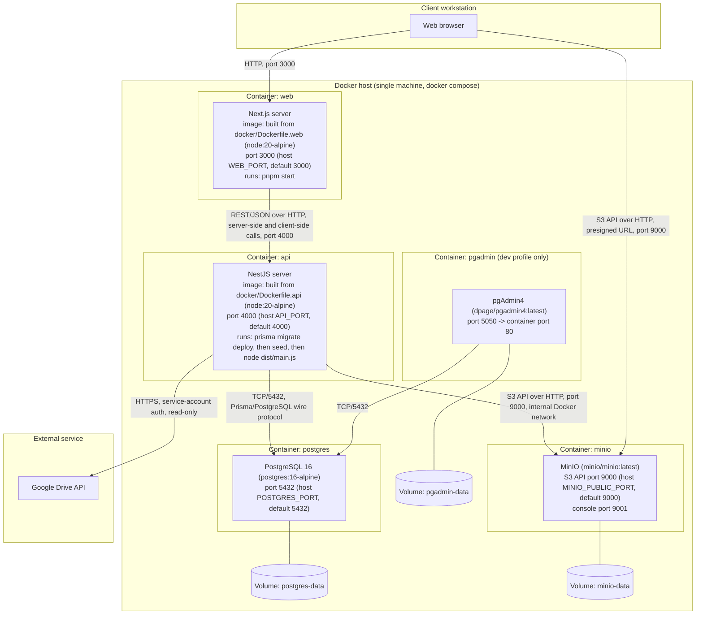

# Design Annex — Database & Deployment Detail

> Extracted from the current repository to satisfy the EMSI PFA report template's
> data-dictionary / UML-diagram / use-case requirements, which
> `docs/internship/factsheet.md` does not cover at this level of detail. Read-only
> extraction — no application code, schema, or containers were touched to produce
> this document. Every fact is checked against `apps/api/prisma/schema.prisma`, the
> 16 migration files under `apps/api/prisma/migrations/`, `docker-compose.yml`, the
> two Dockerfiles, and `package.json`/lockfile-resolved versions. Anything that could
> not be verified is marked **NOT VERIFIED**.
>
> **Scope note:** the task listed 20 distinct model names under "the 18 tables" —
> `User, Role, Permission, Department, DocumentCategory, ControlledDocument,
> DocumentVersion, AuditTemplate, Audit, Finding, Capa, CapaAction, CapaVerification,
> CapaActionVerification, CapaActionEvidence, Indicator, IndicatorValue, ImportJob,
> ImportItem, Notification`. All 20 are documented below rather than arbitrarily
> dropping 2 to match the stated count; see the final reply for the exact tally.

---

## 1. Data dictionary

Types are the actual PostgreSQL types produced by Prisma, confirmed against the
`CREATE TABLE`/`ALTER TABLE` statements in the migration files (not just the Prisma
schema type). All primary keys are `TEXT` — Prisma's `@id @default(uuid())` on a
`String` field generates the UUID in the application layer (Prisma Client), not via
a database-level `DEFAULT`; no migration ever adds a `DEFAULT` clause to an `id`
column. `TIMESTAMP(3)` is Postgres `timestamp(3) without time zone` (millisecond
precision, Prisma's default for `DateTime`).

### 1.1 `users` (Prisma model `User`)

| Column name | Data type | Size/precision | Required | Default value | Allowed values | Primary key | Foreign key | Description |
|---|---|---|---|---|---|---|---|---|
| id | text | — | Yes | — (app-generated UUID) | — | Yes | — | Unique user identifier |
| email | text | — | Yes | — | — | No | — | Login email. **Unique** (`users_email_key`) |
| passwordHash | text | — | Yes | — | — | No | — | Argon2id password hash (see §6) |
| firstName | text | — | Yes | — | — | No | — | Given name |
| lastName | text | — | Yes | — | — | No | — | Family name |
| employeeNumber | text | — | No | NULL | — | No | — | Optional HR employee number |
| phone | text | — | No | NULL | — | No | — | Optional contact phone |
| avatar | text | — | No | NULL | — | No | — | Optional avatar URL/key |
| status | UserStatus (enum) | — | Yes | 'ACTIVE' | ACTIVE, INACTIVE, LOCKED | No | — | Account status gating login |
| lastLoginAt | timestamp(3) | — | No | NULL | — | No | — | Last successful login |
| failedLoginCount | integer | — | Yes | 0 | — | No | — | Consecutive failed logins (lockout counter) |
| lockedUntil | timestamp(3) | — | No | NULL | — | No | — | Temporary lockout expiry |
| passwordResetToken | text | — | No | NULL | — | No | — | SHA-256 hash of an outstanding reset token |
| passwordResetExpiresAt | timestamp(3) | — | No | NULL | — | No | — | Reset token expiry |
| roleId | text | — | Yes | — | — | No | → roles.id | Assigned RBAC role |
| departmentId | text | — | No | NULL | — | No | → departments.id | Home department (null for global roles) |
| deletedAt | timestamp(3) | — | No | NULL | — | No | — | Soft-delete marker; users are never hard-deleted |
| createdAt | timestamp(3) | — | Yes | CURRENT_TIMESTAMP | — | No | — | Row creation time |
| updatedAt | timestamp(3) | — | Yes | set on every write (Prisma `@updatedAt`) | — | No | — | Last modification time |

### 1.2 `roles` (Prisma model `Role`)

| Column name | Data type | Size/precision | Required | Default value | Allowed values | Primary key | Foreign key | Description |
|---|---|---|---|---|---|---|---|---|
| id | text | — | Yes | — (app-generated UUID) | — | Yes | — | Unique role identifier |
| name | text | — | Yes | — | — | No | — | Display name. **Unique** (`roles_name_key`) |
| slug | text | — | Yes | — | — | No | — | Machine slug (e.g. `audit-manager`). **Unique** (`roles_slug_key`) |
| description | text | — | No | NULL | — | No | — | Free-text description |
| isSystem | boolean | — | Yes | false | true, false | No | — | System roles cannot be deleted |
| isGlobal | boolean | — | Yes | false | true, false | No | — | Global roles bypass department data-scoping |
| createdAt | timestamp(3) | — | Yes | CURRENT_TIMESTAMP | — | No | — | Row creation time |
| updatedAt | timestamp(3) | — | Yes | set on every write | — | No | — | Last modification time |

Related M:N table `_PermissionToRole` (Prisma-managed junction, no model of its own):
`A` text → `permissions.id`, `B` text → `roles.id`; composite unique index
`_PermissionToRole_AB_unique` on (A, B); plain index on B.

### 1.3 `permissions` (Prisma model `Permission`)

| Column name | Data type | Size/precision | Required | Default value | Allowed values | Primary key | Foreign key | Description |
|---|---|---|---|---|---|---|---|---|
| id | text | — | Yes | — (app-generated UUID) | — | Yes | — | Unique permission identifier |
| key | text | — | Yes | — | — | No | — | Machine key, e.g. `capas.verify`. **Unique** (`permissions_key_key`) |
| group | text | — | Yes | — | — | No | — | Catalog grouping label (e.g. "Indicators") |
| label | text | — | No | NULL | — | No | — | Human-readable label |
| description | text | — | No | NULL | — | No | — | Free-text description |
| createdAt | timestamp(3) | — | Yes | CURRENT_TIMESTAMP | — | No | — | Row creation time |

### 1.4 `departments` (Prisma model `Department`)

| Column name | Data type | Size/precision | Required | Default value | Allowed values | Primary key | Foreign key | Description |
|---|---|---|---|---|---|---|---|---|
| id | text | — | Yes | — (app-generated UUID) | — | Yes | — | Unique department identifier |
| code | text | — | Yes | — | — | No | — | Short code (e.g. PROD). **Unique** (`departments_code_key`) |
| name | text | — | Yes | — | — | No | — | Display name |
| description | text | — | No | NULL | — | No | — | Free-text description |
| sortOrder | integer | — | Yes | 0 | — | No | — | Display ordering |
| status | DepartmentStatus (enum) | — | Yes | 'ACTIVE' | ACTIVE, INACTIVE | No | — | Whether the department is active |
| managerId | text | — | No | NULL | — | No | → users.id | Department manager (optional) |
| createdAt | timestamp(3) | — | Yes | CURRENT_TIMESTAMP | — | No | — | Row creation time |
| updatedAt | timestamp(3) | — | Yes | set on every write | — | No | — | Last modification time |

### 1.5 `document_categories` (Prisma model `DocumentCategory`)

| Column name | Data type | Size/precision | Required | Default value | Allowed values | Primary key | Foreign key | Description |
|---|---|---|---|---|---|---|---|---|
| id | text | — | Yes | — (app-generated UUID) | — | Yes | — | Unique category identifier |
| code | text | — | Yes | — | — | No | — | Short code. **Unique** (`document_categories_code_key`) |
| name | text | — | Yes | — | — | No | — | Display name |
| icon | text | — | No | NULL | — | No | — | Optional icon identifier |
| color | text | — | No | NULL | — | No | — | Optional display color |
| description | text | — | No | NULL | — | No | — | Free-text description |
| active | boolean | — | Yes | true | true, false | No | — | Whether selectable for new documents |
| sortOrder | integer | — | Yes | 0 | — | No | — | Display ordering |
| createdAt | timestamp(3) | — | Yes | CURRENT_TIMESTAMP | — | No | — | Row creation time |
| updatedAt | timestamp(3) | — | Yes | set on every write | — | No | — | Last modification time |

### 1.6 `controlled_documents` (Prisma model `ControlledDocument`)

| Column name | Data type | Size/precision | Required | Default value | Allowed values | Primary key | Foreign key | Description |
|---|---|---|---|---|---|---|---|---|
| id | text | — | Yes | — (app-generated UUID) | — | Yes | — | Unique document identifier |
| title | text | — | Yes | — | — | No | — | Document title |
| normalizedTitle | text | — | Yes | '' | — | No | — | Trimmed/collapsed/lowercased copy of `title`, used for duplicate-name detection at the service layer (not a DB unique constraint — live data already had duplicates when this column was added) |
| code | text | — | Yes | — | — | No | — | Document code. **Unique** (`controlled_documents_code_key`) |
| description | text | — | No | NULL | — | No | — | Free-text description |
| departmentId | text | — | Yes | — | — | No | → departments.id | Owning department |
| processId | text | — | No | NULL | — | No | → processes.id | Optional owning process (legacy QMS model) |
| categoryId | text | — | Yes | — | — | No | → document_categories.id | Document category |
| currentVersionId | text | — | No | NULL | — | No | → document_versions.id | Pointer to the current version row |
| version | text | — | Yes | '0.1' | — | No | — | Current version label |
| revision | integer | — | Yes | 0 | — | No | — | Current revision number |
| status | DocumentStatus (enum) | — | Yes | 'DRAFT' | DRAFT, UNDER_REVIEW, APPROVED, PUBLISHED, OBSOLETE, ARCHIVED | No | — | Document lifecycle status |
| ownerId | text | — | No | NULL | — | No | → users.id | Document owner |
| reviewerId | text | — | No | NULL | — | No | → users.id | Assigned reviewer |
| approverId | text | — | No | NULL | — | No | → users.id | Assigned approver |
| keywords | text[] | — | Yes | (empty array) | — | No | — | Free-text keyword list for search |
| confidentiality | ConfidentialityLevel (enum) | — | Yes | 'INTERNAL' | PUBLIC, INTERNAL, CONFIDENTIAL, RESTRICTED | No | — | Confidentiality classification |
| effectiveDate | timestamp(3) | — | No | NULL | — | No | — | Date the document takes effect |
| reviewDate | timestamp(3) | — | No | NULL | — | No | — | Next scheduled review date |
| expirationDate | timestamp(3) | — | No | NULL | — | No | — | Expiry/certificate date |
| createdById | text | — | Yes | — | — | No | → users.id | Uploader |
| updatedById | text | — | No | NULL | — | No | → users.id | Last user to update the record |
| searchVector | tsvector | — | No | NULL | — | No | — | Full-text search vector, kept in sync by a `BEFORE INSERT/UPDATE` trigger over title+code+description+keywords; indexed with a GIN index |
| deletedAt | timestamp(3) | — | No | NULL | — | No | — | Soft-delete marker |
| createdAt | timestamp(3) | — | Yes | CURRENT_TIMESTAMP | — | No | — | Row creation time |
| updatedAt | timestamp(3) | — | Yes | set on every write | — | No | — | Last modification time |

### 1.7 `document_versions` (Prisma model `DocumentVersion`)

| Column name | Data type | Size/precision | Required | Default value | Allowed values | Primary key | Foreign key | Description |
|---|---|---|---|---|---|---|---|---|
| id | text | — | Yes | — (app-generated UUID) | — | Yes | — | Unique version identifier |
| documentId | text | — | Yes | — | — | No | → controlled_documents.id | Parent document |
| version | text | — | Yes | — | — | No | — | Version label at time of upload |
| revision | integer | — | Yes | — | — | No | — | Revision number at time of upload |
| fileKey | text | — | Yes | — | — | No | — | Object-storage key (MinIO) |
| fileName | text | — | Yes | — | — | No | — | Original file name |
| mimeType | text | — | Yes | — | — | No | — | MIME type |
| sizeBytes | integer | — | Yes | — | — | No | — | File size in bytes |
| checksum | text | — | No | NULL | — | No | — | Content checksum, immutable once set |
| comment | text | — | No | NULL | — | No | — | Upload comment |
| uploadedById | text | — | Yes | — | — | No | → users.id | Uploader |
| approvedById | text | — | No | NULL | — | No | → users.id | Approver, if approved |
| approvedAt | timestamp(3) | — | No | NULL | — | No | — | Approval timestamp |
| createdAt | timestamp(3) | — | Yes | CURRENT_TIMESTAMP | — | No | — | Row creation time (this row is otherwise immutable) |

### 1.8 `audit_templates` (Prisma model `AuditTemplate`)

| Column name | Data type | Size/precision | Required | Default value | Allowed values | Primary key | Foreign key | Description |
|---|---|---|---|---|---|---|---|---|
| id | text | — | Yes | — (app-generated UUID) | — | Yes | — | Unique template identifier |
| name | text | — | Yes | — | — | No | — | Template name |
| normalizedName | text | — | Yes | '' | — | No | — | Normalized copy of `name` for duplicate-name detection (service-layer only, see §1.6) |
| description | text | — | No | NULL | — | No | — | Free-text description |
| category | text | — | Yes | — | — | No | — | Template category (free text, validated against `TEMPLATE_CATEGORIES` in application code, not a DB enum) |
| version | integer | — | Yes | 1 | — | No | — | Template version number |
| status | TemplateStatus (enum) | — | Yes | 'DRAFT' | DRAFT, PUBLISHED, ARCHIVED | No | — | Publication status |
| departmentId | text | — | No | NULL | — | No | → departments.id | Optional owning department |
| processId | text | — | No | NULL | — | No | → processes.id | Optional owning process |
| createdById | text | — | Yes | — | — | No | → users.id | Creator |
| updatedById | text | — | No | NULL | — | No | → users.id | Last editor |
| createdAt | timestamp(3) | — | Yes | CURRENT_TIMESTAMP | — | No | — | Row creation time |
| updatedAt | timestamp(3) | — | Yes | set on every write | — | No | — | Last modification time |

### 1.9 `audits` (Prisma model `Audit`)

| Column name | Data type | Size/precision | Required | Default value | Allowed values | Primary key | Foreign key | Description |
|---|---|---|---|---|---|---|---|---|
| id | text | — | Yes | — (app-generated UUID) | — | Yes | — | Unique audit identifier |
| title | text | — | Yes | — | — | No | — | Audit title |
| normalizedTitle | text | — | Yes | '' | — | No | — | Normalized copy of `title` for duplicate-name detection (service-layer only) |
| templateId | text | — | Yes | — | — | No | → audit_templates.id | Template this audit was instantiated from |
| departmentId | text | — | Yes | — | — | No | → departments.id | Audited department |
| processId | text | — | No | NULL | — | No | → processes.id | Optional audited process |
| auditorId | text | — | No | NULL | — | No | → users.id | Assigned auditor |
| status | AuditStatus (enum) | — | Yes | 'PLANNED' | PLANNED, IN_PROGRESS, SUBMITTED, UNDER_REVIEW, RETURNED, APPROVED, COMPLETED | No | — | Audit lifecycle status |
| scheduledDate | timestamp(3) | — | No | NULL | — | No | — | Planned execution date |
| startedAt | timestamp(3) | — | No | NULL | — | No | — | Execution start time |
| submittedAt | timestamp(3) | — | No | NULL | — | No | — | Submission time |
| approvedAt | timestamp(3) | — | No | NULL | — | No | — | Approval time |
| approvedById | text | — | No | NULL | — | No | → users.id | Approver |
| reviewComment | text | — | No | NULL | — | No | — | Reviewer's comment (approve/return) |
| score | double precision | — | No | NULL | — | No | — | Overall score, if computed |
| compliance | double precision | — | No | NULL | — | No | — | Compliance percentage (ok / (ok+fail) of answered questions) |
| createdById | text | — | Yes | — | — | No | → users.id | Creator (the scheduling Audit Manager) |
| createdAt | timestamp(3) | — | Yes | CURRENT_TIMESTAMP | — | No | — | Row creation time |
| updatedAt | timestamp(3) | — | Yes | set on every write | — | No | — | Last modification time |

### 1.10 `findings` (Prisma model `Finding`)

| Column name | Data type | Size/precision | Required | Default value | Allowed values | Primary key | Foreign key | Description |
|---|---|---|---|---|---|---|---|---|
| id | text | — | Yes | — (app-generated UUID) | — | Yes | — | Unique finding identifier |
| auditId | text | — | Yes | — | — | No | → audits.id | Parent audit |
| questionId | text | — | No | NULL | — | No | — | Optional linked checklist question (no DB FK enforced) |
| title | text | — | Yes | — | — | No | — | Finding title |
| description | text | — | No | NULL | — | No | — | Free-text description |
| severity | FindingSeverity (enum) | — | Yes | — | OBSERVATION, OFI, MINOR_NC, MAJOR_NC | No | — | Non-conformity severity |
| responsibleUserId | text | — | No | NULL | — | No | → users.id | User responsible for follow-up |
| dueDate | timestamp(3) | — | No | NULL | — | No | — | Follow-up due date |
| status | text | — | Yes | 'OPEN' | application-level values (e.g. OPEN/CLOSED — not a DB enum) | No | — | Finding status |
| processId | text | — | No | NULL | — | No | → processes.id | Optional related process |
| comments | text | — | No | NULL | — | No | — | Free-text comments |
| capaDecision | text | — | No | NULL | — | No | — | CAPA decision outcome ('REQUIRED'/'NOT_REQUIRED', not a DB enum) |
| capaDecisionById | text | — | No | NULL | — | No | — | User who made the CAPA decision (no DB FK enforced) |
| capaDecisionDate | timestamp(3) | — | No | NULL | — | No | — | When the CAPA decision was made |
| capaDecisionReason | text | — | No | NULL | — | No | — | Reason for the decision |
| createdAt | timestamp(3) | — | Yes | CURRENT_TIMESTAMP | — | No | — | Row creation time |
| updatedAt | timestamp(3) | — | Yes | set on every write | — | No | — | Last modification time |

### 1.11 `capas` (Prisma model `Capa`)

| Column name | Data type | Size/precision | Required | Default value | Allowed values | Primary key | Foreign key | Description |
|---|---|---|---|---|---|---|---|---|
| id | text | — | Yes | — (app-generated UUID) | — | Yes | — | Unique CAPA identifier |
| referenceNumber | text | — | Yes | — | — | No | — | Human-facing reference, e.g. CAPA-2026-0001. **Unique** (`capas_referenceNumber_key`) |
| title | text | — | Yes | — | — | No | — | CAPA title |
| normalizedTitle | text | — | Yes | '' | — | No | — | Normalized copy of `title` for duplicate-name detection (service-layer only) |
| description | text | — | No | NULL | — | No | — | Free-text description |
| sourceType | text | — | Yes | 'MANUAL' | e.g. MANUAL, FINDING (application-level, not a DB enum) | No | — | How the CAPA originated |
| sourceId | text | — | No | NULL | — | No | — | Free-form reference to the originating record |
| findingId | text | — | No | NULL | — | No | → findings.id | Originating finding, if any |
| departmentId | text | — | Yes | — | — | No | → departments.id | Owning department |
| processId | text | — | No | NULL | — | No | → processes.id | Optional owning process |
| ownerId | text | — | No | NULL | — | No | → users.id | Pilot/owner responsible for the corrective work |
| createdById | text | — | Yes | — | — | No | → users.id | Creator |
| priority | CapaPriority (enum) | — | Yes | 'MEDIUM' | LOW, MEDIUM, HIGH, CRITICAL | No | — | Priority |
| status | CapaStatus (enum) | — | Yes | 'DRAFT' | DRAFT, ROOT_CAUSE_ANALYSIS, ACTION_PLAN, IN_PROGRESS, PENDING_VERIFICATION, PENDING_EFFECTIVENESS, CLOSED, CANCELLED, ASSIGNED, EVIDENCE_UPLOADED, RETURNED, VALIDATED | No | — | CAPA lifecycle status (12 values; the last 4 added additively for the TECPAP workflow) |
| targetDate | timestamp(3) | — | No | NULL | — | No | — | Target completion date |
| openedAt | timestamp(3) | — | No | NULL | — | No | — | Time work actually started |
| submittedAt | timestamp(3) | — | No | NULL | — | No | — | Time submitted for verification |
| verifiedAt | timestamp(3) | — | No | NULL | — | No | — | Time the general verification passed |
| effectivenessDueDate | timestamp(3) | — | No | NULL | — | No | — | Effectiveness review due date |
| effectivenessReviewedAt | timestamp(3) | — | No | NULL | — | No | — | Effectiveness review time |
| closedAt | timestamp(3) | — | No | NULL | — | No | — | Closure time |
| closedById | text | — | No | NULL | — | No | → users.id | User who closed the CAPA |
| closureComment | text | — | No | NULL | — | No | — | Closure comment |
| deletedAt | timestamp(3) | — | No | NULL | — | No | — | Soft-delete marker |
| createdAt | timestamp(3) | — | Yes | CURRENT_TIMESTAMP | — | No | — | Row creation time |
| updatedAt | timestamp(3) | — | Yes | set on every write | — | No | — | Last modification time |

### 1.12 `capa_actions` (Prisma model `CapaAction`)

| Column name | Data type | Size/precision | Required | Default value | Allowed values | Primary key | Foreign key | Description |
|---|---|---|---|---|---|---|---|---|
| id | text | — | Yes | — (app-generated UUID) | — | Yes | — | Unique action identifier |
| capaId | text | — | Yes | — | — | No | → capas.id | Parent CAPA |
| title | text | — | Yes | — | — | No | — | Action title |
| description | text | — | No | NULL | — | No | — | Free-text description |
| actionType | CapaActionType (enum) | — | Yes | 'CORRECTIVE' | CONTAINMENT, CORRECTIVE, PREVENTIVE | No | — | Type of corrective/preventive action |
| ownerId | text | — | No | NULL | — | No | → users.id | Pilot responsible for this action |
| priority | CapaPriority (enum) | — | Yes | 'MEDIUM' | LOW, MEDIUM, HIGH, CRITICAL | No | — | Priority |
| status | CapaActionStatus (enum) | — | Yes | 'OPEN' | OPEN, IN_PROGRESS, COMPLETED, VERIFIED, CANCELLED | No | — | Action lifecycle status |
| dueDate | timestamp(3) | — | No | NULL | — | No | — | Due date |
| completedAt | timestamp(3) | — | No | NULL | — | No | — | Completion time |
| completionComment | text | — | No | NULL | — | No | — | Comment recorded on completion |
| createdAt | timestamp(3) | — | Yes | CURRENT_TIMESTAMP | — | No | — | Row creation time |
| updatedAt | timestamp(3) | — | Yes | set on every write | — | No | — | Last modification time |

### 1.13 `capa_verifications` (Prisma model `CapaVerification`)

| Column name | Data type | Size/precision | Required | Default value | Allowed values | Primary key | Foreign key | Description |
|---|---|---|---|---|---|---|---|---|
| id | text | — | Yes | — (app-generated UUID) | — | Yes | — | Unique verification-attempt identifier |
| capaId | text | — | Yes | — | — | No | → capas.id | CAPA being verified. Originally unique (1:1); the unique index was **dropped** in migration `20260909010644_capa_verification_history` to make this an append-only 1:N history — no row is ever updated or deleted |
| verifiedById | text | — | Yes | — | — | No | → users.id | Audit Manager who performed this verification |
| result | VerificationResult (enum) | — | Yes | — | PASSED, FAILED | No | — | Outcome of this attempt |
| notes | text | — | No | NULL | — | No | — | Verifier's notes/reason |
| verifiedAt | timestamp(3) | — | Yes | CURRENT_TIMESTAMP | — | No | — | Time of this verification attempt |

### 1.14 `capa_action_verifications` (Prisma model `CapaActionVerification`)

| Column name | Data type | Size/precision | Required | Default value | Allowed values | Primary key | Foreign key | Description |
|---|---|---|---|---|---|---|---|---|
| id | text | — | Yes | — (app-generated UUID) | — | Yes | — | Unique verification-attempt identifier |
| actionId | text | — | Yes | — | — | No | → capa_actions.id | Action being verified. No unique constraint — append-only 1:N history by design, mirroring `capa_verifications` |
| verifiedById | text | — | Yes | — | — | No | → users.id | Audit Manager who performed this verification |
| result | VerificationResult (enum) | — | Yes | — | PASSED, FAILED | No | — | Outcome of this attempt |
| notes | text | — | No | NULL | — | No | — | Verifier's reason (required by application code when result = FAILED) |
| verifiedAt | timestamp(3) | — | Yes | CURRENT_TIMESTAMP | — | No | — | Time of this verification attempt |

### 1.15 `capa_action_evidence` (Prisma model `CapaActionEvidence`)

| Column name | Data type | Size/precision | Required | Default value | Allowed values | Primary key | Foreign key | Description |
|---|---|---|---|---|---|---|---|---|
| id | text | — | Yes | — (app-generated UUID) | — | Yes | — | Unique evidence-file identifier |
| actionId | text | — | Yes | — | — | No | → capa_actions.id | Action this evidence supports |
| fileKey | text | — | Yes | — | — | No | — | Object-storage key (MinIO) |
| fileName | text | — | Yes | — | — | No | — | Original file name |
| mimeType | text | — | Yes | — | — | No | — | MIME type |
| sizeBytes | integer | — | Yes | — | — | No | — | File size in bytes |
| comment | text | — | No | NULL | — | No | — | Upload comment |
| uploadedById | text | — | Yes | — | — | No | → users.id | Uploader |
| createdAt | timestamp(3) | — | Yes | CURRENT_TIMESTAMP | — | No | — | Row creation time |

### 1.16 `indicators` (Prisma model `Indicator`)

| Column name | Data type | Size/precision | Required | Default value | Allowed values | Primary key | Foreign key | Description |
|---|---|---|---|---|---|---|---|---|
| id | text | — | Yes | — (app-generated UUID) | — | Yes | — | Unique indicator identifier |
| code | text | — | Yes | — | — | No | — | Short code. **Unique** (`indicators_code_key`) |
| name | text | — | Yes | — | — | No | — | Display name |
| description | text | — | No | NULL | — | No | — | Free-text description |
| departmentId | text | — | Yes | — | — | No | → departments.id | Owning department |
| category | text | — | No | NULL | — | No | — | Free-text category label |
| unit | text | — | No | NULL | — | No | — | Unit of measure |
| direction | IndicatorDirection (enum) | — | Yes | 'HIGHER_IS_BETTER' | HIGHER_IS_BETTER, LOWER_IS_BETTER, TARGET_BASED | No | — | How the value compares to its thresholds |
| target | double precision | — | No | NULL | — | No | — | Target value (used by TARGET_BASED direction) |
| warningThreshold | double precision | — | No | NULL | — | No | — | Warning threshold |
| criticalThreshold | double precision | — | No | NULL | — | No | — | Critical threshold |
| frequency | IndicatorFrequency (enum) | — | Yes | 'MONTHLY' | MONTHLY, QUARTERLY, SEMIANNUAL, ANNUAL | No | — | Measurement frequency (originally also had DAILY/WEEKLY/YEARLY, renamed/pruned in migration `20260913000000_indicator_periods`, verified no row used the removed values) |
| responsibleUserId | text | — | No | NULL | — | No | → users.id | User responsible for the indicator |
| active | boolean | — | Yes | true | true, false | No | — | Whether the indicator is currently tracked |
| createdById | text | — | Yes | — | — | No | → users.id | Creator |
| createdAt | timestamp(3) | — | Yes | CURRENT_TIMESTAMP | — | No | — | Row creation time |
| updatedAt | timestamp(3) | — | Yes | set on every write | — | No | — | Last modification time |

### 1.17 `indicator_values` (Prisma model `IndicatorValue`)

| Column name | Data type | Size/precision | Required | Default value | Allowed values | Primary key | Foreign key | Description |
|---|---|---|---|---|---|---|---|---|
| id | text | — | Yes | — (app-generated UUID) | — | Yes | — | Unique value-record identifier |
| indicatorId | text | — | Yes | — | — | No | → indicators.id | Parent indicator |
| value | double precision | — | Yes | — | — | No | — | Measured value |
| year | integer | — | Yes | — (added nullable then backfilled+tightened in migration `20260913000000_indicator_periods`) | — | No | — | Calendar year of the period |
| periodMonth | integer | — | Yes | — (same migration) | 1–12, application-validated against the indicator's frequency (e.g. quarterly accepts only 3/6/9/12) | No | — | Representative month of the period |
| measuredAt | timestamp(3) | — | Yes | — | — | No | — | Timestamp of measurement (last day of `periodMonth`) |
| comment | text | — | No | NULL | — | No | — | Optional comment |
| recordedById | text | — | No | NULL | — | No | → users.id | User who recorded/corrected the value |
| createdAt | timestamp(3) | — | Yes | CURRENT_TIMESTAMP | — | No | — | Row creation time |
| updatedAt | timestamp(3) | — | Yes | set on every write (added in the same migration as `year`/`periodMonth`) | — | No | — | Last modification time — a second recording for the same (indicatorId, year, periodMonth) updates this row in place (a correction), rather than inserting a new one; no DB unique constraint enforces this, it is service-layer only |

### 1.18 `import_jobs` (Prisma model `ImportJob`)

| Column name | Data type | Size/precision | Required | Default value | Allowed values | Primary key | Foreign key | Description |
|---|---|---|---|---|---|---|---|---|
| id | text | — | Yes | — (app-generated UUID) | — | Yes | — | Unique job identifier |
| source | ImportSource (enum) | — | Yes | 'UPLOAD' | LOCAL, GOOGLE_DRIVE, UPLOAD | No | — | Import source type |
| sourceLocation | text | — | No | NULL | — | No | — | Folder path or Google Drive folder id |
| name | text | — | No | NULL | — | No | — | Optional job name |
| status | ImportJobStatus (enum) | — | Yes | 'PENDING' | PENDING, SCANNING, PARSING, CLASSIFYING, WAITING_REVIEW, IMPORTING, COMPLETED, FAILED, CANCELLED | No | — | Job status |
| startedById | text | — | Yes | — | — | No | → users.id | User who started the job |
| progress | integer | — | Yes | 0 | — | No | — | Progress percentage |
| processed | integer | — | Yes | 0 | — | No | — | Items processed so far |
| imported | integer | — | Yes | 0 | — | No | — | Items successfully imported |
| skipped | integer | — | Yes | 0 | — | No | — | Items skipped |
| failed | integer | — | Yes | 0 | — | No | — | Items failed |
| duplicates | integer | — | Yes | 0 | — | No | — | Items flagged as duplicates |
| warnings | integer | — | Yes | 0 | — | No | — | Items with warnings |
| errorMessage | text | — | No | NULL | — | No | — | Job-level error message (e.g. Google Drive not configured) |
| stats | jsonb | — | No | NULL | — | No | — | Aggregate roll-up (by department/category/format/timings) |
| errors | jsonb | — | No | NULL | — | No | — | Array of `{ fileName, message }` |
| cancelledAt | timestamp(3) | — | No | NULL | — | No | — | Cancellation time |
| completedAt | timestamp(3) | — | No | NULL | — | No | — | Completion time |
| createdAt | timestamp(3) | — | Yes | CURRENT_TIMESTAMP | — | No | — | Row creation time |
| updatedAt | timestamp(3) | — | Yes | set on every write | — | No | — | Last modification time |

### 1.19 `import_items` (Prisma model `ImportItem`)

| Column name | Data type | Size/precision | Required | Default value | Allowed values | Primary key | Foreign key | Description |
|---|---|---|---|---|---|---|---|---|
| id | text | — | Yes | — (app-generated UUID) | — | Yes | — | Unique item identifier |
| jobId | text | — | Yes | — | — | No | → import_jobs.id | Parent job |
| originalPath | text | — | Yes | — | — | No | — | Original file path/name as scanned |
| relativePath | text | — | No | NULL | — | No | — | Path relative to the scanned folder |
| fileName | text | — | Yes | — | — | No | — | File name |
| extension | text | — | Yes | — | — | No | — | File extension |
| mimeType | text | — | No | NULL | — | No | — | MIME type |
| sizeBytes | integer | — | Yes | — | — | No | — | File size in bytes |
| checksum | text | — | No | NULL | — | No | — | SHA-256 checksum of the file bytes (duplicate detection) |
| parentFolder | text | — | No | NULL | — | No | — | Parent folder name |
| format | text | — | Yes | — | — | No | — | Detected file format |
| status | ImportItemStatus (enum) | — | Yes | 'PENDING' | PENDING, PARSED, CLASSIFIED, DUPLICATE, AWAITING_REVIEW, APPROVED, REJECTED, IMPORTED, FAILED, SKIPPED | No | — | Item status |
| parsedMetadata | jsonb | — | No | NULL | — | No | — | Parser-extracted metadata |
| contentText | text | — | No | NULL | — | No | — | Extracted text content |
| pageCount | integer | — | No | NULL | — | No | — | Page count, if applicable |
| tableCount | integer | — | No | NULL | — | No | — | Table count, if applicable |
| imageCount | integer | — | No | NULL | — | No | — | Image count, if applicable |
| ocrNeeded | boolean | — | Yes | false | true, false | No | — | Whether OCR was flagged as needed |
| ocrText | text | — | No | NULL | — | No | — | OCR-extracted text, if any |
| warnings | jsonb | — | No | NULL | — | No | — | Parser warnings |
| error | text | — | No | NULL | — | No | — | Parse/classification/materialization error message |
| detectedType | text | — | No | NULL | — | No | — | Detected document type |
| targetEntityType | ImportItemType (enum) | — | No | NULL | CONTROLLED_DOCUMENT, AUDIT_TEMPLATE, BUSINESS_OBJECT | No | — | What kind of entity this item will materialize into |
| classification | jsonb | — | No | NULL | — | No | — | Department/category/process classification + confidence score |
| duplicateOfId | text | — | No | NULL | — | No | — | Id of the existing entity this item duplicates (no DB FK enforced — target type varies) |
| duplicateStrategy | text | — | No | NULL | — | No | — | e.g. REPLACE_VERSION |
| reviewDecision | ReviewDecision (enum) | — | No | NULL | APPROVE, REJECT, MERGE, REPLACE_VERSION | No | — | Human reviewer's decision |
| reviewNote | text | — | No | NULL | — | No | — | Reviewer's note |
| reviewById | text | — | No | NULL | — | No | → users.id | Reviewer |
| reviewedAt | timestamp(3) | — | No | NULL | — | No | — | Review time |
| fileKey | text | — | No | NULL | — | No | — | Object-storage key once stored |
| importedEntityId | text | — | No | NULL | — | No | — | Id of the materialized entity (no DB FK — target type varies) |
| importedEntityType | text | — | No | NULL | — | No | — | Type of the materialized entity, e.g. `controlled_document` |
| importedAt | timestamp(3) | — | No | NULL | — | No | — | Materialization time |
| createdAt | timestamp(3) | — | Yes | CURRENT_TIMESTAMP | — | No | — | Row creation time |
| updatedAt | timestamp(3) | — | Yes | set on every write | — | No | — | Last modification time |

### 1.20 `notifications` (Prisma model `Notification`)

| Column name | Data type | Size/precision | Required | Default value | Allowed values | Primary key | Foreign key | Description |
|---|---|---|---|---|---|---|---|---|
| id | text | — | Yes | — (app-generated UUID) | — | Yes | — | Unique notification identifier |
| userId | text | — | Yes | — | — | No | → users.id | Recipient |
| type | text | — | Yes | — | Application-level type string, e.g. `CAPA_ACTION_FAILED` (17 types defined in `packages/config/src/notification-templates.ts`; not a DB enum) | No | — | Notification type |
| category | text | — | Yes | — | e.g. audit, capa, document, indicator, import (not a DB enum) | No | — | Category grouping |
| severity | NotificationSeverity (enum) | — | Yes | 'INFO' | INFO, SUCCESS, WARNING, CRITICAL | No | — | Severity |
| title | text | — | Yes | — | — | No | — | English fallback title (always populated) |
| message | text | — | Yes | — | — | No | — | English fallback message body |
| params | jsonb | — | No | NULL | — | No | — | Structured interpolation params; when set, the frontend renders a localized (EN/FR) version from `type`+`params` via the shared template catalog instead of the stored `title`/`message` |
| entityType | text | — | No | NULL | — | No | — | Related entity type (no DB FK — target type varies) |
| entityId | text | — | No | NULL | — | No | — | Related entity id |
| actionUrl | text | — | No | NULL | — | No | — | Frontend deep link |
| departmentId | text | — | No | NULL | — | No | — | Related department (no DB FK enforced) |
| readAt | timestamp(3) | — | No | NULL | — | No | — | When the user read it |
| archivedAt | timestamp(3) | — | No | NULL | — | No | — | When the user archived it |
| expiresAt | timestamp(3) | — | No | NULL | — | No | — | Optional expiry |
| createdAt | timestamp(3) | — | Yes | CURRENT_TIMESTAMP | — | No | — | Row creation time |

### 1.21 Enumerations used by these tables

| Enum | Values |
|---|---|
| UserStatus | ACTIVE, INACTIVE, LOCKED |
| DepartmentStatus | ACTIVE, INACTIVE |
| DocumentStatus | DRAFT, UNDER_REVIEW, APPROVED, PUBLISHED, OBSOLETE, ARCHIVED |
| ConfidentialityLevel | PUBLIC, INTERNAL, CONFIDENTIAL, RESTRICTED |
| TemplateStatus | DRAFT, PUBLISHED, ARCHIVED |
| AuditStatus | PLANNED, IN_PROGRESS, SUBMITTED, UNDER_REVIEW, RETURNED, APPROVED, COMPLETED |
| FindingSeverity | OBSERVATION, OFI, MINOR_NC, MAJOR_NC |
| CapaStatus | DRAFT, ROOT_CAUSE_ANALYSIS, ACTION_PLAN, IN_PROGRESS, PENDING_VERIFICATION, PENDING_EFFECTIVENESS, CLOSED, CANCELLED, ASSIGNED, EVIDENCE_UPLOADED, RETURNED, VALIDATED |
| CapaPriority | LOW, MEDIUM, HIGH, CRITICAL |
| CapaActionType | CONTAINMENT, CORRECTIVE, PREVENTIVE |
| CapaActionStatus | OPEN, IN_PROGRESS, COMPLETED, VERIFIED, CANCELLED |
| VerificationResult | PASSED, FAILED |
| IndicatorDirection | HIGHER_IS_BETTER, LOWER_IS_BETTER, TARGET_BASED |
| IndicatorFrequency | MONTHLY, QUARTERLY, SEMIANNUAL, ANNUAL |
| ImportSource | LOCAL, GOOGLE_DRIVE, UPLOAD |
| ImportJobStatus | PENDING, SCANNING, PARSING, CLASSIFYING, WAITING_REVIEW, IMPORTING, COMPLETED, FAILED, CANCELLED |
| ImportItemType | CONTROLLED_DOCUMENT, AUDIT_TEMPLATE, BUSINESS_OBJECT |
| ImportItemStatus | PENDING, PARSED, CLASSIFIED, DUPLICATE, AWAITING_REVIEW, APPROVED, REJECTED, IMPORTED, FAILED, SKIPPED |
| ReviewDecision | APPROVE, REJECT, MERGE, REPLACE_VERSION |
| NotificationSeverity | INFO, SUCCESS, WARNING, CRITICAL |

Not used by these 20 tables but present elsewhere in the schema: `ProcessStatus`
(Process), `RelationType` (DocumentRelation), `QuestionType`
(AuditTemplateQuestion), `EffectivenessResult` (CapaEffectivenessReview).

### 1.22 Indexes and unique constraints on these tables

| Table | Constraint | Type |
|---|---|---|
| users | `users_email_key` (email) | Unique |
| users | `users_roleId_idx`, `users_departmentId_idx`, `users_status_idx`, `users_deletedAt_idx` | Index |
| roles | `roles_name_key` (name), `roles_slug_key` (slug) | Unique |
| permissions | `permissions_key_key` (key) | Unique |
| permissions | `permissions_group_idx` | Index |
| departments | `departments_code_key` (code) | Unique |
| departments | `departments_status_idx` | Index |
| _PermissionToRole | `_PermissionToRole_AB_unique` (A, B) | Unique (junction) |
| _PermissionToRole | `_PermissionToRole_B_index` (B) | Index |
| document_categories | `document_categories_code_key` (code) | Unique |
| controlled_documents | `controlled_documents_code_key` (code) | Unique |
| controlled_documents | `departmentId`, `processId`, `categoryId`, `status`, `ownerId`, `deletedAt`, `expirationDate`, `normalizedTitle` | Index (one each) |
| controlled_documents | `controlled_documents_searchVector_idx` (GIN, on searchVector) | Index |
| document_versions | `documentId`, `uploadedById` | Index (one each) |
| audit_templates | `status`, `departmentId`, `processId`, `normalizedName` | Index (one each) |
| audits | `templateId`, `departmentId`, `processId`, `status`, `auditorId`, `normalizedTitle` | Index (one each) |
| findings | `auditId`, `severity`, `status` | Index (one each) |
| capas | `capas_referenceNumber_key` (referenceNumber) | Unique |
| capas | `departmentId`, `status`, `findingId`, `ownerId`, `processId`, `normalizedTitle` | Index (one each) |
| capa_actions | `capaId`, `ownerId` | Index (one each) |
| capa_verifications | `capaId_verifiedAt` (composite) | Index — replaces the original `capaId`-only **unique** index, dropped to allow 1:N history |
| capa_action_verifications | `actionId_verifiedAt` (composite) | Index |
| capa_action_evidence | `actionId` | Index |
| indicators | `indicators_code_key` (code) | Unique |
| indicators | `departmentId`, `active`, `category` | Index (one each) |
| indicator_values | `indicatorId_measuredAt` (composite), `indicatorId_year_periodMonth` (composite) | Index |
| import_jobs | `startedById`, `status` | Index (one each) |
| import_items | `jobId`, `status`, `checksum`, `importedEntityId` | Index (one each) |
| notifications | `userId_readAt`, `userId_archivedAt`, `type_entityId_userId` (all composite) | Index |

---

## 2. Relational model

Scope: the same 20 tables as §1 (the full schema has 48 models; the legacy/generic
Process/BusinessObject/Kpi/ProcessRisk models and the Phase 7.6 document-experience
tables are out of scope for this annex).

```
User (id PK, email, passwordHash, firstName, lastName, employeeNumber, phone,
      avatar, status, lastLoginAt, failedLoginCount, lockedUntil,
      passwordResetToken, passwordResetExpiresAt, #roleId, #departmentId,
      deletedAt, createdAt, updatedAt)

Role (id PK, name, slug, description, isSystem, isGlobal, createdAt, updatedAt)

Permission (id PK, key, group, label, description, createdAt)

PermissionToRole (#permissionId PK1, #roleId PK2)   -- junction table (M:N)

Department (id PK, code, name, description, sortOrder, status, #managerId,
            createdAt, updatedAt)

DocumentCategory (id PK, code, name, icon, color, description, active,
                  sortOrder, createdAt, updatedAt)

ControlledDocument (id PK, title, normalizedTitle, code, description,
                    #departmentId, #processId, #categoryId,
                    #currentVersionId, version, revision, status, #ownerId,
                    #reviewerId, #approverId, keywords, confidentiality,
                    effectiveDate, reviewDate, expirationDate, #createdById,
                    #updatedById, searchVector, deletedAt, createdAt, updatedAt)

DocumentVersion (id PK, #documentId, version, revision, fileKey, fileName,
                 mimeType, sizeBytes, checksum, comment, #uploadedById,
                 #approvedById, approvedAt, createdAt)

AuditTemplate (id PK, name, normalizedName, description, category, version,
               status, #departmentId, #processId, #createdById,
               #updatedById, createdAt, updatedAt)

Audit (id PK, title, normalizedTitle, #templateId, #departmentId,
       #processId, #auditorId, status, scheduledDate, startedAt,
       submittedAt, approvedAt, #approvedById, reviewComment, score,
       compliance, #createdById, createdAt, updatedAt)

Finding (id PK, #auditId, questionId, title, description, severity,
         #responsibleUserId, dueDate, status, #processId, comments,
         capaDecision, capaDecisionById, capaDecisionDate,
         capaDecisionReason, createdAt, updatedAt)

Capa (id PK, referenceNumber, title, normalizedTitle, description,
      sourceType, sourceId, #findingId, #departmentId, #processId,
      #ownerId, #createdById, priority, status, targetDate, openedAt,
      submittedAt, verifiedAt, effectivenessDueDate,
      effectivenessReviewedAt, closedAt, #closedById, closureComment,
      deletedAt, createdAt, updatedAt)

CapaAction (id PK, #capaId, title, description, actionType, #ownerId,
            priority, status, dueDate, completedAt, completionComment,
            createdAt, updatedAt)

CapaVerification (id PK, #capaId, #verifiedById, result, notes, verifiedAt)

CapaActionVerification (id PK, #actionId, #verifiedById, result, notes,
                        verifiedAt)

CapaActionEvidence (id PK, #actionId, fileKey, fileName, mimeType,
                    sizeBytes, comment, #uploadedById, createdAt)

Indicator (id PK, code, name, description, #departmentId, category, unit,
           direction, target, warningThreshold, criticalThreshold,
           frequency, #responsibleUserId, active, #createdById, createdAt,
           updatedAt)

IndicatorValue (id PK, #indicatorId, value, year, periodMonth, measuredAt,
                comment, #recordedById, createdAt, updatedAt)

ImportJob (id PK, source, sourceLocation, name, status, #startedById,
           progress, processed, imported, skipped, failed, duplicates,
           warnings, errorMessage, stats, errors, cancelledAt, completedAt,
           createdAt, updatedAt)

ImportItem (id PK, #jobId, originalPath, relativePath, fileName, extension,
            mimeType, sizeBytes, checksum, parentFolder, format, status,
            parsedMetadata, contentText, pageCount, tableCount, imageCount,
            ocrNeeded, ocrText, warnings, error, detectedType,
            targetEntityType, classification, duplicateOfId,
            duplicateStrategy, reviewDecision, reviewNote, #reviewById,
            reviewedAt, fileKey, importedEntityId, importedEntityType,
            importedAt, createdAt, updatedAt)

Notification (id PK, #userId, type, category, severity, title, message,
              params, entityType, entityId, actionUrl, departmentId,
              readAt, archivedAt, expiresAt, createdAt)
```

### Passage rules applied

- **One-to-many → foreign key on the "many" side.** Applied throughout: e.g.
  `Department 1—N User` (`User.departmentId`), `Audit 1—N Finding`
  (`Finding.auditId`), `Capa 1—N CapaAction` (`CapaAction.capaId`),
  `CapaAction 1—N CapaActionVerification` (`CapaActionVerification.actionId`),
  `Indicator 1—N IndicatorValue` (`IndicatorValue.indicatorId`),
  `ImportJob 1—N ImportItem` (`ImportItem.jobId`), `User 1—N Notification`
  (`Notification.userId`). This is the dominant pattern in this schema — every
  table above except `Role`, `Permission`, and `Department` carries at least one
  foreign key placed by this rule.
- **Many-to-many → junction table.** Applied once in this scope: `Role N—M
  Permission` becomes the junction table `_PermissionToRole` (Prisma's implicit
  M:N table name; it has no corresponding model in `schema.prisma`, only the two
  scalar columns `A`/`B` shown above), with a composite unique key on
  (roleId, permissionId) preventing a duplicate grant.
- **Optional one-to-one → foreign key with a unique constraint, dropped when the
  relationship becomes historical.** `Capa 1—1 CapaVerification` was originally
  built this way (`capa_verifications_capaId_key`, unique on `capaId`), then the
  unique constraint was deliberately dropped (migration
  `20260909010644_capa_verification_history`) once the business rule changed to
  "keep every verification attempt" — turning it into an ordinary 1—N
  relationship. `CapaActionVerification` was designed 1—N from the start, using
  the same non-unique foreign key shape.
- **Inheritance:** none. No table in this schema uses single-table, class-table,
  or concrete-table inheritance — every entity above is a plain, independent
  table linked only by foreign keys.

---

## 3. Component diagram (software architecture)

Grouping of the 23 backend modules under `apps/api/src/modules/` into coherent
components, plus the frontend and shared packages.

```mermaid
flowchart TB
    subgraph Frontend["Frontend - Next.js App Router (apps/web)"]
        FE_Auth["Login / session pages"]
        FE_Dash["Dashboard"]
        FE_Docs["Documents + Templates + Audits + CAPA + Indicators pages"]
        FE_Admin["Administration pages (users, roles, permissions, departments)"]
        FE_Prod["Productivity pages (tasks, calendar, workspace, notifications)"]
    end

    subgraph AuthRBAC["Authentication and RBAC component"]
        M_Auth["auth module"]
        M_Users["users module"]
        M_Roles["roles module"]
        M_Perms["permissions module"]
    end

    subgraph DocumentsC["Documents component"]
        M_Docs["documents module"]
        M_Cats["document-categories module"]
    end

    subgraph AuditsC["Audit programme component"]
        M_Templates["audit-templates module"]
        M_Audits["audits module (includes findings, evidence, reports)"]
    end

    subgraph CapaC["CAPA component"]
        M_Capa["capa module (includes actions, verification, evidence, reports)"]
    end

    subgraph IndicatorsC["Indicators component"]
        M_Ind["indicators module"]
    end

    subgraph ImportC["Import component"]
        M_Import["import module (parsers, classification, Google Drive provider)"]
    end

    subgraph ProdC["Productivity and notifications component"]
        M_Prod["productivity module (notifications, tasks, calendar, workspace, reminders)"]
    end

    subgraph AdminC["Administration component"]
        M_Dept["departments module"]
        M_Log["audit-log module"]
    end

    subgraph DashC["Dashboard component"]
        M_Dash["dashboard module"]
    end

    subgraph SharedInfra["Shared and infrastructure components"]
        M_Prisma["prisma module (PrismaService)"]
        M_Storage["storage module (StorageService)"]
        M_Search["search module"]
        M_Health["health module"]
        M_Legacy["processes, business-objects, activity-timeline modules (legacy QMS, kept but not in the main UI)"]
        M_Workflow["workflow module (generic WorkflowEngine)"]
    end

    subgraph SharedPkgs["Shared packages"]
        P_Config["packages/config (RBAC catalog, roles, notification templates, env schema)"]
        P_Types["packages/types (DTOs, enums)"]
        P_UI["packages/ui (design tokens, Tailwind preset)"]
    end

    subgraph TechDeps["Technical dependencies"]
        T_PrismaClient["Prisma Client / PostgreSQL driver"]
        T_MinioClient["MinIO S3 client"]
        T_Scheduler["@nestjs/schedule (cron)"]
        T_Drive["googleapis Drive client"]
    end

    Frontend -->|REST over HTTPS/HTTP, JSON| AuthRBAC
    Frontend -->|REST| DocumentsC
    Frontend -->|REST| AuditsC
    Frontend -->|REST| CapaC
    Frontend -->|REST| IndicatorsC
    Frontend -->|REST| ImportC
    Frontend -->|REST| ProdC
    Frontend -->|REST| AdminC
    Frontend -->|REST| DashC

    AuthRBAC -->|ORM calls| M_Prisma
    DocumentsC -->|ORM calls| M_Prisma
    DocumentsC -->|S3 API| M_Storage
    AuditsC -->|ORM calls| M_Prisma
    AuditsC -->|S3 API| M_Storage
    CapaC -->|ORM calls| M_Prisma
    CapaC -->|S3 API| M_Storage
    IndicatorsC -->|ORM calls| M_Prisma
    ImportC -->|ORM calls| M_Prisma
    ImportC -->|S3 API| M_Storage
    ImportC -->|Drive API over HTTPS| T_Drive
    ProdC -->|ORM calls| M_Prisma
    ProdC -->|scheduled trigger| T_Scheduler
    AdminC -->|ORM calls| M_Prisma
    DashC -->|ORM calls| M_Prisma
    M_Search -->|ORM calls, raw SQL tsquery| M_Prisma

    M_Prisma --> T_PrismaClient
    M_Storage --> T_MinioClient

    AuthRBAC -.->|imports constants| P_Config
    AuditsC -.->|imports constants| P_Config
    CapaC -.->|imports constants| P_Config
    IndicatorsC -.->|imports constants| P_Config
    ImportC -.->|imports constants| P_Config
    ProdC -.->|notification templates| P_Config
    Frontend -.->|shared DTOs| P_Types
    Frontend -.->|design tokens| P_UI
```



**Notes on this grouping (verified from the module folder names and their
constructors/imports):**
- The "notifications" grouping named in the task is not a separate module folder —
  `NotificationService` lives inside the `productivity` module alongside tasks,
  calendar, workspace, and the daily `ReminderService` cron. Presented here as one
  component to match the actual code structure.
- `capa` is one module folder containing `capa.service.ts`, `capa-actions.service.ts`,
  `capa-verification` logic, `capa-findings.service.ts`, and `capa-reports.service.ts`
  — shown as one component with its internal files noted, not split further.
- `audits` similarly contains `audits.service.ts`, `findings.service.ts`, and
  `audit-evidence.service.ts`.
- Modules not mentioned by the task's suggested grouping (`processes`,
  `business-objects`, `activity-timeline`, `workflow`, `search`, `health`) are
  placed under "Shared and infrastructure" since they are cross-cutting or
  legacy-support, not part of the 9 named business components.

---

## 4. Deployment diagram (runtime topology)

From `docker-compose.yml` and the two Dockerfiles. **No reverse proxy and no TLS
termination exist anywhere in this compose file** — every service is reached
directly on its published port over plain HTTP; this is not invented, and none is
added here.



**Container detail:**

| Container | Image | Exposed port(s) | What it runs |
|---|---|---|---|
| `postgres` | `postgres:16-alpine` | `${POSTGRES_PORT:-5432}` → 5432 | The application's relational database |
| `minio` | `minio/minio:latest` | `${MINIO_PUBLIC_PORT:-9000}` → 9000 (S3 API), `9001` (web console) | Object storage for all document/evidence bytes |
| `api` | built from `docker/Dockerfile.api` (`node:20-alpine` base) | `${API_PORT:-4000}` → 4000 | NestJS backend; container start command runs `prisma migrate deploy`, then the seed script, then `node dist/main.js` |
| `web` | built from `docker/Dockerfile.web` (`node:20-alpine` base) | `${WEB_PORT:-3000}` → 3000 | Next.js frontend, `next start` |
| `pgadmin` | `dpage/pgadmin4:latest` | `${PGADMIN_PORT:-5050}` → 80 | Optional DB browser, only started with `docker compose --profile dev up -d` |

**Startup dependency order** (from `depends_on` + healthchecks): `postgres` must be
`service_healthy` before `api` starts; `api` must be `service_healthy` before `web`
starts. `pgadmin` waits on `postgres` healthy.

**Volumes:**

| Volume | Mounted in | Purpose |
|---|---|---|
| `postgres-data` | `postgres` at `/var/lib/postgresql/data` | Persists the database across container recreation |
| `minio-data` | `minio` at `/data` | Persists object-storage buckets/objects |
| `pgadmin-data` | `pgadmin` at `/var/lib/pgadmin` | Persists pgAdmin's own configuration |

**Reverse proxy / TLS:** none present in `docker-compose.yml`. Each service is
reached on its own plain-HTTP port directly; there is no nginx/Traefik/Caddy
service and no certificate configuration anywhere in the compose file or
Dockerfiles.

---

## 5. Use case textual descriptions

### (a) Authenticate

| Field | Detail |
|---|---|
| Use case number | UC-01 |
| Actor(s) | Any user with an ACTIVE account (Administrator, Audit Manager, Pilot) |
| Objective | Obtain an access token + refresh token to use the application |
| Precondition(s) | The user has an account in `users` with `status = ACTIVE` and is not currently locked out |
| Postcondition(s) | A JWT access token (15 min TTL) and a single-use refresh token (7-day TTL) are issued; `lastLoginAt` is updated; an `AUTH_LOGIN` audit-log entry is recorded |
| Nominal scenario | 1. User submits email + password to `POST /api/v1/auth/login` (rate-limited: max 10 requests/min per the `@Throttle` decorator). 2. `AuthService.login()` looks up the user by lowercased email. 3. Checks `status === 'ACTIVE'` and that `lockedUntil` is not in the future. 4. Verifies the password against `passwordHash` via `@node-rs/argon2`. 5. On success: resets `failedLoginCount` to 0, clears `lockedUntil`, sets `lastLoginAt`. 6. Issues an access token (signed JWT, claims: sub, email, role, roleIsGlobal, departmentId, permissions) and creates a new `refresh_tokens` row (SHA-256-hashed token stored, not the raw token). 7. Records an `AUTH_LOGIN` entry in `audit_logs`. 8. Returns `{ accessToken, refreshToken, expiresIn, user }` |
| Alternative scenarios | Refresh flow: `POST /api/v1/auth/refresh` with a valid, unrevoked, unexpired refresh token → the old token is revoked and a new access+refresh pair is issued (rotation) — `AuthService.refresh()`. Logout: `POST /api/v1/auth/logout` revokes the given refresh token. |
| Exceptions | Unknown email or soft-deleted user → `401 Unauthorized "Invalid email or password"` (identical message to a wrong password, deliberately not distinguishing). Account not ACTIVE → `401 "Account is not active. Contact an administrator."` Locked out (`lockedUntil` in the future) → `401 "Account is temporarily locked. Try again later."` Wrong password → `401 "Invalid email or password"`, plus `failedLoginCount` is incremented and, at 5 consecutive failures, `lockedUntil` is set to now + 15 minutes. Invalid/expired/revoked refresh token → `401 "Invalid or expired refresh token"`. |

### (b) Import documents from Google Drive

| Field | Detail |
|---|---|
| Use case number | UC-02 |
| Actor(s) | Administrator or Audit Manager (permission `imports.start`) |
| Objective | Bring an existing Google Drive folder's files into the platform's import review queue |
| Precondition(s) | `GOOGLE_DRIVE_SERVICE_ACCOUNT_JSON` and `GOOGLE_DRIVE_FOLDER_ID` are configured server-side (or a folder id is supplied explicitly); the service account has been shared on the target Drive folder with at least read access |
| Postcondition(s) | An `import_jobs` row is created; one `import_items` row exists per scanned file, each parsed, checksummed, and classified, ending in `AWAITING_REVIEW`, `DUPLICATE`, or `FAILED` |
| Nominal scenario | 1. User triggers `POST /api/v1/import/scan` with `{ source: 'GOOGLE_DRIVE' }` (optionally a folder id). 2. `ImportJobService.runScan()` creates the `ImportJob` row (`source = GOOGLE_DRIVE`, `status = PENDING`). 3. `GoogleDriveProvider.scan()` authenticates via the service account (`drive.readonly` scope) and lists the folder's files, exporting native Google Docs/Sheets/Slides to their OOXML equivalents rather than downloading them raw. 4. For each file: SHA-256 checksum computed; format-specific parser extracts text/metadata; keyword-based classifier infers department/category/process with a confidence score; checksum or document-code match flags `DUPLICATE`. 5. Job status becomes `WAITING_REVIEW` once all files are processed. |
| Alternative scenarios | Same flow with `source: 'LOCAL'` (a server-mounted folder) or `source: 'UPLOAD'` (browser file/folder picker, via `POST /api/v1/import` with multipart files) — both share the identical scan/parse/classify/review pipeline through the same `ImportSourceProvider` interface. |
| Exceptions | No folder configured and none supplied → `"No Google Drive folder configured. Set GOOGLE_DRIVE_FOLDER_ID, or pass a folder id explicitly."` Service account not configured → `"Google Drive is not configured (GOOGLE_DRIVE_SERVICE_ACCOUNT_JSON is missing)."` Malformed service-account JSON → `400 Bad Request "GOOGLE_DRIVE_SERVICE_ACCOUNT_JSON is not valid JSON."` Any of these failures marks the job `FAILED` with `errorMessage` set, rather than leaving it stuck `PENDING`. |

### (c) Review an imported item

| Field | Detail |
|---|---|
| Use case number | UC-03 |
| Actor(s) | Administrator or Audit Manager (permission `imports.review`) |
| Objective | Turn one parsed/classified import item into an official controlled document (or audit template), or dismiss it |
| Precondition(s) | The `import_items` row exists and its `status` is one of `AWAITING_REVIEW`, `DUPLICATE`, or `FAILED` |
| Postcondition(s) | On approval: a `controlled_documents` row (+ first `document_versions` row) or an `audit_templates` row is created, and the item's `status` becomes `IMPORTED` with `importedEntityId`/`importedEntityType`/`importedAt` set. On rejection: `status` becomes `REJECTED`. Either way, `reviewById`, `reviewedAt`, `reviewDecision`, and `reviewNote` are recorded — never overwritten again |
| Nominal scenario | 1. Reviewer calls `POST /api/v1/import/items/:itemId/review` with `{ decision: 'APPROVE', overrides?, note? }`. 2. `ImportReviewService.review()` loads the item and checks it is reviewable. 3. For `APPROVE`: applies any reviewer overrides (department/category) on top of the automatic classification, requires both to be resolved, then materializes a `ControlledDocument` (or an `AuditTemplate` if the parser detected a checklist spreadsheet) and its first version, storing the file in MinIO. 4. Marks the item `IMPORTED` with a link to the new entity. |
| Alternative scenarios | `MERGE` — folds the item's metadata into an existing document (`duplicateOfId`) without creating a new version. `REPLACE_VERSION` — adds the file as a new `DocumentVersion` on the existing duplicate document. `REJECT` — item becomes `REJECTED`, nothing is materialized. Bulk path: `POST /api/v1/import/:id/approve-all` calls the same `review()` with `APPROVE` for every item still `AWAITING_REVIEW` in the job, skipping (and logging) any that fail. |
| Exceptions | Item not found → `404 Not Found`. Item not in a reviewable status → `400 "Item is not reviewable (status: ...)"`. `REPLACE_VERSION` with no existing document/file → `400 "No existing document to replace"`. `MERGE` with no `duplicateOfId` → `400 "No existing document to merge into"`. `APPROVE` without a resolved department + category → `400 "Cannot approve without a department and category — set reviewer overrides."` Any materialization failure marks the item `FAILED` with the error message stored, and re-throws. |

### (d) Execute an internal audit

| Field | Detail |
|---|---|
| Use case number | UC-04 |
| Actor(s) | The assigned auditor or an Audit Manager (permission `audits.execute`) |
| Objective | Answer an audit's checklist questions and submit it for approval |
| Precondition(s) | The audit exists with `status` in `PLANNED` or `RETURNED` (to start/resume) or `IN_PROGRESS`/`RETURNED` (to answer); its template is `PUBLISHED` |
| Postcondition(s) | `status` becomes `IN_PROGRESS` on start, then `SUBMITTED` on submit; `audit_answers` rows exist per answered question; `compliance` is recomputed from ok/fail answer counts |
| Nominal scenario | 1. Auditor calls `POST /api/v1/audits/:id/start` (permission `audits.execute`) — status moves `PLANNED`/`RETURNED` → `IN_PROGRESS`, `startedAt` set once. 2. For each checklist question, `PATCH /api/v1/audits/:id/answer` (`audits.execute`) upserts an `AuditAnswer` (value + status ok/fail/na/pending) and recomputes `compliance`. 3. Evidence can be attached per question via the audit evidence endpoints (stored in MinIO, viewed via presigned URL). 4. Once satisfied, `POST /api/v1/audits/:id/submit` (permission `audits.submit`) moves status to `SUBMITTED`. |
| Alternative scenarios | An Audit Manager reviews with `POST /api/v1/audits/:id/approve` or `/return` (permission `audits.approve`) — `SUBMITTED`/`UNDER_REVIEW` → `APPROVED` or → `RETURNED` (looping back to `IN_PROGRESS` once the auditor restarts). `POST /api/v1/audits/:id/complete` (`audits.approve`) closes an `APPROVED` audit as `COMPLETED`. |
| Exceptions | Wrong current status for the requested transition → `409 Conflict "Audit is {status}; expected one of {allowed}"` (`AuditsService.assertStatus()`). Missing/insufficient permission → `403 Forbidden` from the guard, before the service method ever runs. |

### (e) Verify an individual corrective action

| Field | Detail |
|---|---|
| Use case number | UC-05 |
| Actor(s) | Audit Manager only (permission `capas.verify` — the same key as the general CAPA verification, no separate permission exists) |
| Objective | Record a Pass or Fail outcome for one specific `CapaAction`, independent of the CAPA's own overall verification |
| Precondition(s) | The action's parent CAPA has `status = PENDING_VERIFICATION` |
| Postcondition(s) | A new, immutable `capa_action_verifications` row is created (never updated); the action's `status` becomes `VERIFIED` (on PASSED) or `IN_PROGRESS` (on FAILED, ready for rework); a `CAPA_ACTION_VERIFIED` or `CAPA_ACTION_FAILED` notification is sent to the CAPA's owner (deduplicated by the new verification row's own id) |
| Nominal scenario | 1. Audit Manager calls `POST /api/v1/capas/:id/actions/:actionId/verify` with `{ result: 'PASSED' | 'FAILED', notes? }`. 2. `CapaActionsService.verifyAction()` checks the parent CAPA is `PENDING_VERIFICATION`. 3. Creates the `CapaActionVerification` row. 4. Updates `CapaAction.status`. 5. Records the event in the activity timeline and audit log. 6. Sends the notification to `capa.ownerId` (falling back to `capa.createdById`), skipped if the actor is the recipient. |
| Alternative scenarios | The general CAPA verification (`POST /api/v1/capas/:id/verify`, same permission) can still be performed afterward — but `CapaService.verify()` refuses a `PASSED` result while any action's latest `CapaActionVerification.result` is `FAILED`, forcing the failed action to be reworked and re-verified first. A previously `FAILED` action can be reworked by its Pilot owner and re-submitted, then verified again — the earlier `FAILED` row is never deleted or overwritten, only a new row is added. |
| Exceptions | `result = 'FAILED'` with no `notes` → `400 Bad Request "A reason is required when failing an action"`. Parent CAPA not `PENDING_VERIFICATION` → `409 Conflict "The parent CAPA must be in PENDING_VERIFICATION to verify an individual action"`. Actor lacking `capas.verify` (e.g. a Pilot) → `403 Forbidden` from the guard — enforced server-side, not just a hidden UI button. |

### (f) Record an indicator value

| Field | Detail |
|---|---|
| Use case number | UC-06 |
| Actor(s) | Audit Manager or Pilot (permission `indicators.values.create`; a Pilot is restricted to indicators in their own department via `DataScope`) |
| Objective | Add or correct one period's measured value for a department indicator |
| Precondition(s) | The `Indicator` exists and is visible to the caller's data scope; the target `periodMonth` is valid for the indicator's `frequency` (e.g. only 3/6/9/12 for QUARTERLY) |
| Postcondition(s) | An `indicator_values` row exists for (indicatorId, year, periodMonth) — created if new, updated in place if a row for that exact period already existed (a correction, not a new history entry); if the new value evaluates to WARNING or CRITICAL, an `INDICATOR_THRESHOLD_EXCEEDED` notification is sent |
| Nominal scenario | 1. User calls `POST /api/v1/indicators/:id/values` with `{ value, year, periodMonth, comment? }`. 2. `IndicatorsService.recordValue()` loads the indicator and checks the caller's scope. 3. Validates `periodMonth` against the indicator's frequency's valid months. 4. Looks up an existing row for the same (indicatorId, year, periodMonth); updates it if found, else creates a new row; either way sets `measuredAt` to the last day of `periodMonth`. 5. Evaluates the new value against `direction`/`target`/`warningThreshold`/`criticalThreshold` via `evaluateIndicator()`. 6. If WARNING or CRITICAL, notifies the indicator's `responsibleUserId` plus all global-role users. |
| Alternative scenarios | Reading the 12-month grid for a year: `GET /api/v1/indicators/:id/grid?year=YYYY` (permission `indicators.values.read`) returns all 12 calendar months, marking non-applicable ones (per frequency) as `applicable: false` with a null value rather than a fabricated zero. |
| Exceptions | Indicator not found or outside the caller's department scope → `404 Not Found`. `periodMonth` not valid for the indicator's frequency → `400 Bad Request "Month {n} is not a valid period for a {frequency} indicator. Valid periods: {list}."` Actor lacking `indicators.values.create` → `403 Forbidden`. |

---

## 6. Development environment (software)

All versions are the actually-resolved versions from `node_modules`/lockfile
resolution, not just the `package.json` semver range (both are shown where they
differ).

| Category | Tool | Declared range | Resolved version |
|---|---|---|---|
| Runtime | Node.js | `>=20.0.0` (root `engines`); `node:20-alpine` (both Dockerfiles) | 20.x (container base image) |
| Package manager | pnpm | `packageManager: pnpm@9.15.4` | 9.15.4 |
| Monorepo build orchestration | Turborepo | `^2.3.3` | 2.10.6 |
| Backend framework | NestJS core | `^10.4.15` | 10.4.22 |
| Backend — scheduling | `@nestjs/schedule` | `^4.1.1` | 4.1.2 |
| Backend — API docs | `@nestjs/swagger` | (present) | 7.4.2 |
| Backend — auth | `@nestjs/jwt`, `@nestjs/passport`, `passport`, `passport-jwt` | (present) | 10.2.0, 10.0.3, 0.7.0, 4.0.1 |
| Backend — rate limiting | `@nestjs/throttler` | (present, used on `/auth/login` and password-reset) | NOT VERIFIED (resolved version not read) |
| Backend — file upload | `multer` (via `@nestjs/platform-express`) | (present) | 1.4.5-lts.2 |
| Password hashing | `@node-rs/argon2` (argon2id) | `^2.0.2` | 2.0.2 |
| ORM | Prisma (CLI + Client) | `^5.22.0` | 5.22.0 |
| Database | PostgreSQL | `postgres:16-alpine` (compose image tag) | 16 (Alpine build) |
| Object storage | MinIO (server) | `minio/minio:latest` (compose image tag) | latest (untagged — NOT VERIFIED exact build) |
| Object storage client | `minio` (Node SDK) | `^8.0.4` | 8.0.7 |
| Validation (API DTOs) | class-validator | `^0.14.1` | 0.14.4 |
| Validation (shared env schema) | zod | `^3.24.1` | 3.25.76 |
| Google Drive client | googleapis | `^178.1.1` | 178.1.1 |
| Frontend framework | Next.js (App Router) | `^15.1.3` | 15.5.21 |
| UI runtime | React / React DOM | `^19.0.0` | 19.2.8 |
| Styling | Tailwind CSS | `^3.4.17` | 3.4.19 |
| Icons | lucide-react | `^0.469.0` | 0.469.0 |
| Test runner (both apps) | Vitest | `^2.1.8` | 2.1.9 |
| E2E test tooling | Playwright (`@playwright/test`) | (present, `apps/web/playwright.config.ts`) | 1.61.1 |
| Linting | ESLint | (present in each workspace's devDependencies) | 9.39.5 |
| Formatting | Prettier (+ `prettier-plugin-tailwindcss`) | `^3.4.2` | 3.9.6 |
| Git hooks | Husky | `^9.1.7` | 9.1.7 |
| Staged-file linting | lint-staged | `^15.3.0` | 15.5.2 |
| Commit message linting | `@commitlint/cli` + `@commitlint/config-conventional` | `^19.6.1` / `^19.6.0` | NOT VERIFIED (resolved versions not read) |
| Language | TypeScript | `^5.5.4` (root) | 5.9.3 |
| Container tooling | Docker / docker compose | (used via `docker compose` commands; no version pinned in the repo) | NOT VERIFIED (host-installed, not a repo dependency) |
| UML / diagram tooling | — | — | **None found in the repository.** No PlantUML, Mermaid CLI, `prisma-erd-generator`, dbdiagram, or Graphviz dependency exists in any `package.json`. Diagrams in this document and the factsheet are hand-authored Mermaid source, rendered by whatever viewer opens the Markdown (e.g. GitHub, VS Code) — no generator tool is part of this project. |

**NOT VERIFIED items in this section:** `@nestjs/throttler`'s exact resolved
version, `@commitlint/*`'s exact resolved versions, MinIO's exact build under the
`latest` tag, and the host machine's Docker/docker-compose version — none of these
are pinned or discoverable from the repository alone.

---

*Generated by reading the repository only (schema.prisma, all 16 migration files,
docker-compose.yml, both Dockerfiles, package.json files, and resolved
node_modules versions). No application code, schema, configuration, or running
containers were modified to produce this document.*
