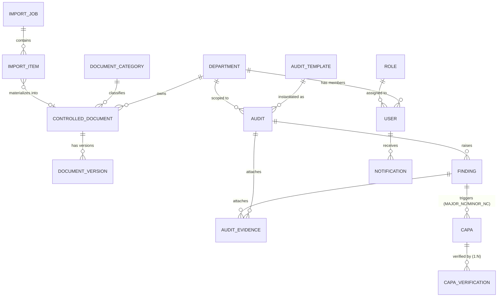

# EMSI Internship Factsheet — AuditTecpap (TECPAP Audit Platform)

> Source material for the internship presentation and report. This document does not
> contain slides or report text — only verified facts extracted from the repository,
> plus the student-provided information below. Every claim in Part B is checked
> against the actual code as of this writing; anything that could not be verified is
> explicitly marked **NOT VERIFIED**.

---

## PART A — Student-provided information

*(To be filled in by the student — copied here as-is, not invented.)*

| Field | Value |
|---|---|
| Student(s) | [full names, EMSI program: 4th year IA & Big Data, class/group] |
| Academic year | [2025–2026] |
| EMSI campus | [Casablanca / ...] |
| Host company | TECPAP — [one-line description of the company, sector, location] |
| Company supervisor | [name, title] |
| EMSI academic supervisor | [name] |
| Internship period | [start date → end date] |
| Presentation duration | [e.g., 15 min + 5 min Q&A] |
| Language (presentation & report) | [French / English] |
| Report target length | [e.g., ~20 pages, short and clear] |
| Slide target count | [e.g., 12–15 slides] |

**Context/problem before the project (student's words):**
[how audits/documents/CAPA were handled before: paper, Excel, Drive, email...]

**Personal contribution / role in the project:**
[what I did specifically]

**Anything the jury must see:**
[...]

> Note: `docs/SAD-TECPAP-Audit-Platform.md` (a pre-implementation architecture draft
> dated 2026-07-22) independently describes the host company as "TECPAP — Packaging
> manufacturer, Bouskoura, Morocco." This is repository content, not student input —
> the student should confirm it against what TECPAP itself told them before using it.

---

## PART B — Extracted from the repository

### B1. Project summary

**Problem statement.** Before this platform, TECPAP's quality/audit activity ran on
disconnected tools: legacy documents lived on Google Drive and shared folders,
checklists and corrective-action follow-up were manual, and there was no single
system tying an audit finding to the corrective action it produced, to the evidence
proving it was fixed, to a record of who verified it and when.

**Solution statement.** AuditTecpap is a single web application covering the
document → audit → finding → CAPA → verification → closure loop end-to-end:
controlled documents are versioned and approved; audits are executed against
published templates; a failing/non-conforming finding can automatically generate a
CAPA; the CAPA owner submits evidence; an Audit Manager verifies it (every attempt
kept, not just the latest); once effective, the CAPA closes. A manual, user-triggered
import pipeline lets the legacy Google Drive document set be brought in under this
same governance instead of being replaced by a second parallel system.

**Key objectives verified in code:**
- Role-based, department-scoped access control enforced server-side on every request (`PermissionsGuard` + `RolesGuard` + `DepartmentScopeGuard`, `apps/api/src/app.module.ts`).
- Versioned, approvable controlled documents with full-text search (`ControlledDocument`/`DocumentVersion`, Postgres `tsvector`).
- A findings→CAPA rule that is automatic for non-conformities, not discretionary (`AUTO_CAPA_SEVERITIES`, `capa-findings.service.ts`).
- CAPA verification kept as full history (1:N), not overwritten, so repeated failed attempts are never lost (`CapaVerification`, Prisma schema).
- A manual (non-automatic) legacy-document import pipeline with human review before anything becomes an official document (`ImportJob`/`ImportItem`, `import-review.service.ts`).
- Bilingual (FR/EN) in-app + email notifications driven by one shared template catalog (`packages/config/src/notification-templates.ts`).

### B2. Actors & roles

Verified against `packages/config/src/roles.ts` (`SYSTEM_ROLES`) and `permissions.ts`.

| Role | `isGlobal` | Responsibilities (verified) | Representative permission keys |
|---|---|---|---|
| **Administrator** | true | Full platform governance: all permissions, incl. users/roles/permissions/departments. | `ALL_PERMISSIONS` (every key in the catalog) |
| **Audit Manager** | true | Runs the audit programme end-to-end: creates/publishes templates, schedules and executes audits, approves/returns them, **verifies CAPA completion**, reviews effectiveness, manages documents/categories, governs Google Drive/legacy imports. | `audits.validate`\*, `capas.verify`, `capas.effectiveness_review`, `capas.close`, `documents.approve`, `documents.publish`, `imports.start`, `imports.review` |
| **Pilot** | **false** (department-scoped) | Executes corrective-action work for **their own department only**: reads audits/findings assigned to them, creates/updates findings, submits CAPA work and evidence, responds to CAPA rework, uploads documents for approval. **Cannot** validate audits, verify CAPAs, or start/review imports. | `findings.create`, `capas.submit`, `capas.rework`, `capa_actions.complete`, `documents.create`, `imports.read` (read-only) |

\* the actual permission key in the seeded catalog is `audits.approve`/`audits.review`; `MANAGER_PERMISSIONS` also lists a legacy `audits.validate` key — see Limitations (B10) for a note on stale/duplicate keys.

Confirmed in code:
- **Audit Manager performs audits and verifies CAPA** — `capas.verify` is granted to `MANAGER_PERMISSIONS` only; a dedicated regression test (`capa-verify.rbac.spec.ts`) asserts Pilots never hold it.
- **Pilots are department-scoped** — `Role.isGlobal = false` only for Pilot; `DataScope` (resolved from the JWT) is injected into every repository query via `departmentScopeWhere()`, so a Pilot's queries are structurally restricted to their own `departmentId`.
- **Administrator** is a distinct, non-business-operational role: full permission set, but the seeded default password/email come from `SEED_ADMIN_EMAIL`/`SEED_ADMIN_PASSWORD` env vars (not printed here).

**The six departments** (`packages/config/src/constants.ts`, `DEPARTMENTS`):

| Code | Name |
|---|---|
| `PROD` | Production |
| `QUAL` | Quality |
| `PUR` | Purchasing |
| `HR` | Human Resources |
| `LOG` | Logistics |
| `HYG` | Hygiene |

### B3. Functional modules (current sidebar/routes only)

Verified against `apps/web/src/lib/navigation.ts` and each route's backing API module. Removed modules (Settings, Processes, Business Objects, KPIs, Risks) are excluded, as instructed.

| Name | Purpose | Main route | Main backend module |
|---|---|---|---|
| Dashboard | Role-aware KPI overview (documents, audits, CAPA workload) | `/dashboard` | `modules/dashboard` |
| Workspace | Personal "my work" landing page (my audits, my CAPAs, my imports…) | `/workspace` | `modules/productivity` (`workspace.service.ts`) |
| Tasks | Personal task list | `/tasks` | `modules/productivity` (`task.service.ts`) |
| Calendar | Personal deadline calendar (documents, findings, CAPAs, risk reviews) | `/calendar` | `modules/productivity` (`calendar.service.ts`) |
| Bookmarks | User's saved/bookmarked documents | `/bookmarks` | `modules/documents` (`document-bookmarks.service.ts`) |
| Documents | Controlled-document library: versioning, approval, search | `/documents` | `modules/documents` |
| Document insights | Aggregate analytics over the document library | `/documents/insights` | `modules/documents` (`document-insights.service.ts`) |
| Templates | Audit template builder (sections → questions), Excel import, publish/version | `/audit-templates` | `modules/audit-templates` |
| Audits | Schedule, execute, approve/return audits | `/audits` | `modules/audits` |
| CAPA | Corrective/preventive action tracking, root-cause analysis, verification, effectiveness review | `/capas` | `modules/capa` |
| Departments | Manage the 6 departments | `/admin/departments` | `modules/departments` |
| Categories | Manage document categories | `/admin/categories` | `modules/document-categories` |
| Import | Manual document import (upload / server folder / Google Drive) with review queue | `/import` | `modules/import` |
| Users | User accounts, role/department assignment | `/admin/users` | `modules/users` |
| Roles | Role definitions + permission assignment | `/admin/roles` | `modules/roles` |
| Permissions | Read-only permission catalog view | `/admin/permissions` | `modules/permissions` |
| Audit log | Append-only administrative action log | `/admin/audit-log` | `modules/audit-log` |

Not in the sidebar but present and reachable (verified): `/search` (global search), `/notifications`, `/login`.

### B4. Key workflows

**1. Document import pipeline** (`apps/api/src/modules/import`):
1. Source selected: `UPLOAD` (browser file/folder), `LOCAL` (server-mounted folder), or `GOOGLE_DRIVE` (configured folder, manual trigger only).
2. Scan → each source file enumerated as a `ScannedFile` (name, path, mime type, bytes).
3. Checksum — SHA-256 of the file bytes computed and stored on the `ImportItem`.
4. Parse — format-specific parser (Word/Excel/PDF/PowerPoint) extracts text/metadata; Google-native files (Docs/Sheets/Slides) are exported to the OOXML equivalent first, never downloaded raw.
5. Classification — keyword-based department/category/process inference against the real seeded department and category codes, with a confidence score.
6. Duplicate detection — checksum match → flagged `DUPLICATE`; matching document code → flagged for `REPLACE_VERSION`.
7. Human review (`AWAITING_REVIEW`) — a reviewer approves, rejects, merges, or replaces a version; nothing is auto-approved except the same-status shortcut when a job has zero items awaiting review.
8. On approval → materializes into a `ControlledDocument` + first `DocumentVersion` (or an `AuditTemplate` if the source was a detected audit-checklist spreadsheet).

**2. Document approval — Audit Manager vs Pilot upload** (`documents.service.ts`, comment: *"TECPAP rule"*):
- Audit Manager upload → document status is **immediately `APPROVED`**.
- Pilot upload → document starts as `DRAFT` ("pending approval") and a `DOCUMENT_AWAITING_APPROVAL` notification is sent to all Audit Managers.
- On `APPROVED`/`PUBLISHED` → the uploader is notified (`DOCUMENT_APPROVED`, unless they approved their own document).
- On rejection (`OBSOLETE` from a `DRAFT`) → the uploader is notified (`DOCUMENT_REJECTED`).

**3. Audit lifecycle** — `AuditStatus` enum + verified transitions (`audits.service.ts`):
```
PLANNED --start--> IN_PROGRESS --submit--> SUBMITTED
IN_PROGRESS/RETURNED --answer--> (same status, autosaved)
SUBMITTED/UNDER_REVIEW --approve--> APPROVED --complete--> COMPLETED
SUBMITTED/UNDER_REVIEW --return--> RETURNED --start--> IN_PROGRESS (loop)
```
(`UNDER_REVIEW` exists in the enum; the service's `approve`/`return` guards accept both `SUBMITTED` and `UNDER_REVIEW` as the pre-state.)

**4. Finding → auto-CAPA rule** (`capa-findings.service.ts`, `AUTO_CAPA_SEVERITIES = ['MAJOR_NC', 'MINOR_NC']`):
1. A finding is created with severity `OBSERVATION | OFI | MINOR_NC | MAJOR_NC`.
2. If severity is `MAJOR_NC` or `MINOR_NC` (and no CAPA decision/CAPA already exists — idempotent) → a CAPA is auto-created at status `ASSIGNED`, priority `HIGH` for `MAJOR_NC` / `MEDIUM` for `MINOR_NC`.
3. Owner resolution order: `ProcessAssignment` with role `OPERATOR` on the finding's process → finding's `responsibleUserId` → audit's `auditorId` → audit's `createdById` (the Audit Manager who scheduled it) → none.
4. The resolved owner receives a `CAPA_ASSIGNED` notification.

**5. CAPA lifecycle** — `CapaStatus` enum (12 values) and the exact transition table (`packages/config/src/capa.ts`, `CAPA_TRANSITIONS`):
```
DRAFT              → ROOT_CAUSE_ANALYSIS, ASSIGNED, CANCELLED
ROOT_CAUSE_ANALYSIS→ ACTION_PLAN, CANCELLED
ACTION_PLAN        → IN_PROGRESS, CANCELLED
ASSIGNED           → IN_PROGRESS, CANCELLED
IN_PROGRESS        → EVIDENCE_UPLOADED, PENDING_VERIFICATION, ACTION_PLAN, CANCELLED
EVIDENCE_UPLOADED  → PENDING_VERIFICATION, IN_PROGRESS
PENDING_VERIFICATION → VALIDATED, RETURNED, PENDING_EFFECTIVENESS, IN_PROGRESS
RETURNED           → IN_PROGRESS                      ← rework loop
VALIDATED          → CLOSED, IN_PROGRESS
PENDING_EFFECTIVENESS → CLOSED, IN_PROGRESS, ACTION_PLAN
CLOSED / CANCELLED → (terminal)
```
- **Verification is 1:N, not 1:1**: `Capa.verifications CapaVerification[]` — every verification attempt (`PASSED`/`FAILED`) is preserved as its own row (`verifiedById`, `result`, `notes`, `verifiedAt`); a `RETURNED` CAPA can be reworked and re-verified any number of times without losing prior attempts.
- Notifications: `CAPA_VALIDATED` on a `PASSED` verification, `CAPA_RETURNED` on `FAILED`; the notification's dedup key uses the new verification's own id (not the CAPA id), so repeated attempts on the same CAPA within 24h are never silently swallowed.

**6. Notification flow** (`packages/config/src/notification-templates.ts`): 14 typed templates, each with EN + FR text and `{param}` interpolation, rendered server-side (English, for the stored fallback + email) and client-side (locale-aware, from `type`+`params`) via the same catalog: `CAPA_ASSIGNED`, `CAPA_RETURNED`, `CAPA_VALIDATED`, `CAPA_DUE`, `CAPA_OVERDUE`, `AUDIT_STARTING_SOON`, `AUDIT_OVERDUE`, `DOCUMENT_AWAITING_APPROVAL`, `DOCUMENT_APPROVED`, `DOCUMENT_REJECTED`, `DOCUMENT_REVIEW_OVERDUE`, `CERTIFICATE_EXPIRING`, `KPI_THRESHOLD_EXCEEDED`, `IMPORT_REQUIRES_REVIEW`. A daily cron (`@Cron(EVERY_DAY_AT_6AM)`, `reminder.service.ts`) actually fires the document/certificate-expiry and overdue-CAPA/audit reminders — this is wired, not aspirational.

### B5. Architecture

**Tech stack** (versions read from the actual `package.json`/Dockerfiles):

| Layer | Technology | Version |
|---|---|---|
| Backend framework | NestJS | `^10.4.15` (`@nestjs/core`) |
| ORM | Prisma | `^5.22.0` |
| Database | PostgreSQL | `16-alpine` (docker-compose image tag) |
| Object storage | MinIO | `latest` (docker-compose image tag) |
| Frontend framework | Next.js (App Router) | `^15.1.3` |
| UI runtime | React | `^19.0.0` |
| Styling | Tailwind CSS | `^3.4.17` |
| UI primitives | Radix UI + custom shadcn-style components (`@tecpap/ui`) | Radix `^1.1.x`/`^2.1.x` |
| Icons | lucide-react | `^0.469.0` |
| Validation (API) | class-validator | `^0.14.1` |
| Validation (shared env) | zod | `^3.24.1` |
| Google Drive client | googleapis | `^178.1.1` |
| Test runner | Vitest | `^2.1.8` (both apps) |
| E2E tooling | Playwright | configured (`playwright.config.ts`) — **no e2e spec files exist yet** |
| Monorepo tooling | pnpm workspaces + Turborepo | pnpm `9.15.4`, turbo `^2.3.3` |
| Container base | `node:20-alpine` | both Dockerfiles |

**Monorepo structure** (`pnpm-workspace.yaml`: `apps/*`, `packages/*`):

| Package | Role |
|---|---|
| `apps/api` | NestJS backend — 23 feature/infra modules under `src/modules` |
| `apps/web` | Next.js frontend — App Router, 29 page routes |
| `packages/config` | Shared runtime constants: RBAC catalog, roles, departments, CAPA/import rules, notification templates, env schema |
| `packages/types` | Shared TypeScript DTOs/enums used by both apps |
| `packages/ui` | Shared design-token CSS + Tailwind preset + a few cross-app UI primitives |
| `packages/eslint-config`, `packages/tsconfig` | Shared lint/TS presets |

**Deployment topology** (`docker-compose.yml`): `postgres` (16-alpine, healthchecked) ← `api` (NestJS, runs `prisma migrate deploy` + seed + `node dist/main.js` on boot, depends on postgres healthy) and `minio` (S3-compatible, healthchecked, used by `api` for all binary/document storage) ← `web` (Next.js, depends on `api` healthy, calls it via `NEXT_PUBLIC_API_URL`). An optional `pgadmin` service is gated behind the `dev` compose profile. No reverse proxy, Redis, message queue, or virus-scanning service is present in this compose file (see B10).

**Authentication design**: JWT access token + a separate, **rotating** (single-use) refresh token (`RefreshToken` Prisma model with a revocation/replacement chain — `auth.service.ts` comment: *"token issuance with refresh-token rotation + revocation"*). Default TTLs (`packages/config/src/env.ts`): access `900`s (15 min), refresh `604800`s (7 days) — both overridable by env var. RBAC is enforced by three chained guards (`PermissionsGuard`, `RolesGuard`, `DepartmentScopeGuard`) registered in `app.module.ts`; a `DataScope` (role + `departmentId`) is resolved per-request and applied as a mandatory `where` filter in repository queries (`departmentScopeWhere()`), so scoping happens even if a route-level permission check were missed. On the frontend, both tokens are stored in `localStorage` (see B10) and a shared refresh-mutex (`apps/web/src/lib/api.ts`) ensures concurrent 401s trigger exactly one refresh call, required because the backend's refresh token is single-use.

**Google Drive integration**: manual import source only — a user explicitly starts a scan (`POST /import/scan` with `source: GOOGLE_DRIVE`); there is no polling, webhook, or scheduled sync anywhere in the code. Authenticates via a server-side Google **service account** (`GOOGLE_DRIVE_SERVICE_ACCOUNT_JSON` env var), scoped read-only (`drive.readonly`). The service account must be shared on the target Drive folder (`GOOGLE_DRIVE_FOLDER_ID`); no end-user OAuth flow exists.

### B6. Data model

Core models actually used by the QMS workflow (of 45 total Prisma models / 22 enums):

| Model | Key fields | Main relations |
|---|---|---|
| `User` | email, passwordHash, roleId, departmentId? | → `Role`, → `Department` |
| `Role` | name, slug, isSystem, isGlobal | ↔ `Permission` (M:N) |
| `Department` | code (unique), name | ← `User`, ← `ControlledDocument`, ← `Audit`, ← `Capa` |
| `DocumentCategory` | code (unique), name | ← `ControlledDocument` |
| `ControlledDocument` | code (unique), status, departmentId, categoryId, currentVersionId | → `DocumentVersion[]`, → `Department`, → `DocumentCategory` |
| `DocumentVersion` | version, revision, fileKey, checksum (immutable) | → `ControlledDocument` |
| `AuditTemplate` | name, status, version | → `AuditTemplateSection[]` → `AuditTemplateQuestion[]` |
| `Audit` | title, templateId, departmentId, status | → `AuditTemplate`, → `AuditAnswer[]`, → `Finding[]`, → `AuditEvidence[]` |
| `Finding` | severity (enum), status, capaDecision | → `Audit`, ← `Capa[]` |
| `Capa` | referenceNumber (unique), status, priority, findingId? | → `Finding?`, → `CapaAction[]`, → `CapaVerification[]` (1:N) |
| `CapaVerification` | result (PASSED/FAILED), verifiedById, verifiedAt | → `Capa` (append-only history) |
| `AuditEvidence` | fileKey, auditId?, findingId? | → `Audit?`, → `Finding?` |
| `Notification` | type, category, params (Json?), readAt | → `User` |
| `ImportJob` | source (LOCAL/GOOGLE_DRIVE/UPLOAD), status | → `ImportItem[]` |
| `ImportItem` | checksum, status, classification (Json), importedEntityId? | → `ImportJob`, ⇢ `ControlledDocument` (on approval) |



### B7. Project metrics (computed)

| Metric | Value | How computed |
|---|---|---|
| Prisma models | **45** | `grep -c "^model " schema.prisma` |
| Prisma enums | **22** | `grep -c "^enum " schema.prisma` |
| API modules | **23** | folders under `apps/api/src/modules` |
| REST endpoints | **174** | count of `@Get/@Post/@Patch/@Put/@Delete(` across all `*.controller.ts` |
| Frontend page routes | **29** file-based routes (**30** incl. the framework-generated `/_not-found`, per `next build` output) | `page.tsx` file count / build output |
| API tests | **213 / 213 passing**, 35 files | `pnpm --filter @tecpap/api test` (vitest) |
| Web tests | **24 / 24 passing**, 4 files | `pnpm --filter @tecpap/web test` (vitest) |
| API typecheck / lint | clean, 0 errors / 0 warnings | `tsc --noEmit`, `eslint --max-warnings 0` |
| Web typecheck / lint | clean, 0 errors / 0 warnings | `tsc --noEmit`, `eslint --max-warnings 0` |
| API production build | succeeds (`nest build`) | run |
| Web production build | succeeds (`next build`), 25 routes rendered | run |
| Lines of code — API source (excl. tests) | **11,231** | `apps/api/src/**/*.ts` minus `*.spec.ts` |
| Lines of code — API tests | 2,715 | `apps/api/src/**/*.spec.ts` |
| Lines of code — Web source (excl. tests) | **8,494** | `apps/web/src/**/*.{ts,tsx}` minus `*.test.*` |
| Lines of code — Web tests | 397 | `apps/web/src/**/*.test.{ts,tsx}` |
| Lines of code — shared packages (`config`/`types`/`ui`) | 2,710 | `packages/*/src/**/*.ts` |
| **Total source LOC (excl. tests)** | **22,435** | sum of the three "excl. tests" rows above |
| Git commits | **4** | `git log --oneline \| wc -l` |
| Git first/last commit date | 2026-07-23 → 2026-08-01 | `git log --format=%ad --date=short` |
| Git contributors | **1** (`TECPAP Tech Lead`) | `git log --format=%an \| sort -u` |
| Uncommitted files at time of writing | **155** (modified + untracked) | `git status --porcelain \| wc -l` — see B8 note |

### B8. Timeline

**Important, verified caveat:** the git history contains only **4 commits** (2026-07-23 to 2026-08-01, single author). Substantially more work exists in the working tree than in git history — 155 files are currently modified/untracked. The phase sequence below is reconstructed from **in-code phase labels** (comments in the Prisma schema and services, e.g. `// Phase 6 — CAPA & Continuous Improvement`) and the 4 real commit messages, cross-checked against what modules/features actually exist today. **Exact calendar dates for anything beyond the 4 commits are NOT VERIFIED** — the student must supply real working dates from their own record for the Gantt chart.

| Phase (as labeled in code/commits) | Date | Deliverables (verified present in code) |
|---|---|---|
| Initial setup | commit `bac1a70`, **2026-07-23** | Monorepo scaffold, authentication, RBAC, department seeding |
| "Phase 6 — CAPA and continuous improvement" | commit `9f0d8d1`, **2026-08-01** | CAPA model, actions, root-cause analysis, verification |
| "Phase 7 — legacy QMS import engine" | commit `c3b5d80`, **2026-08-01** | Import pipeline (parsers, classification, duplicate detection, review) |
| "Phase 7.5 — workflow and productivity" | commit `5a04d23`, **2026-08-01** | Notifications, tasks, calendar, workspace, recent items |
| "Phase 7.6 — Enterprise document experience" | NOT VERIFIED (no commit) | Document comments, acknowledgements, collections, bookmarks, compare/viewer (present in code, uncommitted) |
| "Phase 7.7 — TECPAP workflow" | NOT VERIFIED (no commit) | CAPA `ASSIGNED`/`EVIDENCE_UPLOADED`/`RETURNED`/`VALIDATED` states, pilot/manager submit-rework loop (present in code, uncommitted) |
| RBAC/data-scope hardening, silent token refresh, CAPA verification history made 1:N, CAPA verification notifications | NOT VERIFIED (no commit) | Present in code (e.g. `CapaVerification` is an array relation with no unique constraint on `capaId`) |
| Notification localization (EN/FR) | NOT VERIFIED (no commit) | `notification-templates.ts`, `Notification.params` column, locale-aware rendering |
| Google Drive manual import | NOT VERIFIED (no commit) | `GoogleDriveProvider`, `GOOGLE_DRIVE_*` env vars |
| Navigation cleanup (Settings/Processes/Business Objects/KPIs/Risks removed from UI) | NOT VERIFIED (no commit) | Current `navigation.ts` has no such items; corresponding routes absent from `apps/web/src/app` |

### B9. Technical challenges & solutions

| # | Problem | Decision | Result (verified) |
|---|---|---|---|
| 1 | A CAPA's verification history was overwritten on re-verification, losing evidence of prior failed attempts. | Changed `CapaVerification` from a 1:1 to a **1:N** relation (`Capa.verifications: CapaVerification[]`); service always `create()`s, never `upsert()`s. | Every verification attempt is a permanent row; `RETURNED` → rework → re-verify preserves the full trail. |
| 2 | A repeated verification on the same CAPA within the notification dedup window (24h) would be silently swallowed by the generic dedup rule (`type`+`entityId`+`userId`). | Used the **new verification row's own id** as the notification's `entityId`, not the CAPA's id. | Two distinct verification attempts on the same CAPA the same day both notify correctly. |
| 3 | The backend rotates (single-uses) refresh tokens; naive concurrent 401 handling on the frontend would fire multiple refresh calls and fail. | A shared **refresh-mutex promise** in `apps/web/src/lib/api.ts` — the first 401 starts the refresh, concurrent callers await the same promise. | No refresh-stampede; matches the single-use backend contract. |
| 4 | Adding Google Drive as an import source risked a second, parallel import code path. | `GoogleDriveProvider` implements the same `ImportSourceProvider` interface as the existing local-folder provider; returns the identical `ScannedFile[]` shape. | Zero changes to parsing/classification/duplicate-detection/review — Drive is just another source. |
| 5 | Fully-automatic document classification (department/category) on import risks silent misfiling. | Deterministic keyword classification with a **confidence score and a review gate**; anything below threshold or missing a required field must be reviewed by a human before materializing. | No document is created without a resolved department + category, verified or overridden by a reviewer. |
| 6 | Department-scoped authorization must hold even if a controller forgets a permission check. | `DataScope` resolved from the JWT is injected and applied as a **mandatory `where` filter** inside repository/service methods, not only at the guard layer. | Defence-in-depth: a missed `@Permissions()` decorator still cannot leak cross-department rows. |
| 7 | Removing the generic Processes/Business-Objects/KPIs/Risks modules risked breaking the `Process` model, which turned out to be a real dependency of Documents, Audits, and CAPA (via `processId` foreign keys) and of the Audits page's process selector. | Investigated every dependency first; kept the `Process` and `BusinessObject` backend modules and Prisma models intact (the latter because `ImportModule` structurally imports `BusinessObjectsModule`); removed only the now-orphaned `Kpis`/`ProcessRisks`/`ProcessWorkspace` modules and their frontend pages. | Documents/Audits/CAPA/Import continued working (tests passing) after the UI cleanup. |

### B10. Limitations & perspectives

**Verified known limitations:**
- **Access and refresh tokens are stored in browser `localStorage`** (`apps/web/src/lib/api.ts`), not an httpOnly cookie — readable by any script running on the page (XSS exposure).
- **No dedicated Google Drive file-identity field.** Duplicate detection for imports is checksum- and document-code-based only; re-importing an edited Drive file is only recognized as "the same document" if it still carries the same embedded code.
- **Google Drive connectivity has not been exercised against real credentials** in this environment — the integration is covered by mocked-API unit tests only.
- **`ImportReviewService`'s reviewer-override department is not checked against the reviewing user's own `DataScope`.** Harmless today because only global roles (Administrator, Audit Manager) can review imports, but would need closing before any department-scoped role is ever granted import-review rights.
- **A stale permission surface**: `MANAGER_PERMISSIONS`/`PILOT_PERMISSIONS` still list `business_objects.*`, `kpis.*`, `risks.*` keys from the removed generic modules — `business_objects.*` is still enforced (that module was kept for an internal dependency reason); `kpis.*`/`risks.*` are now inert since their controllers were deleted.
- **A "Run demo" import action exists in production code** (`POST /import/demo`, gated by the same `imports.start` permission as real imports) — it generates sample Word/Excel/PDF/PowerPoint files and imports them; nothing in the code disables it outside development.
- **No E2E test suite exists** despite Playwright being configured (`playwright.config.ts` present, zero spec files) and only one API integration smoke test (`test/smoke.e2e-spec.ts`).
- **No reverse proxy / TLS termination, message queue, or virus-scanning service** appear in `docker-compose.yml` (an earlier architecture draft in `docs/SAD-TECPAP-Audit-Platform.md` had planned these; they were not built).
- Document-expiry and CAPA/audit-overdue reminders **are** actually wired (a real daily cron, `reminder.service.ts`), which is worth stating positively rather than as a gap.

**Realistic future improvements (QMS-scoped):**
1. Move tokens to an httpOnly, secure cookie and drop `localStorage` storage.
2. Add a `driveFileId`-style stable identity so re-importing an edited Drive file is recognized as a new version of the same source, not an unrelated file.
3. Close the `ImportReviewService` DataScope gap before any department-scoped role is given import-review rights.
4. Remove the stale `kpis.*`/`risks.*` permission keys from the RBAC catalog now that their modules are gone.
5. Gate or remove the "Run demo" import action in production deployments.
6. Add a minimal E2E smoke path (login → create a document → run an audit → raise a finding → close a CAPA) now that Playwright is already wired but unused.

### B11. Screenshot shot list

Confirmed: a non-production seed path exists with clearly separated sample data
(`apps/api/prisma/seed.ts` → `seedSystem()` always runs configuration-only seeding;
`seedDemo()` runs **only** when `NODE_ENV !== 'production'`, adding sample users and
business data). So screenshots taken against a dev/staging environment will show
real-looking sample data, not empty states — as long as the environment used for
screenshots was seeded with `NODE_ENV` unset to `production`.

| # | Route | What must be visible | Login as |
|---|---|---|---|
| 1 | `/login` | Branded login screen | — |
| 2 | `/dashboard` | KPI cards (documents, audits, CAPA workload) | Audit Manager |
| 3 | `/documents` | Document list with status badges, department/category filters | Audit Manager |
| 4 | `/documents/[id]` | A document's version history + approval state | Audit Manager |
| 5 | `/import` | Import dashboard incl. the "From Google Drive" action | Administrator or Audit Manager |
| 6 | `/import/[id]` | Review queue for a completed import job (classification, confidence, approve/reject) | Audit Manager |
| 7 | `/audit-templates` | Template list / builder (sections → questions) | Audit Manager |
| 8 | `/audits/[id]` | An audit mid-execution or awaiting approval | Audit Manager or Pilot |
| 9 | `/capas/[id]` | A CAPA showing status, actions, and the **verification history list** (1:N) | Audit Manager |
| 10 | `/notifications` | The localized notification feed (switch locale to show FR + EN) | any |

### B12. Design inputs

**Brand tokens** — `packages/ui/src/styles/tokens.css` (HSL channel values, light theme):

| Token | Role | HSL value |
|---|---|---|
| `--primary` | Actions, active nav, key CTAs (Deep Brown) | `26 30% 22%` |
| `--secondary` | Accents (Leaf Green) | `84 60% 29%` |
| `--background` | App canvas | `0 0% 100%` |
| `--foreground` | Body text | `25 30% 11%` |
| `--muted` | Muted surfaces | `30 14% 96%` |
| `--destructive` | Errors/destructive actions | `0 65% 47%` |
| `--border` / `--input` | Dividers, input borders | `33 16% 89%` |
| `--radius` | Corner radius | `0.625rem` (10px) |

A structural `.dark` theme block also exists (dark-mode tokens defined) though the
app does not expose a theme switcher in the sidebar (NOT VERIFIED whether dark mode
is reachable anywhere in the current UI).

**Typography** (`packages/ui/tailwind-preset.js`): sans = `Inter`, mono = `JetBrains
Mono`, loaded via Google Fonts in `apps/web/src/app/layout.tsx`.

**Image assets present in the repository:**
- `apps/web/public/tecpap-building.jpeg` — referenced from `apps/web/src/app/(auth)/login/page.tsx`. This is the only image asset inside the application (`apps/web/public`).
- No vector/SVG TECPAP logo file exists in the repository — NOT VERIFIED whether TECPAP has a separate logo file the student should add for the presentation.
- Two files at the repository root, `tecpap_pic.jpeg` and `setting_pic.jpeg`, are **not referenced by any application code** — they are not part of the shipped product and should not be presented as app screenshots.

**For reference (EMSI identity, provided by the student's task, not from this repository):** green primary, dark grey, small red-orange accent.

---

*Generated by reading the repository only. No application code, schema, or config was modified to produce this document.*
