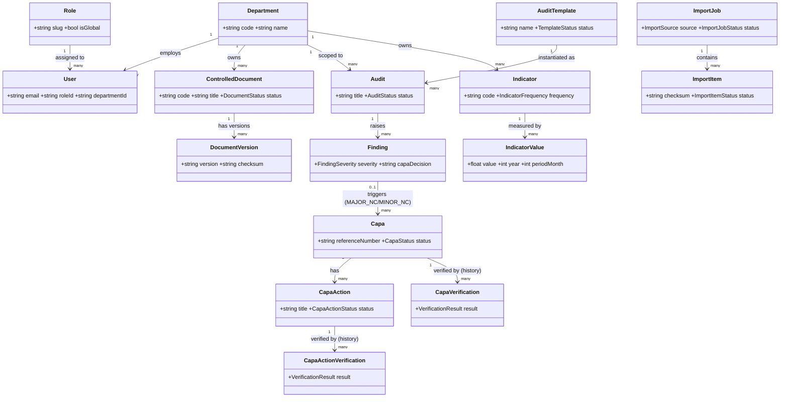
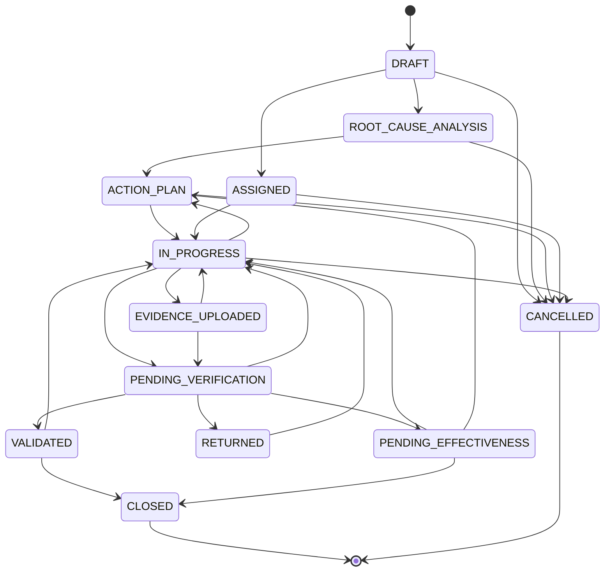
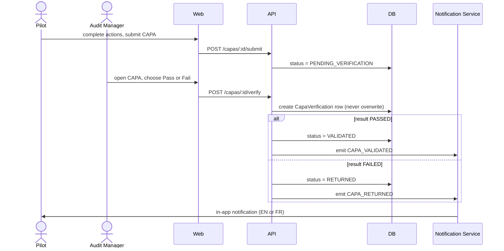
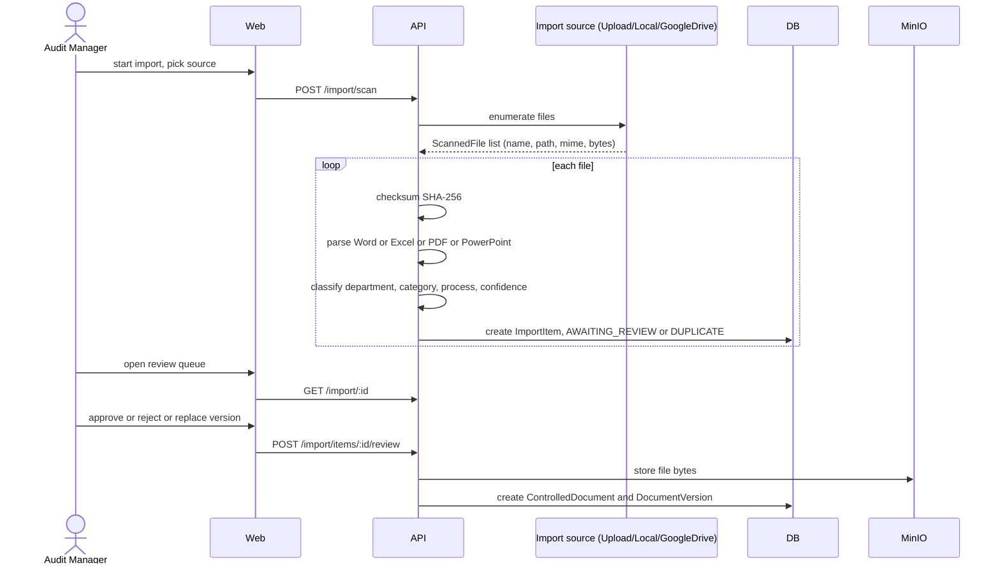
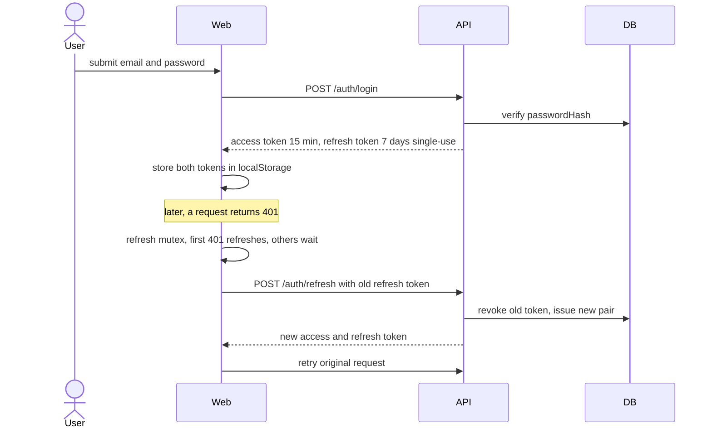
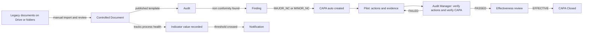
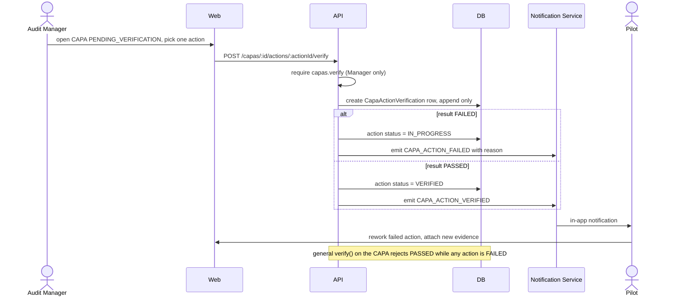

# EMSI Internship Factsheet — AuditTecpap (TECPAP Audit Platform)

> Source material for the internship presentation and report. This document does not
> contain slides or report text — only verified facts extracted from the repository,
> plus the student-provided information below. Every claim in Part B is checked
> against the actual code as of this rewrite (2026-09-12); anything that could not be
> verified is explicitly marked **NOT VERIFIED**. This file replaces the previous
> version wholesale — see `docs/internship/changelog.md` for what changed and why.

---

## PART A — Student-provided information

*(To be filled in by the student — copied here as-is, not invented.)*

| Field | Value |
|---|---|
| Student(s) | [full names, EMSI program: 4th year IA & Big Data, class/group] |
| Academic year | [2025–2026] |
| EMSI campus | [Casablanca / ...] |
| Host company | TECPAP — [one-line description of the company, sector, location] |
| Company supervisor | [name, title] |
| EMSI academic supervisor | [name] |
| Internship period | [start date → end date] |
| Presentation duration | [e.g., 15 min + 5 min Q&A] |
| Language (presentation & report) | [French / English] |
| Report target length | [e.g., ~20 pages, short and clear] |
| Slide target count | [e.g., 12–15 slides] |

**Context/problem before the project (student's words):**
[how audits/documents/CAPA were handled before: paper, Excel, Drive, email...]

**Personal contribution / role in the project:**
[what I did specifically]

**Anything the jury must see:**
[...]

> Note: `docs/SAD-TECPAP-Audit-Platform.md` (a pre-implementation architecture draft
> dated 2026-07-22) independently describes the host company as "TECPAP — Packaging
> manufacturer, Bouskoura, Morocco." This is repository content, not student input —
> the student should confirm it against what TECPAP itself told them before using it.
> As instructed, this draft is not used as a source of truth anywhere in Part B below.

---

## PART B — Extracted from the repository

### B1. Project summary

**Problem statement.** TECPAP's quality/audit activity previously ran on disconnected
tools: legacy documents lived on Google Drive and shared folders, checklists and
corrective-action follow-up were manual, and no single system tied an audit finding
to the corrective action it produced, to the evidence proving it was fixed, to a
record of who verified it and when, or to the process indicators that should reflect
whether the fix actually worked.

**Solution statement.** AuditTecpap is a single web application covering the
document → audit → finding → CAPA → verification → closure loop end-to-end, now
extended with department-level performance indicators: controlled documents are
versioned and approved; audits are executed against published templates; a
failing/non-conforming finding automatically generates a CAPA; the CAPA owner submits
evidence per corrective action; an Audit Manager can verify each action individually
as well as the CAPA as a whole (every verification attempt kept, never overwritten);
once effective, the CAPA closes. Departments track monthly/quarterly/semi-annual/
annual indicators against thresholds, feeding a role-aware dashboard. A manual,
user-triggered import pipeline lets the legacy Google Drive document set be brought
in under this same governance instead of a second parallel system.

**Key objectives verified in code:**
- Role-based, department-scoped access control enforced server-side on every request (`PermissionsGuard`/`RolesGuard`/`DepartmentScopeGuard`, `apps/api/src/app.module.ts`); a `DataScope` resolved from the JWT is applied as a mandatory `where` filter in repository queries (`departmentScopeWhere()`), not only at the guard layer.
- Versioned, approvable controlled documents with full-text search (`ControlledDocument`/`DocumentVersion`, Postgres `tsvector`) plus server-side filtering by department/category/status/free text.
- A findings→CAPA rule that is automatic for non-conformities, not discretionary (`AUTO_CAPA_SEVERITIES`, `capa-findings.service.ts`).
- CAPA verification kept as full history at **both** the CAPA level (`CapaVerification`, 1:N) and, as of this rewrite, at the **individual action level** (`CapaActionVerification`, 1:N) — neither is ever overwritten.
- Department-level indicators (`Indicator`/`IndicatorValue`) evaluated against configurable thresholds (ON_TARGET/WARNING/CRITICAL/NO_DATA), feeding the dashboard and threshold-crossing notifications.
- A manual (non-automatic) legacy-document import pipeline with human review before anything becomes an official document (`ImportJob`/`ImportItem`, `import-review.service.ts`).
- Bilingual (FR/EN) in-app notifications driven by one shared template catalog, now 17 types (`packages/config/src/notification-templates.ts`).

### B2. Actors & roles

Verified against `packages/config/src/roles.ts` (`SYSTEM_ROLES`) and `permissions.ts`.
**Unchanged from the previous factsheet: still exactly three roles, no new role added.**

| Role | `isGlobal` | Responsibilities (verified) | Representative permission keys |
|---|---|---|---|
| **Administrator** | true | Full platform governance: all permissions, incl. users/roles/permissions/departments. | `ALL_PERMISSIONS` (every key in the catalog) |
| **Audit Manager** | true | Runs the audit programme end-to-end: creates/publishes templates, schedules and executes/approves/returns audits, verifies CAPA completion **and each individual CAPA action**, reviews effectiveness, manages documents/categories, defines/manages indicators, governs Google Drive/legacy imports. | `audits.approve`, `capas.verify`, `capas.effectiveness_review`, `capas.close`, `documents.approve`, `documents.publish`, `indicators.create`, `indicators.update`, `imports.start`, `imports.review` |
| **Pilot** | **false** (department-scoped) | Executes corrective-action work for **their own department only**: reads audits/findings assigned to them, creates/updates findings, submits CAPA work and evidence, responds to CAPA rework, uploads documents for approval, records/corrects indicator values. **Cannot** approve audits, verify CAPAs or individual actions, define indicators, or start/review imports. | `findings.create`, `capas.submit`, `capas.rework`, `capa_actions.complete`, `documents.create`, `indicators.values.create`, `imports.read` (read-only) |

Confirmed in code:
- **`capas.verify` (both general and per-action) is Manager-only** — granted to `MANAGER_PERMISSIONS` only; a Pilot cannot verify their own action, only rework it. Regression-tested (`capa-verify.rbac.spec.ts`).
- **Pilots are department-scoped** — `Role.isGlobal = false` only for Pilot.
- A stale permission surface persists: `MANAGER_PERMISSIONS`/`PILOT_PERMISSIONS` still list `business_objects.*`, `kpis.*`, `risks.*` keys from modules whose controllers were already removed before the previous factsheet was written — still true today, see B11.

**Departments defined in code** (`packages/config/src/constants.ts`, `DEPARTMENTS` — unchanged, still 6):

| Code | Name |
|---|---|
| `PROD` | Production |
| `QUAL` | Quality |
| `PUR` | Purchasing |
| `HR` | Human Resources |
| `LOG` | Logistics |
| `HYG` | Hygiene |

**Departments actually present in the live database today: 8** — the 6 above plus
`COM` (Commerce) and `EQUIP` (Équipements et Infrastructure), created at runtime
through the admin UI (departments are a normal manageable entity, not fixed to the
seed list). Screenshots taken against the current running environment will show 8
departments, not 6.

### B3. Functional modules

Verified against `apps/web/src/lib/navigation.ts` and each route's backing API module.
Removed modules (Settings, Processes, Business Objects, KPIs, Risks) remain excluded
from the UI, as before.

| Name | Purpose | Main route | Main backend module | vs previous factsheet |
|---|---|---|---|---|
| Dashboard | Role-aware KPI overview, now sectioned (Overview/Documents/Audits/CAPA/Indicators/Requires attention) | `/dashboard` | `modules/dashboard` | **CHANGED** — restructured |
| Workspace | Personal "my work" landing page | `/workspace` | `modules/productivity` | UNCHANGED |
| Tasks | Personal task list, auto-hides items completed 30+ days ago | `/tasks` | `modules/productivity` | **CHANGED** — added auto-cleanup |
| Calendar | Personal deadline calendar | `/calendar` | `modules/productivity` | UNCHANGED |
| Bookmarks | User's saved documents | `/bookmarks` | `modules/documents` | UNCHANGED |
| Documents | Controlled-document library: versioning, approval, search | `/documents` | `modules/documents` | **CHANGED** — search OR-clause extended to description/category/department name this round (this changelog's first draft mistakenly said it predated the round; corrected here after re-diffing against the factsheet commit) |
| Document insights | Aggregate analytics over the document library | `/documents/insights` | `modules/documents` | UNCHANGED |
| Indicators | Department indicator definitions, 12-month value grid, threshold status | `/indicators` | `modules/indicators` | **NEW** |
| Templates | Audit template builder, now with search/filter | `/audit-templates` | `modules/audit-templates` | **CHANGED** — search added |
| Audits | Schedule/execute/approve audits, now with search/filter | `/audits` | `modules/audits` | **CHANGED** — search added; evidence viewer bug fixed |
| CAPA | CAPA tracking, root-cause, per-action + general verification, evidence viewer | `/capas` | `modules/capa` | **CHANGED** — per-action verification and evidence viewer added |
| Departments | Manage departments | `/admin/departments` | `modules/departments` | UNCHANGED |
| Categories | Manage document categories | `/admin/categories` | `modules/document-categories` | UNCHANGED |
| Import | Manual document import with review queue | `/import` | `modules/import` | UNCHANGED (module byte-for-byte identical since the last factsheet) |
| Users | User accounts, role/department assignment | `/admin/users` | `modules/users` | UNCHANGED |
| Roles | Role definitions + permission assignment | `/admin/roles` | `modules/roles` | UNCHANGED |
| Permissions | Read-only permission catalog view | `/admin/permissions` | `modules/permissions` | UNCHANGED |
| Audit log | Append-only administrative action log | `/admin/audit-log` | `modules/audit-log` | UNCHANGED |

Not in the sidebar but present and reachable (verified): `/search` (global search),
`/notifications`, `/login` (visually refreshed this round, same behaviour).

### B4. Key workflows

**1. Document import pipeline** — `apps/api/src/modules/import` is byte-for-byte
unchanged since the previous factsheet:
1. Source selected: `UPLOAD` (browser file/folder), `LOCAL` (server-mounted folder), or `GOOGLE_DRIVE` (configured folder, manual trigger only).
2. Scan → each source file enumerated as a `ScannedFile` (name, path, mime type, bytes).
3. Checksum — SHA-256 of the file bytes, stored on the `ImportItem`.
4. Parse — format-specific parser (Word/Excel/PDF/PowerPoint); Google-native files are exported to the OOXML equivalent first, never downloaded raw.
5. Classification — keyword-based department/category/process inference against real seeded codes, with a confidence score.
6. Duplicate detection — checksum match → `DUPLICATE`; matching document code → `REPLACE_VERSION`.
7. Human review (`AWAITING_REVIEW`) — approve, reject, merge, or replace a version.
8. On approval → materializes into a `ControlledDocument` + first `DocumentVersion` (or an `AuditTemplate` if the source was a detected checklist spreadsheet).

**2. Document approval paths** (`documents.service.ts` — unchanged, "TECPAP rule" comment still present):
- Only Audit Manager / Administrator (`imports.start`, `documents.approve`) can start an import or approve a document; a Pilot can only upload (`documents.create`).
- Audit Manager upload → document status immediately `APPROVED`.
- Pilot upload → document starts `DRAFT`, and a `DOCUMENT_AWAITING_APPROVAL` notification goes to all Audit Managers.
- On `APPROVED`/`PUBLISHED` → the uploader is notified (`DOCUMENT_APPROVED`), unless they approved their own document.
- On rejection (`OBSOLETE` from `DRAFT`) → the uploader is notified (`DOCUMENT_REJECTED`).

**3. Audit lifecycle** (`AuditStatus`, `audits.service.ts` — unchanged):
```
PLANNED --start--> IN_PROGRESS --submit--> SUBMITTED
IN_PROGRESS/RETURNED --answer--> (same status, autosaved)
SUBMITTED/UNDER_REVIEW --approve--> APPROVED --complete--> COMPLETED
SUBMITTED/UNDER_REVIEW --return--> RETURNED --start--> IN_PROGRESS (loop)
```

**4. Finding → CAPA rule and owner resolution** (`capa-findings.service.ts`,
`AUTO_CAPA_SEVERITIES = ['MAJOR_NC', 'MINOR_NC']` — unchanged):
1. A finding is created with severity `OBSERVATION | OFI | MINOR_NC | MAJOR_NC`.
2. If severity is `MAJOR_NC` or `MINOR_NC` (idempotent — skipped if a CAPA decision/CAPA already exists) → a CAPA is auto-created at `ASSIGNED`, priority `HIGH` for `MAJOR_NC` / `MEDIUM` for `MINOR_NC`.
3. Owner resolution order: `ProcessAssignment` (role `OPERATOR`) on the finding's process → finding's `responsibleUserId` → audit's `auditorId` → audit's `createdById` → none.
4. The resolved owner receives `CAPA_ASSIGNED`.

**5. CAPA lifecycle** — `CapaStatus` (12 values) and `CAPA_TRANSITIONS`
(`packages/config/src/capa.ts`) are unchanged since the previous factsheet:
```
DRAFT              → ROOT_CAUSE_ANALYSIS, ASSIGNED, CANCELLED
ROOT_CAUSE_ANALYSIS→ ACTION_PLAN, CANCELLED
ACTION_PLAN        → IN_PROGRESS, CANCELLED
ASSIGNED           → IN_PROGRESS, CANCELLED
IN_PROGRESS        → EVIDENCE_UPLOADED, PENDING_VERIFICATION, ACTION_PLAN, CANCELLED
EVIDENCE_UPLOADED  → PENDING_VERIFICATION, IN_PROGRESS
PENDING_VERIFICATION → VALIDATED, RETURNED, PENDING_EFFECTIVENESS, IN_PROGRESS
RETURNED           → IN_PROGRESS                      (rework loop)
VALIDATED          → CLOSED, IN_PROGRESS
PENDING_EFFECTIVENESS → CLOSED, IN_PROGRESS, ACTION_PLAN
CLOSED / CANCELLED → (terminal)
```
- **General verification is 1:N**: `Capa.verifications: CapaVerification[]` — every attempt (`PASSED`/`FAILED`) is a permanent row.
- **NEW — individual action verification is also 1:N**: `CapaAction.verifications: CapaActionVerification[]`. The Audit Manager can Pass/Fail each action separately while the CAPA is `PENDING_VERIFICATION`; FAILED moves the action back to `IN_PROGRESS` (ready for Pilot rework, evidence stays attached, history is never erased), PASSED moves it to `VERIFIED`. The **general** CAPA verification (`verify()`) now refuses `PASSED` while any action's latest individual verification is `FAILED` — the two mechanisms are linked by this one guard, not merged.
- Notifications: CAPA-level `CAPA_VALIDATED`/`CAPA_RETURNED`; action-level `CAPA_ACTION_VERIFIED`/`CAPA_ACTION_FAILED` (new). Each notification's dedup key uses the verification row's own id, not the CAPA/action id, so repeated attempts the same day are never silently swallowed.
- **NEW — CAPA evidence can now actually be viewed in-app**: a `GET /capas/:id/actions/:actionId/evidence` list endpoint plus a two-step fetch (authenticated API call returns a presigned MinIO URL; the browser fetches that URL directly for the bytes) power an in-app image preview, thumbnail, and download. Previously evidence could only be uploaded, never viewed.

**6. Notification flow** (`packages/config/src/notification-templates.ts`): **17**
typed templates (was 14), each with EN + FR text and `{param}` interpolation:
`CAPA_ASSIGNED`, `CAPA_RETURNED`, `CAPA_VALIDATED`, `CAPA_DUE`, `CAPA_OVERDUE`,
`CAPA_ACTION_FAILED` (new), `CAPA_ACTION_VERIFIED` (new), `AUDIT_STARTING_SOON`,
`AUDIT_OVERDUE`, `DOCUMENT_AWAITING_APPROVAL`, `DOCUMENT_APPROVED`,
`DOCUMENT_REJECTED`, `DOCUMENT_REVIEW_OVERDUE`, `CERTIFICATE_EXPIRING`,
`KPI_THRESHOLD_EXCEEDED`, `INDICATOR_THRESHOLD_EXCEEDED` (new),
`IMPORT_REQUIRES_REVIEW`. Delivery channels: **in-app only** (the `Notification`
table, read by `/notifications`) plus an "email" call that is, in this codebase, a
`ConsoleEmailProvider` that just logs the message — **no real SMTP delivery exists**
(swappable at the `EMAIL_PROVIDER` DI token, but nothing else is wired). A daily cron
(`@Cron(EVERY_DAY_AT_6AM)`, `reminder.service.ts`, unchanged) fires document/
certificate-expiry and overdue-CAPA/audit reminders. `INDICATOR_THRESHOLD_EXCEEDED`
is **event-triggered** (fired immediately when a value crossing a threshold is
recorded), not cron-based, unlike the legacy `KPI_THRESHOLD_EXCEEDED` which is still
checked only by the daily cron.

**7. NEW workflow — Indicator recording and evaluation** (`modules/indicators`):
1. An Audit Manager defines an indicator: code, name, department, unit, `direction` (HIGHER_IS_BETTER/LOWER_IS_BETTER/TARGET_BASED), target, warning/critical thresholds, `frequency` (MONTHLY/QUARTERLY/SEMIANNUAL/ANNUAL).
2. The Pilot (own department) or Manager records a value for a given year + period month; only the months valid for that indicator's frequency are accepted (e.g. quarterly accepts month 3/6/9/12 only) — enforced server-side, not just in the UI.
3. `evaluateIndicator()` classifies the latest value as `ON_TARGET`/`WARNING`/`CRITICAL`/`NO_DATA` against the configured thresholds and direction.
4. Crossing WARNING/CRITICAL fires `INDICATOR_THRESHOLD_EXCEEDED` to the indicator's responsible user and all global-role users.
5. The dashboard's Indicators section and "Requires attention" panel both read this same evaluation.

### B5. Architecture

**Tech stack** — declared `package.json` ranges are unchanged from the previous
factsheet; the table below also shows the actually-resolved installed version where
it differs (normal lockfile drift within the same semver range, not a project
decision):

| Layer | Technology | Declared range | Resolved (installed) |
|---|---|---|---|
| Backend framework | NestJS | `^10.4.15` | `10.4.22` |
| ORM | Prisma | `^5.22.0` | `5.22.0` |
| Database | PostgreSQL | `16-alpine` (compose image tag) | — |
| Object storage | MinIO | `latest` (compose image tag) | — |
| Frontend framework | Next.js (App Router) | `^15.1.3` | `15.5.21` |
| UI runtime | React | `^19.0.0` | `19.2.8` |
| Styling | Tailwind CSS | `^3.4.17` | `3.4.19` |
| UI primitives | Radix UI + custom shadcn-style components (`@tecpap/ui`) | Radix `^1.1.x`/`^2.1.x` | — |
| Icons | lucide-react | `^0.469.0` | — |
| Scheduling | `@nestjs/schedule` (cron) | `^4.1.1` | — (used by the reminder scan and, new, the task auto-cleanup job) |
| Validation (API) | class-validator | `^0.14.1` | — |
| Validation (shared env) | zod | `^3.24.1` | — |
| Google Drive client | googleapis | `^178.1.1` | — |
| Test runner | Vitest | `^2.1.8` (both apps) | — |
| E2E tooling | Playwright | configured, **1 spec file now exists** (`apps/web/e2e/smoke.spec.ts`, 2 tests) — CHANGED, was zero | — |
| Monorepo tooling | pnpm workspaces + Turborepo | pnpm `9.15.4`, turbo `^2.3.3` | — |
| Container base | `node:20-alpine` | both Dockerfiles | — |

**Monorepo structure** (`pnpm-workspace.yaml`: `apps/*`, `packages/*`):

| Package | Role |
|---|---|
| `apps/api` | NestJS backend — 23 feature/infra modules under `src/modules` (was 22; `indicators` is new) |
| `apps/web` | Next.js frontend — App Router, 31 page routes (was 29; the two new `/indicators*` routes) |
| `packages/config` | Shared runtime constants: RBAC catalog, roles, departments, CAPA/import/indicator rules, notification templates, name normalization, env schema |
| `packages/types` | Shared TypeScript DTOs/enums used by both apps |
| `packages/ui` | Shared design-token CSS + Tailwind preset + a few cross-app UI primitives |
| `packages/eslint-config`, `packages/tsconfig` | Shared lint/TS presets |

**Deployment topology** (`docker-compose.yml` — byte-for-byte unchanged since the
previous factsheet): `postgres` (16-alpine, healthchecked) ← `api` (NestJS, runs
`prisma migrate deploy` + seed + `node dist/main.js` on boot, depends on postgres
healthy) and `minio` (S3-compatible, healthchecked, all binary/document storage) ←
`web` (Next.js, depends on `api` healthy, calls it via `NEXT_PUBLIC_API_URL`). An
optional `pgadmin` service is gated behind the `dev` compose profile. Still no
reverse proxy, Redis, message queue, or virus-scanning service.

**Authentication design** — unchanged (`apps/api/src/modules/auth`,
`apps/web/src/lib/api.ts`, `apps/web/src/lib/auth-context.tsx` all byte-for-byte
identical to the previous factsheet's commit): JWT access token (900s / 15 min) +
rotating, single-use refresh token (604800s / 7 days), both stored in browser
`localStorage`. RBAC enforced by three chained guards plus a mandatory `DataScope`
`where`-filter at the repository layer. A shared refresh-mutex on the frontend
ensures concurrent 401s trigger exactly one refresh call.

**External integrations and their mode:**

| Integration | Mode | Notes |
|---|---|---|
| Google Drive | Manual, user-triggered only | No polling/webhook/scheduled sync. Server-side Google service account, `drive.readonly` scope. Must be shared on the target folder; no end-user OAuth. |
| MinIO (object storage) | Always-on, direct | All document/evidence bytes; browser access via short-lived presigned URLs minted server-side after an authorization check — never direct browser-to-MinIO credentials. |
| Email | Configured but not real | `EMAIL_PROVIDER` DI token defaults to `ConsoleEmailProvider`, which only logs the message. No SMTP/provider is wired. |
| PostgreSQL full-text search | Internal, always-on | `tsvector` column + `websearch_to_tsquery`, used by the global `/search`. |

### B6. Data model

Core models of the QMS workflow (of **48** total Prisma models / **24** enums, up
from 45/22):

| Model | Key fields | Main relations |
|---|---|---|
| `User` | email, passwordHash, roleId, departmentId? | → `Role`, → `Department` |
| `Role` | name, slug, isSystem, isGlobal | ↔ `Permission` (M:N) |
| `Department` | code (unique), name | ← `User`, `ControlledDocument`, `Audit`, `Capa`, `Indicator` |
| `ControlledDocument` | code (unique), title, **normalizedTitle** (new), status, departmentId, categoryId | → `DocumentVersion[]`, → `Department`, → `DocumentCategory` |
| `DocumentVersion` | version, revision, fileKey, checksum (immutable) | → `ControlledDocument` |
| `AuditTemplate` | name, **normalizedName** (new), status, version | → `AuditTemplateSection[]` → `AuditTemplateQuestion[]` |
| `Audit` | title, **normalizedTitle** (new), templateId, departmentId, status | → `AuditTemplate`, → `AuditAnswer[]`, → `Finding[]`, → `AuditEvidence[]` |
| `Finding` | severity (enum), status, capaDecision | → `Audit`, ← `Capa[]` |
| `Capa` | referenceNumber (unique), title, **normalizedTitle** (new), status, priority, findingId? | → `Finding?`, → `CapaAction[]`, → `CapaVerification[]` (1:N) |
| `CapaAction` | title, actionType, status (incl. `VERIFIED`) | → `Capa`, → `CapaActionEvidence[]`, → `CapaActionVerification[]` (new, 1:N) |
| `CapaVerification` | result (PASSED/FAILED), verifiedById, verifiedAt | → `Capa` (append-only history) |
| `CapaActionVerification` | **new model** — result, verifiedById, notes, verifiedAt | → `CapaAction` (append-only history) |
| `Indicator` | **new model** — code (unique), name, departmentId, direction, target, thresholds, frequency | → `Department`, → `IndicatorValue[]` |
| `IndicatorValue` | **new model** — value, year, periodMonth, measuredAt | → `Indicator` |
| `AuditEvidence` | fileKey, auditId?, findingId? | → `Audit?`, → `Finding?` |
| `Notification` | type, category, params (Json?), readAt | → `User` |
| `ImportJob` | source (LOCAL/GOOGLE_DRIVE/UPLOAD), status | → `ImportItem[]` |
| `ImportItem` | checksum, status, classification (Json), importedEntityId? | → `ImportJob`, ⇢ `ControlledDocument` (on approval) |


### B7. Diagrams as mermaid source

**classDiagram — core data model** (same as B6, repeated here per the requested
document structure):



**stateDiagram-v2 — CAPA lifecycle** (from `CAPA_TRANSITIONS`, unchanged since the
previous factsheet):



**sequenceDiagram — CAPA verification (general):**



**sequenceDiagram — document import and review:**



**sequenceDiagram — authentication and session renewal:**



**flowchart — overall quality workflow:**



**NEW since the previous factsheet — sequenceDiagram: CAPA individual action
verification** (per-action Pass/Fail, distinct from the general CAPA verification
above):



### B8. Project metrics (computed)

| Metric | Value | How computed |
|---|---|---|
| Prisma models | **48** | `grep -c "^model " schema.prisma` |
| Prisma enums | **24** | `grep -c "^enum " schema.prisma` |
| API modules | **23** | folders under `apps/api/src/modules` |
| REST endpoints | **185** | count of `@Get/@Post/@Patch/@Put/@Delete(` across all `*.controller.ts` |
| Frontend page routes | **31** file-based routes | `page.tsx` file count |
| API tests | **288 / 288 passing**, 38 files | `pnpm --filter @tecpap/api test` (vitest), run fresh for this document |
| Web tests | **36 / 36 passing**, 6 files | `pnpm --filter @tecpap/web test` (vitest), run fresh for this document |
| API typecheck / lint | clean, 0 errors / 0 warnings | `tsc --noEmit`, `eslint --max-warnings 0`, run fresh |
| Web typecheck / lint | clean, 0 errors / 0 warnings | `tsc --noEmit`, `eslint --max-warnings 0`, run fresh |
| API production build | succeeds (`nest build`) | run fresh |
| Web production build | succeeds (`next build`), 31 routes rendered | run fresh |
| Test coverage | v8 provider **configured** for the API (`apps/api/vitest.config.ts`); no `test:coverage` script wired, not run for this document. Not configured for the web app. | inspected `vitest.config.ts` in both apps |
| E2E tests | 1 Playwright spec file exists (`apps/web/e2e/smoke.spec.ts`, 2 tests) — **NOT VERIFIED whether it currently passes** (not executed here to avoid the config's `webServer: pnpm dev` side effect, outside this task's read-only scope; its asserted text "Certificates expiring" does not appear in the current dashboard). The API's `test/smoke.e2e-spec.ts` is still a placeholder (`expect(true).toBe(true)`). | inspected, not executed |
| Lines of code — API source (excl. tests) | **12,085** | `apps/api/src/**/*.ts` minus `*.spec.ts` |
| Lines of code — API tests | 3,455 | `apps/api/src/**/*.spec.ts` |
| Lines of code — Web source (excl. tests) | **9,660** | `apps/web/src/**/*.{ts,tsx}` minus `*.test.*` |
| Lines of code — Web tests | 499 | `apps/web/src/**/*.test.{ts,tsx}` |
| Lines of code — shared packages (`config`/`types`/`ui`) | 3,180 | `packages/*/src/**/*.ts` |
| **Total source LOC (excl. tests)** | **24,925** | sum of the three "excl. tests" rows above |
| Git commits | **24** | `git log --oneline \| wc -l` |
| Git first/last commit date | 2026-07-23 → 2026-09-12 | `git log --format=%ad --date=short` |
| Git contributors | **1** (`TECPAP Tech Lead`) | `git log --format=%an \| sort -u` |
| Uncommitted files at time of writing | **0** — everything in this rewrite's scope is now committed (9 new commits, see B9) | `git status --porcelain \| wc -l` |

### B9. Timeline

Reconstructed from the full commit history — 24 commits, all with real dates.

| Phase | Date | Deliverables (verified present in code) |
|---|---|---|
| Initial setup | commit `bac1a70`, **2026-07-23** | Monorepo scaffold, authentication, RBAC, department seeding |
| Phase 6 — CAPA and continuous improvement | commit `9f0d8d1`, **2026-08-01** | CAPA model, actions, root-cause analysis, verification |
| Phase 7 — legacy QMS import engine | commit `c3b5d80`, **2026-08-01** | Import pipeline (parsers, classification, duplicate detection, review) |
| Phase 7.5 — workflow and productivity | commit `5a04d23`, **2026-08-01** | Notifications, tasks, calendar, workspace |
| Enterprise document experience, TECPAP audit/CAPA workflow | commit `25811b4`, **2026-09-10** | Document comments/acknowledgements/collections/bookmarks, CAPA `ASSIGNED`/`EVIDENCE_UPLOADED`/`RETURNED`/`VALIDATED` states, pilot/manager submit-rework loop |
| Navigation cleanup | commit `0a923b6`, **2026-09-10** | Settings/Processes/Business Objects/KPIs/Risks removed from the UI |
| Manual Google Drive import | commit `66e9e54`, **2026-09-10** | `GoogleDriveProvider`, `GOOGLE_DRIVE_*` env vars |
| Centralized EN/FR notification templates | commit `59b2289`, **2026-09-10** | `notification-templates.ts`, locale-aware rendering |
| CAPA verification history (1:N), auto-CAPA-from-finding | commit `58ed953`, **2026-09-10** | `CapaVerification` as an array relation, notification dedup by verification id |
| Silent token refresh, RBAC tightening | commits `2ab1aa3`/`f50fc04`, **2026-09-10** | Refresh-mutex, department-scope hardening |
| Previous factsheet committed | commit `531bee1`, **2026-09-10** | Baseline for this changelog |
| Tooling cleanups | commits `cd089c8`/`f75daa2`/`5a60d08`, **2026-09-10** | Not app-functional |
| Indicators module (full stack) | commit `0e6948d`, **2026-09-12** | `Indicator`/`IndicatorValue` models, 12-month grid, evaluation, permissions, dashboard section |
| CAPA individual action verification + evidence viewer | commit `92159f6`, **2026-09-12** | `CapaActionVerification` model, per-action Pass/Fail UI, notifications, in-app evidence preview |
| Audit evidence viewer fix | commit `4d441d5`, **2026-09-12** | Two-step presigned-URL fetch, matching the CAPA fix |
| Smart search + duplicate-name prevention (Documents, Templates, Audits, CAPA) | commit `159ab99`, **2026-09-12** | Filter bars, `normalizeName()`, service-layer uniqueness checks |
| Duplicate-name schema columns | commit `9a1b9a2`, **2026-09-12** | `normalizedName`/`normalizedTitle` migration |
| Dashboard rework | commit `f1825bb`, **2026-09-12** | Sectioned layout, requires-attention panel |
| Task auto-cleanup | commit `079f851`, **2026-09-12** | Daily cron, `dismissedAt`-based auto-hide |
| Login visual refresh | commit `c3f4d78`, **2026-09-12** | Richer background, lighter glass panel |
| Remaining translations | commit `50c30d9`, **2026-09-12** | EN/FR strings for the above, collected in one shared dictionary file |

Note: all nine commits above share the 2026-09-12 commit date because the work was
committed in one batch at the end of the engagement — the underlying implementation
and manual verification for each feature happened progressively across the working
session that preceded it, not in an 8-minute window. The student should use their own
day-by-day working record for the Gantt chart rather than these commit timestamps.

### B10. Technical challenges & solutions

| # | Problem | Decision | Result (verified) |
|---|---|---|---|
| 1 | A CAPA's verification history was overwritten on re-verification, losing evidence of prior failed attempts. | Changed `CapaVerification` from 1:1 to **1:N**; service always `create()`s, never `upsert()`s. | Every attempt is a permanent row; rework → re-verify preserves the full trail. |
| 2 | The same problem existed one level down: an Audit Manager needed to fail one specific corrective action without discarding the record of a previously passed one. | Added `CapaActionVerification` as its **own** 1:N relation on `CapaAction`, mirroring the CAPA-level pattern exactly, plus a guard so the general CAPA verification cannot pass while any action's latest verification is FAILED. | An Audit Manager can fail Action 2 of 3 while Actions 1 and 3 stay `VERIFIED`; the Pilot sees exactly which action needs rework and why. |
| 3 | Existing live data already contained case/whitespace-variant duplicate names in `audit_templates`, `audits`, and `controlled_documents` before duplicate-name prevention was added; a naive unique constraint migration would fail to apply. | Checked live data first (`psql`), then added an **indexed, non-unique** `normalizedName`/`normalizedTitle` column per entity, enforcing uniqueness at the **service layer** instead of the database. | New duplicates are rejected on create/update; existing ones were left untouched, as required; the migration applied cleanly against real data. |
| 4 | CAPA evidence could be uploaded but never viewed: the download endpoint returns `{ url }` JSON (a presigned MinIO URL), and the frontend was treating that JSON response itself as the file's bytes. | Implemented the correct two-step fetch: authenticated API call → presigned URL → separate `fetch()` of that URL for the actual bytes. Verified end-to-end against a real seeded PNG (`Content-Type: image/png`, correct byte count) rather than trusting a green build alone. | Images now render in the CAPA evidence preview; the same latent bug was found and fixed in the pre-existing Audit evidence viewer next. |
| 5 | A repeated verification on the same CAPA within the notification dedup window (24h) would be silently swallowed by the generic dedup rule (`type`+`entityId`+`userId`). | Used the **verification row's own id** as the notification's `entityId`, not the CAPA's/action's id. | Two distinct verification attempts the same day both notify correctly. |
| 6 | The backend rotates (single-uses) refresh tokens; naive concurrent 401 handling on the frontend would fire multiple refresh calls and fail. | A shared **refresh-mutex promise** in `apps/web/src/lib/api.ts` — the first 401 starts the refresh, concurrent callers await the same promise. | No refresh-stampede; matches the single-use backend contract. |
| 7 | Department-scoped authorization must hold even if a controller forgets a permission check. | `DataScope` resolved from the JWT is injected and applied as a **mandatory `where` filter** inside repository/service methods, not only at the guard layer. | A missed `@Permissions()` decorator still cannot leak cross-department rows. |
| 8 | A Tailwind arbitrary-value class (`bg-[hsl(25,30%,11%)]/55`, comma-separated with a separate opacity modifier) silently failed to generate any CSS at all for the login page's glass panel. | Caught by inspecting the actual compiled CSS output, not by trusting "build succeeded"; switched to the CSS-native alpha syntax baked into the arbitrary value itself (`bg-[hsl(25_30%_11%/0.55)]`). | Confirmed present in the compiled stylesheet on the second attempt; a reminder that a passing build does not guarantee a given utility class actually compiled. |

### B11. Limitations & perspectives

**Verified known limitations — each re-checked against the current code:**
- **Access and refresh tokens are still stored in browser `localStorage`** (unchanged) — readable by any script on the page (XSS exposure). *Still true.*
- **No dedicated Google Drive file-identity field** for duplicate detection. *Still true, module untouched.*
- **Google Drive connectivity is still not exercised against real credentials** in this environment — mocked-API unit tests only. *Still true.*
- **`ImportReviewService`'s reviewer-override department is still not checked against the reviewing user's own `DataScope`** — harmless today (only global roles can review imports). *Still true, module untouched.*
- **The "Run demo" import action still exists in production code** (`POST /import/demo`, gated by `imports.start`). *Still true.*
- **Stale `kpis.*`/`risks.*` permission keys still present** in `MANAGER_PERMISSIONS`/`PILOT_PERMISSIONS`, now joined by **no new stale keys** — the new `indicators.*` keys are all actually enforced. *Still true, unchanged.*
- **No reverse proxy / TLS termination / message queue / virus scanning** in `docker-compose.yml`. *Still true, compose file unchanged.*
- **PARTIALLY FIXED — E2E coverage**: the previous factsheet said "no E2E test suite exists ... zero spec files." A real Playwright spec file now exists, but it was not re-verified to pass and its asserted text does not match the current dashboard — so this is better described as **"exists but likely stale,"** not fixed.
- **NEW limitation — no database-level uniqueness for names.** Duplicate-name prevention (Templates/Audits/CAPAs/Documents) is enforced only at the service layer, not by a database constraint, because live data already contained duplicates when the feature was added (see B10 #3). A very narrow race (two simultaneous requests with the identical name) is not closed by a DB constraint the way it would be for a brand-new table.
- **NEW limitation — Indicator period edits overwrite, they do not keep history.** Recording a second value for the same indicator/year/period is treated as a *correction* (update-in-place), not a new attempt — deliberately different from the CAPA verification pattern, but worth stating clearly since both "history" models exist side by side in the same codebase.
- Document-expiry and CAPA/audit-overdue reminders **are** genuinely wired (real daily cron) — worth stating positively, as before.

**Realistic future improvements (QMS-scoped):**
1. Move tokens to an httpOnly, secure cookie and drop `localStorage` storage.
2. Add a `driveFileId`-style stable identity so re-importing an edited Drive file is recognized as a new version of the same source.
3. Close the `ImportReviewService` DataScope gap before any department-scoped role is given import-review rights.
4. Remove the stale `kpis.*`/`risks.*` permission keys now that their modules are gone.
5. Refresh or extend the Playwright smoke spec so it matches the current dashboard and actually runs in CI.
6. Consider a database-level partial unique index for CAPA names specifically (the one entity with zero live duplicates today), if stronger race protection is ever needed.

### B12. Screenshot shot list

Confirmed: a non-production seed path still exists with clearly separated sample
data (`apps/api/prisma/seed.ts` → `seedSystem()` always runs configuration-only
seeding; `seedDemo()` runs only when `NODE_ENV !== 'production'`). The **currently
running environment has real sample data** (verified live: 3 indicators, 23
documents, 4 CAPAs, 13 audits, 15 templates, 8 departments) — screenshots will show
populated screens, not empty states.

| # | Route | What must be visible | Login as | Why it matters |
|---|---|---|---|---|
| 1 | `/login` | Vivid building background, translucent glass login panel | — | Visual identity, recently refreshed |
| 2 | `/dashboard` | New sectioned layout: Overview, Document Control, Audit Programme, CAPA, Indicators, Requires attention | Audit Manager | Shows the reworked, most-visible screen |
| 3 | `/documents` | List with search box, department/category/status filters combined | Audit Manager | Smart search added this round |
| 4 | `/audit-templates` | List with the new search/filter bar | Audit Manager | Search added this round |
| 5 | `/audits` | List with search + department + template + auditor + status + date-range filters | Audit Manager | Search added this round |
| 6 | `/audits/[id]` | Evidence thumbnail actually rendering an image (the fixed viewer) | Audit Manager or Pilot | Demonstrates the evidence-viewer bug fix |
| 7 | `/indicators` | List of indicators with frequency and ON_TARGET/WARNING/CRITICAL/NO_DATA badges | Audit Manager | Entirely new module |
| 8 | `/indicators/[id]` | The 12-month period grid with only frequency-valid months editable | Audit Manager or Pilot | Core new-module interaction |
| 9 | `/capas/[id]` | Per-action Pass/Fail controls plus per-action verification history, with the CAPA's own general verification panel still visible | Audit Manager | The most significant new workflow this round |
| 10 | `/capas/[id]` (second shot) | Evidence list with an image preview open | Audit Manager or Pilot | Demonstrates the new CAPA evidence viewer |
| 11 | `/import/[id]` | Review queue: classification, confidence, approve/reject | Audit Manager | Unchanged but still central to the story |
| 12 | `/notifications` | Localized feed, switch locale to show FR + EN, ideally including a `CAPA_ACTION_FAILED` entry | any | Shows the notification catalog growth |

### B13. Design inputs

**Brand tokens** — `packages/ui/src/styles/tokens.css` (HSL channel values, light
theme; unchanged since the previous factsheet):

| Token | Role | HSL value |
|---|---|---|
| `--primary` | Actions, active nav, key CTAs (Deep Brown) | `26 30% 22%` |
| `--secondary` | Accents (Leaf Green) | `84 60% 29%` |
| `--background` | App canvas | `0 0% 100%` |
| `--foreground` | Body text | `25 30% 11%` |
| `--muted` | Muted surfaces | `30 14% 96%` |
| `--destructive` | Errors/destructive actions | `0 65% 47%` |
| `--border` / `--input` | Dividers, input borders | `33 16% 89%` |
| `--radius` | Corner radius | `0.625rem` (10px) |

A structural `.dark` theme block also exists (a full dark palette is defined) but the
app still does not expose a theme switcher in the sidebar — NOT VERIFIED whether dark
mode is reachable anywhere in the current UI other than via a manually-set
`localStorage` flag consumed by `ThemeProvider`.

**NEW — the login page now deliberately overrides some of these tokens with fixed
values**, independent of the light/dark toggle, so its glass panel always renders
dark/brown regardless of the visitor's stored theme preference: panel background
`hsl(25 30% 11% / 0.55)` (the app's own dark-mode `--foreground` hue, used
explicitly), `backdrop-filter: blur(4px)`, background-image filter
`saturate(1.6) contrast(1.15) brightness(1.08)`. This is a login-page-only choice,
not a change to the shared design tokens themselves.

**Typography** (`packages/ui/tailwind-preset.js`, unchanged): sans = `Inter`, mono =
`JetBrains Mono`, loaded via Google Fonts in `apps/web/src/app/layout.tsx`.

**Image assets present in the repository:**
- `apps/web/public/tecpap-building.jpeg` — the only image asset inside the shipped application (`apps/web/public`), used by the login page background.
- No vector/SVG TECPAP logo file exists in the repository — NOT VERIFIED whether TECPAP has a separate logo file the student should add for the presentation.
- `tecpap_pic.jpeg` and `setting_pic.jpeg` — previously at the repository root (flagged in the last factsheet as unreferenced by app code) — have since been **moved into `docs/internship/assets/`**. They are still not referenced by any application code and should not be presented as app screenshots.

**For reference (EMSI identity, provided by the student's task, not from this
repository):** green primary, dark grey, small red-orange accent.

---

*Generated by reading the repository only. No application code, schema, config, or
containers were modified to produce this document.*
